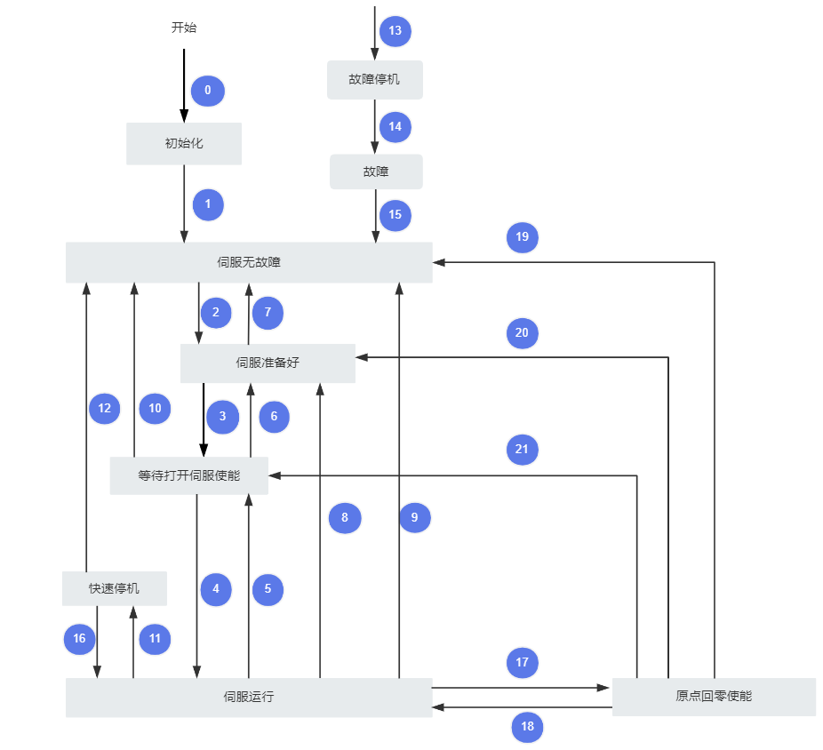

# 守护兽驱动协议手册

> 本手册仅对协议进行说明，关于如何切换通信协议、接口如何使用和如何配置通信参数详见[CyberBeast Driver User Manual](CyberBeast_Driver_User_Manual_EN.md)的通信协议使用板块
>

## 1 CAN Simple 协议

### 1.1 概述

CANSimple 是一个简化版的 CAN 通信协议栈，旨在让开发者更加便捷地进行基于 CAN 总线的设备间通信。它通过简化低层协议的实现，使得开发者能够更快速地实现 CAN 数据的发送和接收，尤其适用于嵌入式系统、机器人控制及其他基于 CAN 总线的应用。

CANSimple 提供了一个简单易用的 API 接口，隐藏了许多复杂的 CAN 协议细节，支持基本的数据帧发送和接收，适合需要简单 CAN 通信功能的应用场景。

**主要功能**

- **简化的通信框架**：CANSimple 提供了一个简单的接口来进行 CAN 总线的数据传输，减少了开发者需要处理的低层协议细节。
- **数据帧发送和接收**：支持标准 CAN 数据帧的发送和接收，提供灵活的消息管理方式。
- **兼容性与跨平台支持**：可以与多个硬件平台和操作系统兼容，支持通过常见的硬件接口（如 USB-CAN 适配器）与 CAN 总线进行通信。

### 1.2 协议帧格式

CAN 通信采用标准帧格式，数据帧，11 位 ID，8 字节数据，如下表所示（左为 MSB，右为 LSB）：

| 数据域 | CAN ID( 11bits)  |   | Data( 8 bytes)  |
|---|---|---|---|
| 分段 | Bit10 ~ Bit5 | Bit4 ~ Bit0 | Byte0 ~ Byte7 |
| 描述 | node_id | cmd_id | 通信数据 data |

- node_id：代表这个电机在总线上的唯一 ID，可在 odrivetool 中用`odrv0.axis0.config.can.node_id`来读取和设置。
- cmd_id：指令编码，表示协议的消息类型，请参见本节余下内容。
- 通信数据：8 个字节，每一个消息中携带的参数会被编码成整数或浮点数，字节序为小端（little endian），其中浮点数是按照 IEEE 754 标准进行编码（可通过网站[在线进制转换-IEE754 浮点数 16 进制转换](http://www.speedfly.cn/tools/hexconvert/) 测试编码）。
例如，假设其三个参数分别为：Input_Pos=3.14，Vel_FF=1000（表示 1rev/s），Torque_FF=5000（表示 5Nm），而 Set_Input_Pos 消息的 CMD ID=0x00C，假设驱动器的节点（node_id）被设置成 0x05，则：

- 11 位 CAN ID=（0x05<<5）+0x0C=0xAC
- 根据 4.1.2 中对于 Set_Input_Pos 的描述可知，Input_Pos 在第 0 个字节开始的 4 个字节，编码为 C3 F5 48 40（浮点数 3.14 用 IEEE 754 标准编码为 32 位数 0x4048f5c3），Vel_FF 在第 4 个字节开始的 2 个字节，编码为 E8 03（1000=0x03E8），Torque_FF 在第 6 个字节开始的 2 个字节，编码为 88 13（5000=0x1388），则 8 个字节的通信数据为：

| Byte0 | Byte1 | Byte2 | Byte3 | Byte4 | Byte5 | Byte6 | Byte7 |
|---|---|---|---|---|---|---|---|
| C3 | F5 | 48 | 40 | E8 | 03 | 88 | 13 |

### 1.3 帧消息

下表列出了所有的可用消息，下方蓝色 CMD ID 图标为超链接，点击即可看到详细协议。

| CMD ID | 名称 | 描述 | 方向 | 参数 |
|---|---|---|---|---|
| [0x01](https://bcnyljrhe70u.feishu.cn/docx/BPnQd8reEotLWVxqHFNc9qYZnKh#share-TBa6dgSuyoeoErxugoQch6j3n5c) | Heartbeat | 心跳消息 | 电机->主机 | Axis_Error Axis_State Motor_Flag Encoder_Flag Controller_Flag Traj_Done Life |
| [0x02](https://bcnyljrhe70u.feishu.cn/docx/BPnQd8reEotLWVxqHFNc9qYZnKh#share-FAx6dP2kmoHxyaxbn5UcipMKnyd) | Estop | 紧急停止 | 主机->电机 |   |
| [0x03](https://bcnyljrhe70u.feishu.cn/docx/BPnQd8reEotLWVxqHFNc9qYZnKh#share-BKS8d5WtSoY4mix2qvccH59qnwg) | Get_Error | 获取详细错误信息 | 电机->主机 | Error_Type |
| [0x04](https://bcnyljrhe70u.feishu.cn/docx/BPnQd8reEotLWVxqHFNc9qYZnKh#share-X6Ftd98iMomItXxUofOcpa4bnQc) | RxSdo | 访问可访问参数 | 电机->主机 |   |
| [0x05](https://bcnyljrhe70u.feishu.cn/docx/BPnQd8reEotLWVxqHFNc9qYZnKh#share-WP9EdqVZOo5ZiJx1jJhcpSZnnAg) | TxSdo |   | 电机->主机 |   |
| [0x06](https://bcnyljrhe70u.feishu.cn/docx/BPnQd8reEotLWVxqHFNc9qYZnKh#share-U7eTd4GrcoIy2PxL9vtcAdnOnZO) | Set_Axis_Node_ID | 设置 Axis 节 点 ID | 主机->电机 | Axis_Node_ID |
| [0x07](https://bcnyljrhe70u.feishu.cn/docx/BPnQd8reEotLWVxqHFNc9qYZnKh#share-MVtsdR9btordvyxqzQlcj7fdnFh) | Set_Axis_State | 设置 Axis 请求状态 | 主机->电机 | Axis_Requested_State |
| [0x08](https://bcnyljrhe70u.feishu.cn/docx/BPnQd8reEotLWVxqHFNc9qYZnKh#share-YeMUdiZbGo7HrDxhwlMct7MbnTh) | Mit_Control | MIT 控制 | 主机->电机 电机->主机 |   |
| [0x09](https://bcnyljrhe70u.feishu.cn/docx/BPnQd8reEotLWVxqHFNc9qYZnKh#share-INaadnxKAoqbIfxTrObc6rpVnkb) | Get_Encoder_Estimates | 获取编码器估算值 | 电机->主机 | Pos_Estimate Vel_Estimate |
| [0x0A](https://bcnyljrhe70u.feishu.cn/docx/BPnQd8reEotLWVxqHFNc9qYZnKh#share-CzDGdT2UfobDujxmwJrcNi6knmB) | Get_Encoder_Count | 获取编码器计数 | 电机->主机 | Shadow_Count Count_In_Cpr |
| [0x0B](https://bcnyljrhe70u.feishu.cn/docx/BPnQd8reEotLWVxqHFNc9qYZnKh#share-GFdMdZ1ekoni2ZxijWOckfLRnMd) | Set_Controller_Mode | 设置控制器模式 | 主机->电机 | Control_Mode Input_Mode |
| [0x0C](https://bcnyljrhe70u.feishu.cn/docx/BPnQd8reEotLWVxqHFNc9qYZnKh#share-SGhzdFQmPoVlIOxmlOmctkeqncd) | Set_Input_Pos | 设定输入位置 | 主机->电机 | Input_Pos Vel_FF Torque_FF |
| [0x0D](https://bcnyljrhe70u.feishu.cn/docx/BPnQd8reEotLWVxqHFNc9qYZnKh#share-N08GdBzocozD77x4UdYcf0Mbnqb) | Set_Input_Vel | 设定输入速度 | 主机->电机 | Input_Vel Torque_FF |
| [0x0E](https://bcnyljrhe70u.feishu.cn/docx/BPnQd8reEotLWVxqHFNc9qYZnKh#share-I9DTdSjBgo7IoAx2klnc5CAvnof) | Set_Input_Torque | 设定输入扭矩 | 主机->电机 | Input_Torque |
| [0x0F](https://bcnyljrhe70u.feishu.cn/docx/BPnQd8reEotLWVxqHFNc9qYZnKh#share-H8dPdn6RloyAhVxLdUPcl9Xgnff) | Set_Limits | 设定速度和电流极限 | 主机->电机 | Velocity_Limit Current_Limit |
| 0x10 | Start_Anticogging |   | 主机->电机 |   |
| [0x11](https://bcnyljrhe70u.feishu.cn/docx/BPnQd8reEotLWVxqHFNc9qYZnKh#share-ZDKQdDnFxoJkYixJpjocALRZndb) | Set_Traj_Vel_Limit | 设置梯形轨迹模式速度限值 | 主机->电机 | Traj_Vel_Limit |
| [0x12](https://bcnyljrhe70u.feishu.cn/docx/BPnQd8reEotLWVxqHFNc9qYZnKh#share-Fj6zdKjRBoRyNOxCh3Fc083ynWe) | Set_Traj_Accel_Limits | 设置梯形轨迹模式加减速度极限 | 主机->电机 | Traj_Accel_Limit Traj_Decel_Limit |
| [0x13](https://bcnyljrhe70u.feishu.cn/docx/BPnQd8reEotLWVxqHFNc9qYZnKh#share-TBPddmrGZotL9uxfz5AcWdlBnmu) | Set_Traj_Inertia | 设置梯形轨迹模式惯性 | 主机->电机 | Traj_Inertia |
| [0x14](https://bcnyljrhe70u.feishu.cn/docx/BPnQd8reEotLWVxqHFNc9qYZnKh#share-F0o7dtpNmoZBi8xI4q2cxBEGnId) | Get_Iq | 获取 IQ | 电机->主机 | Iq_Setpoint Iq_Measured |
| [0x16](https://bcnyljrhe70u.feishu.cn/docx/BPnQd8reEotLWVxqHFNc9qYZnKh#share-CxHpd5NDloAP0Bxh9bocOGuBndc) | Reboot | 重启电机 | 主机->电机 |   |
| [0x17](https://bcnyljrhe70u.feishu.cn/docx/BPnQd8reEotLWVxqHFNc9qYZnKh#share-NraTdqRiko3fMCxRNYlcoNmpn9b) | Get_Bus_Voltage_Current | 获取 Vbus 电压和 Ibus 电流 | 电机->主机 | Bus_Voltage Bus_Current |
| [0x18](https://bcnyljrhe70u.feishu.cn/docx/BPnQd8reEotLWVxqHFNc9qYZnKh#share-WCWSdCwPaokfC8xpMCnc4Pq8nUh) | Clear_Errors | 清除错误 | 主机->电机 |   |
| [0x19](https://bcnyljrhe70u.feishu.cn/docx/BPnQd8reEotLWVxqHFNc9qYZnKh#share-NVMCdapUyojoLXxIRDDc9rlnnHe) | Set_Move_Incremental | 设置增量移动 | 主机->电机 | Displacement |
| [0x1A](https://bcnyljrhe70u.feishu.cn/docx/BPnQd8reEotLWVxqHFNc9qYZnKh#share-QCiVdvE1DoCdVXxZ3rHcZ9a4nMU) | Set_Pos_Gain | 设置位置环 Kp | 主机->电机 | Pos_Gain |
| [0x1B](https://bcnyljrhe70u.feishu.cn/docx/BPnQd8reEotLWVxqHFNc9qYZnKh#share-BwyddusU7obJMwxxfUSck4XAn3f) | Set_Vel_Gains | 设置速度环 Kp 和 Ki | 主机->电机 | Vel_Gain Vel_Integrator_Gain |
| [0x1C](https://bcnyljrhe70u.feishu.cn/docx/BPnQd8reEotLWVxqHFNc9qYZnKh#share-PCg4djsssoRO9PxWofnclB51nSc) | Get_Torques | 获取力矩目标值和当前力矩值 | 电机->主机 | Torque_Setpoint Torque |
| [0x1D](https://bcnyljrhe70u.feishu.cn/docx/BPnQd8reEotLWVxqHFNc9qYZnKh#share-K2lsd9XiDoQP2ax5wshcJCQ8nNb) | Get_Powers | 获取电功率和机械功率 | 电机->主机 | Electrical_Power Mechanical_Power |
| [0x1E](https://bcnyljrhe70u.feishu.cn/docx/BPnQd8reEotLWVxqHFNc9qYZnKh#share-QEBldFE1yoIfjmxado1cEgd0ncf) | Disable_Can | 禁用 CAN | 主机->电机 |   |
| [0x1F](https://bcnyljrhe70u.feishu.cn/docx/BPnQd8reEotLWVxqHFNc9qYZnKh#share-Vmw9dK0CqoeoOYxk4mkcaNfmn8b) | Save_Configuration | 保存并重启电机 | 主机->电机 |   |

所有消息的详细描述如下：

#### **0x01 Heartbeat**

心跳消息

CMD ID: 0x01

> 输出（电机 -> 主机）
>

| 起始字节 | 名称 | 类型 | 说明 |
|---|---|---|---|
| byte0~3 | Axis_Error | uint32 | 驱动异常码（`odrv0.axis0.error`） |
| byte4 | Axis_State | uint8 | 驱动器状态（`odrv0.axis0.current_state`） |
| byte5 | Flags | uint8 | bit0：电机异常位（`odrv0.axis0.motor.error` 是否为 0） bit1：编码器异常位（`odrv0.axis0.encoder.error` 是否为 0） bit2：控制异常位（`odrv0.axis0.controller.error` 是否为 0） bit3：系统异常位（`odrv0.error` 是否为 0） bit7：`odrv0.axis0.controller.trajectory_done`，即位置梯形曲线是否执行完毕 |
| byte6 | Temperature | int8 | 电机温度和驱动板温度的较大值（摄氏度）。温度最大值127（=0x7F）。 |
| byte7 | Life | uint8 | 周期消息的生命值，每一个心跳消息加 1，范围 0-255，如果此生命值不连续，表示心跳消息丢失，即通信不稳。 |

#### **0x02 Estop**

紧急停止

CMD ID: 0x02

> 输入（主机 -> 电机）
>

|   | byte0~7 |   |   |
|---|---|---|---|
| 发送数据 | 00 00 00 00 00 00 00 00 |   |   |

此指令会导致电机紧急停机，并报 ESTOP_REQUESTED 异常。

#### **0x03 Get_Error**

获取详细错误信息，异常码详见本文档[最后](https://cyberbeast.feishu.cn/docx/BPnQd8reEotLWVxqHFNc9qYZnKh#KKr4dVPH3oQ9r5x5KxocJLmQn4b)

CMD ID: 0x03

> 输入（主机 -> 电机）
>

| 起始字节 | 名称 | 类型 | 说明 |
|---|---|---|---|
| byte0 | Error_Type | uint8 | 0：获取电机异常 1：获取编码器异常 3：获取控制异常 4：获取系统异常 |

> 输出（电机 -> 主机）
>

| 起始字节 | 名称 | 类型 | 说明 |
|---|---|---|---|
| byte0~7/byte0~3 | Error | uint32/uint64 | 不同输入 Error_Type 返回的数据及长度： 0：电机异常（odrv0.axis0.motor.error），uint64，8 字节 1：编码器异常（odrv0.axis0.encoder.error），uint32，4 字节 3：控制异常（odrv0.axis0.controller.error），uint32，4 字节 4：系统异常（odrv0.error），uint32，4 字节 |

#### **0x04 RxSdo**

访问所有参数，电机会在0x05 TxSdo回复RxSdo的读取命令

CMD ID: 0x04

> 输入（主机 -> 电机）
>

| 起始字节 | 名称 | 类型 | 说明 |
|---|---|---|---|
| byte0 | opcode | uint8 | 0：读 1：写 |
| byte1 | Endpoint_ID | uint16 | 请下载对应驱动板硬件/固件版本号的 JSON 文件： • V8 通用 用于硬件版本号V8起始的驱动 📎 [endpoints_v8.json](assets_protocol_manual/endpoints_v8.json) • V3 通用 目前支持 3.8.3_0.6.5；3.11.1_0.6.4；3.12.1_xx; 📎 [endpoints_v3.json](assets_protocol_manual/endpoints_v3.json) • 4.1.3 📎 [endpoint_4.1.3_0.6.0.json](assets_protocol_manual/endpoint_4.1.3_0.6.0.json) • 4.1.25 📎 [endpoint_4.1.25.json](assets_protocol_manual/endpoint_4.1.25.json) • 4.1.37 📎 [endpoint_4.1.37_0.6.2.5.json](assets_protocol_manual/endpoint_4.1.37_0.6.2.5.json) 📎 [endpoint_4.1.37_0.6.2.4.json](assets_protocol_manual/endpoint_4.1.37_0.6.2.4.json) 📎 [endpoint_4.1.37_0.6.2.json](assets_protocol_manual/endpoint_4.1.37_0.6.2.json) • 4.2.51 📎 [endpoint_4.2.51_0.6.2.json](assets_protocol_manual/endpoint_4.2.51_0.6.2.json) • 4.2.55 📎 [endpoint_4.2.55.json](assets_protocol_manual/endpoint_4.2.55.json) • 3.11.12 📎 [endpoint_3.11.12_0.6.1.json](assets_protocol_manual/endpoint_3.11.12_0.6.1.json) 📎 [endpoint_3.11.12_0.6.0.json](assets_protocol_manual/endpoint_3.11.12_0.6.0.json) • 3.12.3 📎 [endpoint_3.12.3_0.6.4.json](assets_protocol_manual/endpoint_3.12.3_0.6.4.json) • 3.12.43 📎 [endpoint_3.12.43_0.6.2.2.json](assets_protocol_manual/endpoint_3.12.43_0.6.2.2.json) 📎 [endpoint_3.12.43_0.6.2.0.json](assets_protocol_manual/endpoint_3.12.43_0.6.2.0.json) 📎 [endpoint_3.12.43_0.6.0.json](assets_protocol_manual/endpoint_3.12.43_0.6.0.json) • 3.8.3 📎 [endpoint_3.8.3_0.5.15.json](assets_protocol_manual/endpoint_3.8.3_0.5.15.json) • SG 版本 0.6.0 📎 [endpoints_0.6.0_SG.json](assets_protocol_manual/endpoints_0.6.0_SG.json) • STW 版本 0.6.0 📎 [endpoint_3.11.1_0.6.0.json](assets_protocol_manual/endpoint_3.11.1_0.6.0.json) |
| byte3 | 预留 | uint8 |   |
| byte4~7 | Value | uint8[4] | 根据 Endpoint_ID 不同而不同，可参见上述 JSON 中的描述。如 Endpoint_ID 对应一个可读写的 float 值，则此处 4 个字节为 IEEE 编码而成的 float 值，opcode=1 时将此值写入这个 float 值。 |

#### **0x05 TxSdo**

CMD ID: 0x05

用于电机回复主机的0x04RxSdo 读命令

> 输出（电机 -> 主机）
>

| 起始字节 | 名称 | 类型 | 说明 |
|---|---|---|---|
| byte0 | opcode | uint8 | 固定为 0 |
| byte1 | Endpoint_ID | uint16 | 请下载驱动板硬件/固件版本号对应的Json文件 |
| byte3 | 预留 | uint8 |   |
| byte4~7 | Value | uint8[4] | 根据 Endpoint_ID 不同而不同，可参见上述 JSON 中的描述。如 Endpoint_ID 对应一个可读的 uint32 值，则此处 4 个字节为**小端字节序**的 uint32。 |

#### **0x06 Set_Axis_Node_ID**

设置 Axis 节点 node_id

CMD ID: 0x06

> 输入（主机 -> 电机）
>

| 起始字节 | 名称 | 类型 | 说明 |
|---|---|---|---|
| byte0~3 | Axis_Node_ID | uint32 | odrv0.axis0.config.can.node_id 电机在 CAN 总线上的唯一 ID |

#### **0x07 Set_Axis_State**

设置 Axis 请求状态（客户要求电机达到的状态，心跳中反馈的`odrv0.axis0.current_state`是电机的实际状态）

CMD ID: 0x07

> 输入（主机 -> 电机）
>

| 起始字节 | 名称 | 类型 | 说明 |
|---|---|---|---|
| byte0~3 | Axis_Requested_State | uint32 | `odrv0.axis0.requested_state` • 0：未定义 • 1：空闲 • 3：校准（电机校准+编码器校准） • 4：电机校准 • 7：编码器校准 • 8：闭环 |

#### **0x08 Mit_Control**

MIT 控制

CMD ID: 0x08

这是模拟 MIT 开源运动控制协议（[https://github.com/mit-biomimetics/Cheetah-Software](https://github.com/mit-biomimetics/Cheetah-Software)）的实现。

请注意，在 USB 控制时所输入的位置、速度和扭矩，均是指转子侧，而用 CAN 进行 MIT 控制时，协议中的位置、速度和扭矩均是指输出轴侧，这是为了与 MIT 开源协议保持一致！

关于如何调整下列`mit_max_xxx`值，详见[ mit 最大值范围调整](https://bcnyljrhe70u.feishu.cn/docx/N3SMd4QyRobzHkx3wP3cT1qXnpf#share-SPP1dOodbor2PgxhrX2cWiOPnQd)。这个会影响参数的有效映射范围，请合理确认最大值参数。例如，默认`mit_max_pos`为 12.5，则位置范围为 -12.5～12.5，驱动内部会把这个范围映射到 0～65535，其中会存在小数点精度丢失，请留意。

> 输入（主机 -> 电机）
>

| CAN 数据帧位 | 含义 | 说明 |
|---|---|---|
| BYTE0 | **位置**：总共 16 位，BYTE0 为高 8 位，BYTE1 为低 8 位 输出轴的多圈位置，单位为弧度（RAD），范围`-mit_max_pos`～`mit_max_pos` | 实际**位置**为 double 型，需要转换为 16 位 int 型，转换过程为： pos_int = (pos_double + `mit_max_pos`)*65535 / (`mit_max_pos`*2) `mit_max_pos`默认值为 12.5 |
| BYTE1 |   |   |
| BYTE2 | **速度**：总共 12 位，BYTE2 为其高 8 位，BYTE3[7-4]（高 4 位）为其低 4 位。表示输出轴的角速度，单位为 （RAD/s），范围`-mit_max_vel`～ `mit_max_vel` **KP 值** ：总共 12 位，BYTE3[3-0]（低 4 位）为其高 4 位，BYTE4 为其低 8 位。单位为 （Nm/RAD），范围 0～`mit_max_kp` | 实际**速度**为 double 型，需要转换为 12 位 int 型，转换过程为： vel_int = (vel_double + `mit_max_vel`) * 4095 / (`mit_max_vel`*2) `mit_max_vel`默认值为 65 **KP 值**实际为 double 型，需要转换为 12 位 int 型，转换过程为： kp_int = kp_double * 4095 / `mit_max_kp` `mit_max_kp`默认值为 500 |
| BYTE3 |   |   |
| BYTE4 |   |   |
| BYTE5 | **KD 值** ：总共 12 位，BYTE5 为其高 8 位，BYTE6[7-4]（高 4 位）为其低 4 位。单位为 （Nm/RAD/s），范围 0～`mit_max_kd` **力矩**：总共 12 位，BYTE6[3-0]（低 4 位）为其高 4 位，BYTE7 为其低 8 位。单位是 N.m。范围`-mit_max_torque`～`mit_max_torque` | **KD 值**实际为 double 型，需要转换为 12 位 int 型，转换过程为： kd_int = kd_double * 4095 / `mit_max_kd` `mit_max_kd`默认值为 5 实际**力矩**为 double 型，需要转换为 12 位 int 型，转换过程为： t_int = (t_double + `mit_max_torque`) * 4095 / (`mit_max_torque`*2) `mit_max_torque`默认值为 50 转矩常数的单位为 N.m/A |
| BYTE6 |   |   |
| BYTE7 |   |   |

> 输出（电机 -> 主机）
>

| CAN 数据帧位 | 含义 | 说明 |
|---|---|---|
| BYTE0 | node id | 驱动器 node id |
| BYTE1 | **位置**：总共 16 位，BYTE1 为高 8 位，BYTE2 为低 8 位 输出轴的多圈位置，单位为弧度（RAD），范围`-mit_max_pos`～`mit_max_pos` | 实际**位置**为 double 型，需要转换为 16 位 int 型，转换过程为： pos_int = (pos_double + `mit_max_pos`)*65535 / 25 `mit_max_pos`默认值同上 |
| BYTE2 |   |   |
| BYTE3 | **速度**：总共 12 位，BYTE3 为其高 8 位，BYTE4[7-4]（高 4 位）为其低 4 位。表示输出轴的角速度，单位为 RAD/s，范围 `-mit_max_vel`~ `mit_max_vel` **力矩**：总共 12 位，BYTE4[3-0]（低 4 位）为其高 4 位，BYTE5 为其低 8 位。单位是 N.m。范围`-mit_max_torque`～`mit_max_torque` | 实际**速度**为 double 型，需要从 12 位 int 型转换过来，转换过程为： vel_double = vel_int * 130 / 4095 – `mit_max_vel` `mit_max_vel`默认值同上 实际**力矩**为 double 型，需要从 12 位 int 型转换过来，转换过程为： t_double = t_int * 100 / 4095 - `mit_max_torque` `mit_max_torque`默认值同上 转矩常数的单位为 N.m/A |
| BYTE4 |   |   |
| BYTE5 |   |   |

#### **0x09 Get_Encoder_Estimates**

获取编码器估算值

CMD ID: 0x09

> 输出（电机 -> 主机）
>

| 起始字节 | 名称 | 类型 | 单位 | 说明 |
|---|---|---|---|---|
| 0 | Pos_Estimate | float32 | rev（转） | odrv0.axis0.encoder.pos_estimate 当前电机**转子侧编码器**的位置 |
| 4 | Vel_Estimate | float32 | rev/s（转/秒） | odrv0.axis0.encoder.vel_estimate 当前电机**转子侧编码器**的转速 |

#### **0x0A Get_Encoder_Count**

获取编码器计数

CMD ID: 0x0A

> 输出（电机 -> 主机）
>

| 起始字节 | 名称 | 类型 | 说明 |
|---|---|---|---|
| 0 | Shadow_Count | int32 | odrv0.axis0.encoder.shadow_count 编码器多圈计数 |
| 4 | Count_In_Cpr | int32 | odrv0.axis0.encoder.count_in_cpr 编码器单圈计数 |

#### **0x0B Set_Controller_Mode**

设置控制器模式

CMD ID: 0x0B

> 输入（主机 -> 电机）
>

| 起始字节 | 名称 | 类型 | 说明 |
|---|---|---|---|
| 0 | Control_Mode | uint32 | odrv0.axis0.controller.config.control_mode 控制模式： 0：电压控制 1：力矩控制 2：速度控制 3：位置控制 |
| 4 | Input_Mode | uint32 | odrv0.axis0.controller.config.input_mode 输入模式，表示用户输入的控制值以什么方式去控制电机运转： 0：闲置 1：直接控制 2：速度斜坡 3：位置滤波 5：梯形曲线 6：力矩斜坡 9：运动控制（MIT） |

#### **0x0C Set_Input_Pos**

设定输入位置

CMD ID: 0x0C

> 输入（主机 -> 电机）
>

| 起始字节 | 名称 | 类型 | 单位 | 说明 |
|---|---|---|---|---|
| 0 | Input_Pos | float32 | rev | odrv0.axis0.controller.input_pos 位置控制的目标值。 |
| 4 | Vel_FF | int16 | 0.001rev/s | odrv0.axis0.controller.input_vel 位置控制的速度前馈。 |
| 6 | Torque_FF | int16 | 0.001Nm | odrv0.axis0.controller.input_torque 位置控制的力矩前馈。 |

#### **0x0D Set_Input_Vel**

设定输入速度

CMD ID: 0x0D

> 输入（主机 -> 电机）
>

| 起始字节 | 名称 | 类型 | 单位 | 说明 |
|---|---|---|---|---|
| 0 | Input_Vel | float32 | rev/s | odrv0.axis0.controller.input_vel 速度控制的目标值。 |
| 4 | Torque_FF | float32 | Nm | odrv0.axis0.controller.input_torque 速度控制的力矩前馈。 |

#### **0x0E Set_Input_Torque**

设定输入扭矩

CMD ID: 0x0E

> 输入（主机 -> 电机）
>

| 起始字节 | 名称 | 类型 | 单位 | 说明 |
|---|---|---|---|---|
| 0 | Input_Torque | float32 | Nm | odrv0.axis0.controller.input_torque 力矩控制的目标值。 |

#### **0x0F Set_Limits**

设定速度和电流极限

CMD ID: 0x0F

> 输入（主机 -> 电机）
>

| 起始字节 | 名称 | 类型 | 单位 | 说明 |
|---|---|---|---|---|
| 0 | Velocity_Limit | float32 | rev/s | odrv0.axis0.controller.config.vel_limit 全局速度限制。 |
| 4 | Current_Limit | float32 | A | odrv0.axis0.motor.config.current_lim 电机电流限制。 |

#### **0x10 Start_Anticogging**

CMD ID: 0x10（主机电机）

进行力矩纹波校准。

|   | byte0~7 |   |   |
|---|---|---|---|
| 发送数据 | 00 00 00 00 00 00 00 00 |   |   |

#### **0x11 Set_Traj_Vel_Limit**

设置梯形轨迹模式速度限值

CMD ID: 0x11

> 输入（主机 -> 电机）
>

| 起始字节 | 名称 | 类型 | 单位 | 说明 |
|---|---|---|---|---|
| 0 | Traj_Vel_Limit | float32 | rev/s | odrv0.axis0.trap_traj.config.vel_limit 梯形位置控制的速度限制。 |

#### **0x12 Set_Traj_Accel_Limits**

设置梯形轨迹模式加减速度极限

CMD ID: 0x12

> 输入（主机 -> 电机）
>

| 起始字节 | 名称 | 类型 | 单位 | 说明 |
|---|---|---|---|---|
| 0 | Traj_Accel_Limit | float32 | rev/s^2 | odrv0.axis0.trap_traj.config.accel_limit 梯形位置控制的加速度限制。 |
| 4 | Traj_Decel_Limit | float32 | rev/s^2 | odrv0.axis0.trap_traj.config.decel_limit 梯形位置控制的减速度限制。 |

#### **0x13 Set_Traj_Inertia**

设置梯形轨迹模式惯性

CMD ID: 0x13

> 输入（主机 -> 电机）
>

| 起始字节 | 名称 | 类型 | 单位 | 说明 |
|---|---|---|---|---|
| 0 | Traj_Inertia | float32 | Nm/(rev/s^2) | odrv0.axis0.controller.config.inertia 惯量。 |

#### **0x14 Get_Iq**

获取 IQ

CMD ID: 0x14

> 输出（电机 -> 主机）
>

| 起始字节 | 名称 | 类型 | 单位 | 说明 |
|---|---|---|---|---|
| 0 | Iq_Setpoint | float32 | A | odrv0.axis0.motor.current_control.Idq_setpoint Q 轴电流目标值。 |
| 4 | Iq_Measured | float32 | A | odrv0.axis0.motor.current_control.Iq_measured Q 轴电流实际测量值。 |

#### **0x15 Get_Thermistor_Temperature**

获取温度（摄氏度）

CMD ID: 0x15

> 输出（电机 -> 主机）
>

| 起始字节 | 名称 | 类型 | 单位 | 说明 |
|---|---|---|---|---|
| 0 | Motor_Temperature | float32 | A | odrv0.axis0.motor.motor_thermistor.temperature 电机温度（摄氏度）。 |
| 4 | Fet_Temperature | float32 | A | odrv0.axis0.motor.fet_thermistor.temperature 驱动顺温度（摄氏度）。 |

#### **0x16 Reboot**

`odrv0.reboot()`

重启电机

CMD ID: 0x16

> 输入（主机 -> 电机）
>

|   | byte0~7 |   |   |
|---|---|---|---|
| 发送数据 | 00 00 00 00 00 00 00 00 |   |   |

#### **0x17 Get_Bus_Voltage_Current**

获取 Vbus 电压和 Ibus 电流

CMD ID: 0x17

> 输出（电机 -> 主机）
>

| 起始字节 | 名称 | 类型 | 单位 | 说明 |
|---|---|---|---|---|
| 0 | Bus_Voltage | float32 | V | odrv0.vbus_voltage 母线电压。 |
| 4 | Bus_Current | float32 | A | odrv0.ibus 母线电流。 |

#### **0x18 Clear_Errors**

`odrv0.clear_errors()`

清除所有错误和异常。

CMD ID: 0x18

> 输入（主机 -> 电机）
>

|   | byte0~7 |   |   |
|---|---|---|---|
| 发送数据 | 00 00 00 00 00 00 00 00 |   |   |

#### **0x19 Set_Move_Incremental**

使电机在当前的位置基础上，按照给定的增量（`displacement`）移动。这个增量是相对于电机当前位置的偏移量，而不是一个绝对目标位置。

CMD ID: 0x19

> 输入（主机 -> 电机）
>

| 起始字节 | 名称 | 类型 | 说明 |   |
|---|---|---|---|---|
| 0 | Displacement | float32  | rev | odrv0.axis0.controller.move_incremental(displacement, 1) 增量移动电机位置，displacement 是增量值，单位是**转子侧的转** |

#### **0x1A Set_Pos_Gain**

设置位置环 Kp

CMD ID: 0x1A

> 输入（主机 -> 电机）
>

| 起始字节 | 名称 | 类型 | 单位 | 说明 |
|---|---|---|---|---|
| 0 | Pos_Gain | float32 | (rev/s)/rev | odrv0.axis0.controller.config.pos_gain 位置环增益 Kp。 |

#### **0x1B Set_Vel_Gains**

设置速度环 Kp 和 Ki

CMD ID: 0x1B

> 输入（主机 -> 电机）
>

| 起始字节 | 名称 | 类型 | 单位 | 说明 |
|---|---|---|---|---|
| 0 | Vel_Gain | float32 | Nm/(rev/s) | odrv0.axis0.controller.config.vel_gain 速度环增益 Kp。 |
| 4 | Vel_Integrator_Gain | float32 | Nm/rev | odrv0.axis0.controller.config.vel_integrator_gain 速度环增益 Ki。 |

#### **0x1C Get_Torques**

获取力矩目标值和当前力矩值

CMD ID: 0x1C

> 输出（电机 -> 主机）
>

| 起始字节 | 名称 | 类型 | 单位 | 说明 |
|---|---|---|---|---|
| 0 | Torque_Setpoint | float32 | Nm | odrv0.axis0.controller.torque_setpoint 电流环力矩目标值。 |
| 4 | Torque | float32 | Nm | 表示当前力矩值。 |

#### **0x1D Get_Powers**

获取电功率和机械功率

CMD ID: 0x1D

> 输出（电机 -> 主机）
>

| 起始字节 | 名称 | 类型 | 说明  |
|---|---|---|---|
| 0 | Electrical_Power | float32 | odrv0.axis0.controller.electrical_power 电功率 |
| 4 | Mechanical_Power | float32 | odrv0.axis0.controller.mechanical_power 机械功率 |

#### **0x1E Disable_Can**

禁用 CAN，并重启驱动器。

CMD ID: 0x1E

> 输入（主机 -> 电机）
>

|   | byte0~7 |   |   |
|---|---|---|---|
| 发送数据 | 00 00 00 00 00 00 00 00 |   |   |

#### **0x1F Save_Configuration**

`odrv0.save_configuration()`

存储当前的配置，生效并重启。

CMD ID: 0x1F

> 输入（主机 -> 电机）
>

|   | byte0~7 |   |   |
|---|---|---|---|
| 发送数据 | 00 00 00 00 00 00 00 00 |   |   |

### 1.4 CAN 协议实战

假设电机的node_id = 1：

#### 1.4.1 实战：上电校准

发送 CAN 消息的序列如下：

| CMD ID | 帧类型 | 帧数据 | 说明 |
|---|---|---|---|
| 0x27 | 数据帧 | 04 00 00 00 00 00 00 00 | 消息：Set_Axis_State 参数：4 对电机进行校准 |
| 0x27 | 数据帧 | 07 00 00 00 00 00 00 00 | 消息：Set_Axis_State 参数：7 对编码器进行校准 |

#### 1.4.2 实战：速度控制

发送 CAN 消息的序列如下：

| CMD ID | 帧类型 | 帧数据 | 说明 |
|---|---|---|---|
| 0x2B | 数据帧 | 02 00 00 00 02 00 00 00 | 消息：Set_Controller_Mode 参数：2/2 设置控制模式为速度控制，输入模式为速度斜坡 |
| 0x27 | 数据帧 | 08 00 00 00 00 00 00 00 | 消息：Set_Axis_State 参数：8 进入闭环控制状态 |
| 0x2D | 数据帧 | 00 00 20 41 00 00 00 00 | 消息：Set_Input_Vel 参数：10/0 设置目标速度和力矩前馈，其中目标速度为 10（浮点数：0x41200000），力矩前馈为 0（浮点数：0x00000000） |

#### 1.4.3 实战：位置控制

发送 CAN 消息的序列如下：

| CMD ID | 帧类型 | 帧数据 | 说明 |
|---|---|---|---|
| 0x2B | 数据帧 | 03 00 00 00 03 00 00 00 | 消息：Set_Controller_Mode 参数：3/3 设置控制模式为位置控制，输入模式为位置滤波 |
| 0x27 | 数据帧 | 08 00 00 00 00 00 00 00 | 消息：Set_Axis_State 参数：8 进入闭环控制状态 |
| 0x2C | 数据帧 | CD CC 0C 40 00 00 00 00 | 消息：Set_Input_Pos 参数：2.2/0/0 设置目标位置，速度前馈和力矩前馈，其中目标位置为 2.2（浮点数：0x400CCCCD），力矩前馈和速度前馈为 0 |

#### 

#### 1.4.4 实战：Rx/TxSdo

Rx/TxSdo是一种可以读写驱动内所有参数或函数的命令，可以实现在can-simple下对参数的自由调整

一般RxSdo用于主机->电机，TxSdo用于电机->主机。

    本实战通过读取母线电压、写入电机减速比并读取验证，来展示Rx/TxSdo用法

    基于endpoint_V3，node_id =1 。可在0x04 RxSdo处找到对应版本号的[endpoint.json文件](https://cyberbeast.feishu.cn/docx/BPnQd8reEotLWVxqHFNc9qYZnKh#share-EgmodaGUVoegCBxiVAtcflzxn1b)

    读母线电压：

    | CMD ID | 帧类型 | 帧数据 | 说明 |
    |---|---|---|---|
    | 24 | 数据帧 | 00 02 00 00 00 00 00 00 | 消息：RxSdo，读取母线电压 参数： 00 读取数据 02 00 母线电压(vbus_voltage)在endpoint中的小端十六进制ID 00 保留位 00 00 00 00 读数据，写0即可 |

写电机减速比9.25并读取验证：

| CMD ID | 帧类型 | 帧数据 | 说明 |
|---|---|---|---|
| 24 | 数据帧 | 01 F2 00 00 00 00 14 41 | 消息：RxSdo，写入减速比9.25 参数： 01 :写入数据 F2 00 :减速比(gear_ratio)在endpoint中的小端十六进制ID 00 :保留位 00 00 14 41 : 9.25的小端浮点转十六进制数据 |
| 24 | 数据帧 | 00 F2 00 00 00 00 00 00 | 消息：RxSdo，读取减速比。参数含义同 <读取母线电压> |

## 2 RS485 协议（Modbus RTU）

### 2.1 概述

**通信物理层：RS485**

RS485 是一种差分信号的串行通信标准，具备抗干扰能力强、通信距离远（可达 1200 米）、支持多节点（最多 32 个节点）的特点。由于 RS485 采用半双工通信方式，所有设备共用两根通信线（A、B），必须通过主从机制轮流发送数据，避免冲突。

**通信协议层：Modbus RTU**

Modbus RTU 是工业领域广泛使用的串行通信协议，采用主从架构：主机主动发起请求，从机被动响应。每一帧数据都具有固定格式，支持可靠的读写操作，适合控制与监控设备（如电机驱动器）。

**帧格式（Modbus RTU 标准帧结构）**

| **字段** | **长度** | **描述** |
|---|---|---|
| 从机地址 | 1 字节 | 唯一标识一个从设备（1～247） 此标识也称为站号，可通过`odrv0.axis0.config.can.node_id`来修改 |
| 功能码 | 1 字节 | 表示本次操作的类型（如读/写寄存器等） |
| 数据区 | N 字节 | 根据功能码不同，内容可能是地址、数据等 |
| CRC 校验码 | 2 字节 | 循环冗余校验，低字节在前，高字节在后，Modbus RTU CRC 校验生成请看[ cht.nahua.com](https://cht.nahua.com.tw/software/crc16/index.php)[.](https://cht.nahua.com.tw/software/crc16/index.php)[tw](https://cht.nahua.com.tw/software/crc16/index.php) |

### 2.2 Modbus RTU

基于工业标准的 Modbus RTU，目前支持的功能码如下：

| 功能码 | 含义 |
|---|---|
| 0x04 | 读单个或多个输入寄存器 |
| 0x03 | 读多个保持寄存器 |
| 0x06 | 写单个保持寄存器 |
| 0x10 | 写多个保持寄存器 |

### 2.3 输入寄存器

输入寄存器仅支持读，不能写，表示系统的一些状态或动态指标，如错误信息，电压/电流等，目前支持的输入寄存器如下：

#### **0x01：电机状态**

主机请求（`odrv0.axis0.request_state`）：

| 地址 | 功能码 | 寄存器地址 | 寄存器个数 | 校验码 |
|---|---|---|---|---|
| 1 字节 | 1 字节 | 2 字节 | 2 字节 | 2 字节 |
| XX | 04 | 00 01 | 00 01 | XX XX |

电机响应（`odrv0.axis0.current_state`）：

| 地址 | 功能码 | 字节长度 | 寄存器值 | 校验码 |
|---|---|---|---|---|
| 1 字节 | 1 字节 | 1 字节 | 2 字节 | 2 字节 |
| XX | 04 | 02 | State0 State1 | XX XX |

其中 State0 始终为 0，State1 为电机状态码：

| 电机状态码 | 说明 |
|---|---|
| 1 | 空闲 |
| 3 | 完全校准 |
| 4 | 电机校准 |
| 7 | 编码器校准 |
| 8 | 闭环运行 |
| 11 | 回零 |

#### **0x02：异常标志**

主机请求：

| 地址 | 功能码 | 寄存器地址 | 寄存器个数 | 校验码 |
|---|---|---|---|---|
| 1 字节 | 1 字节 | 2 字节 | 2 字节 | 2 字节 |
| XX | 04 | 00 02 | 00 01 | XX XX |

电机响应：

| 地址 | 功能码 | 字节长度 | 寄存器值 | 校验码 |
|---|---|---|---|---|
| 1 字节 | 1 字节 | 1 字节 | 2 字节 | 2 字节 |
| XX | 04 | 02 | Flag0 Flag1 | XX XX |

其中 Flag0 始终为 0，Flag1 为异常标志，每个 bit 为 1 代表出现相对应的异常，异常代表如下：

| bit7~bit5 | bit4 | bit3 | bit2 | bit1 | bit0 |
|---|---|---|---|---|---|
| 无含义 | 驱动异常位（`odrv0.axis0.error`是否为 0） | 系统异常位（`odrv0.error`是否为 0） | 控制异常位（`odrv0.axis0.controller.error` 是否为 0） | 编码器异常位（`odrv0.axis0.encoder.error` 是否为 0） | 电机异常位（`odrv0.axis0.motor.error` 是否为 0） |

#### **0x03 0x04：驱动异常码 1 驱动异常码 2**

`odrv0.axis0.error`

驱动异常码（）为 32 位无符号整数，其中驱动异常码 1 为其高 16 位，驱动异常码 2 为其低 16 位。用户只能通过访问寄存器地址 0x03，同时获取两个寄存器数据，从而获取完整的驱动异常码。不可单独访问任何一个寄存器。

主机请求：

| 地址 | 功能码 | 寄存器地址 | 寄存器个数 | 校验码 |
|---|---|---|---|---|
| 1 字节 | 1 字节 | 2 字节 | 2 字节 | 2 字节 |
| XX | 04 | 00 03 | 00 02 | XX XX |

电机响应：

| 地址 | 功能码 | 字节长度 | 寄存器值 | 校验码 |
|---|---|---|---|---|
| 1 字节 | 1 字节 | 1 字节 | 2 字节 | 2 字节 |
| XX | 04 | 04 | E0 E1 E2 E3 | XX XX |

E0 E1 E2 E3 组成驱动异常码，请参见[异常码表格](https://cyberbeast.feishu.cn/docx/BPnQd8reEotLWVxqHFNc9qYZnKh#share-PC6HdxK3ioSdO1xWig5cjx0mnkh)。

#### **0x05 0x06 0x07 0x08：电机异常码 1 电机异常码 2 电机异常码 3 电机异常码 4**

`odrv0.axis0.motor.error`

电机异常码为 64 位无符号整数，其中电机异常码 1 为其 63 到 48 位，电机异常码 2 为其 47 到 32 位，电机异常码 3 为其 31 到 16 位，电机异常码 4 为其 15 位到 0 位。用户只能通过访问寄存器地址 0x05，同时获取四个寄存器数据，从而获取完整的电机异常码。不可单独访问任何一个寄存器。

主机请求：

| 地址 | 功能码 | 寄存器地址 | 寄存器个数 | 校验码 |
|---|---|---|---|---|
| 1 字节 | 1 字节 | 2 字节 | 2 字节 | 2 字节 |
| XX | 04 | 00 05 | 00 04 | XX XX |

电机响应：

| 地址 | 功能码 | 字节长度 | 寄存器值 | 校验码 |
|---|---|---|---|---|
| 1 字节 | 1 字节 | 1 字节 | 8 字节 | 2 字节 |
| XX | 04 | 08 | E0 E1 E2 E3 E4 E5 E6 E7 | XX XX |

E0 E1 E2 E3 E4 E5 E6 E7 组成电机异常码，请参见 5.2 节的异常码表格。

#### **0x09 0x0A：编码器异常码 1  编码器异常码 2**

`odrv0.axis0.encoder.error`

编码器异常码为 32 位无符号整数，其中编码器异常码 1 为其高 16 位，编码器异常码 2 为其低 16 位。用户只能通过访问寄存器地址 0x09，同时获取两个寄存器数据，从而获取完整的编码器异常码。不可单独访问任何一个寄存器。

主机请求：

| 地址 | 功能码 | 寄存器地址 | 寄存器个数 | 校验码 |
|---|---|---|---|---|
| 1 字节 | 1 字节 | 2 字节 | 2 字节 | 2 字节 |
| XX | 04 | 00 09 | 00 02 | XX XX |

电机响应：

| 地址 | 功能码 | 字节长度 | 寄存器值 | 校验码 |
|---|---|---|---|---|
| 1 字节 | 1 字节 | 1 字节 | 2 字节 | 2 字节 |
| XX | 04 | 04 | E0 E1 E2 E3 | XX XX |

E0 E1 E2 E3 组成编码器异常码，请参见 5.2 节的异常码表格。

#### **0x0B 0x0C：控制异常码 1 控制异常码 2**

`odrv0.axis0.controller.error`

控制异常码为 32 位无符号整数，其中控制异常码 1 为其高 16 位，控制异常码 2 为其低 16 位。用户只能通过访问寄存器地址 0x0B，同时获取两个寄存器数据，从而获取完整的控制异常码。不可单独访问任何一个寄存器。

主机请求：

| 地址 | 功能码 | 寄存器地址 | 寄存器个数 | 校验码 |
|---|---|---|---|---|
| 1 字节 | 1 字节 | 2 字节 | 2 字节 | 2 字节 |
| XX | 04 | 00 0B | 00 02 | XX XX |

电机响应：

| 地址 | 功能码 | 字节长度 | 寄存器值 | 校验码 |
|---|---|---|---|---|
| 1 字节 | 1 字节 | 1 字节 | 2 字节 | 2 字节 |
| XX | 04 | 04 | E0 E1 E2 E3 | XX XX |

E0 E1 E2 E3 组成控制异常码，请参见 5.2 节的异常码表格。

#### **0x0D 0x0E：系统异常码 1 系统异常码 2**

`odrv0.error`

系统异常码为 32 位无符号整数，其中系统异常码 1 为其高 16 位，系统异常码 2 为其低 16 位。用户只能通过访问寄存器地址 0x0D，同时获取两个寄存器数据，从而获取完整的系统异常码。不可单独访问任何一个寄存器。

主机请求：

| 地址 | 功能码 | 寄存器地址 | 寄存器个数 | 校验码 |
|---|---|---|---|---|
| 1 字节 | 1 字节 | 2 字节 | 2 字节 | 2 字节 |
| XX | 04 | 00 0D | 00 02 | XX XX |

电机响应：

| 地址 | 功能码 | 字节长度 | 寄存器值 | 校验码 |
|---|---|---|---|---|
| 1 字节 | 1 字节 | 1 字节 | 2 字节 | 2 字节 |
| XX | 04 | 04 | E0 E1 E2 E3 | XX XX |

E0 E1 E2 E3 组成系统异常码，请参见 5.2 节的异常码表格。

#### **0x0F 0x10：位置反馈 1 位置反馈 2**

`odrv0.axis0.encoder.pos_estimate`

位置反馈为 32 位浮点数，其中位置反馈 1 为其高 16 位，位置反馈 2 为其低 16 位。用户只能通过访问寄存器地址 0x0F，同时获取两个寄存器数据，从而获取完整的位置反馈。不可单独访问任何一个寄存器。

主机请求：

| 地址 | 功能码 | 寄存器地址 | 寄存器个数 | 校验码 |
|---|---|---|---|---|
| 1 字节 | 1 字节 | 2 字节 | 2 字节 | 2 字节 |
| XX | 04 | 00 0F | 00 02 | XX XX |

电机响应：

| 地址 | 功能码 | 字节长度 | 寄存器值 | 校验码 |
|---|---|---|---|---|
| 1 字节 | 1 字节 | 1 字节 | 2 字节 | 2 字节 |
| XX | 04 | 04 | P0 P1 P2 P3 | XX XX |

P0 P1 P2 P3 组成位置反馈，其中 32 位浮点数按照 IEEE 754 标准进行编码（可通过网站[ https://www.h-schmidt.net/FloatConverter/IEEE754.html ](https://www.h-schmidt.net/FloatConverter/IEEE754.html)测试编码）。

#### **0x11 0x12：速度反馈 1 速度反馈 2**

`odrv0.axis0.encoder.vel_estimate`

速度反馈为 32 位浮点数，其中速度反馈 1 为其高 16 位，速度反馈 2 为其低 16 位。用户只能通过访问寄存器地址 0x11，同时获取两个寄存器数据，从而获取完整的速度反馈。不可单独访问任何一个寄存器。

主机请求：

| 地址 | 功能码 | 寄存器地址 | 寄存器个数 | 校验码 |
|---|---|---|---|---|
| 1 字节 | 1 字节 | 2 字节 | 2 字节 | 2 字节 |
| XX | 04 | 00 11 | 00 02 | XX XX |

电机响应：

| 地址 | 功能码 | 字节长度 | 寄存器值 | 校验码 |
|---|---|---|---|---|
| 1 字节 | 1 字节 | 1 字节 | 2 字节 | 2 字节 |
| XX | 04 | 04 | V0 V1 V2 V3 | XX XX |

V0 V1 V2 V3 组成速度反馈，其中 32 位浮点数按照 IEEE 754 标准进行编码（可通过网站[ https://www.h-schmidt.net/FloatConverter/IEEE754.html ](https://www.h-schmidt.net/FloatConverter/IEEE754.html)测试编码）。

#### **0x13 0x14：母线电压反馈 1 母线电压反馈 2**

`odrv0.vbus_voltage`

母线电压为 32 位浮点数，其中母线电压 1 为其高 16 位，母线电压 2 为其低 16 位。用户只能通过访问寄存器地址 0x13，同时获取两个寄存器数据，从而获取完整的母线电压。不可单独访问任何一个寄存器。

主机请求：

| 地址 | 功能码 | 寄存器地址 | 寄存器个数 | 校验码 |
|---|---|---|---|---|
| 1 字节 | 1 字节 | 2 字节 | 2 字节 | 2 字节 |
| XX | 04 | 00 13 | 00 02 | XX XX |

电机响应：

| 地址 | 功能码 | 字节长度 | 寄存器值 | 校验码 |
|---|---|---|---|---|
| 1 字节 | 1 字节 | 1 字节 | 2 字节 | 2 字节 |
| XX | 04 | 04 | V0 V1 V2 V3 | XX XX |

V0 V1 V2 V3 组成母线电压，其中 32 位浮点数按照 IEEE 754 标准进行编码（可通过网站[ https://www.h-schmidt.net/FloatConverter/IEEE754.html ](https://www.h-schmidt.net/FloatConverter/IEEE754.html)测试编码）。

#### **0x15 0x16：母线电流反馈 1 母线电流反馈 2**

`odrv0.ibus`

母线电流反馈为 32 位浮点数，其中母线电流反馈 1 为其高 16 位，母线电流反馈 2 为其低 16 位。用户只能通过访问寄存器地址 0x15，同时获取两个寄存器数据，从而获取完整的母线电流反馈。不可单独访问任何一个寄存器。

主机请求：

| 地址 | 功能码 | 寄存器地址 | 寄存器个数 | 校验码 |
|---|---|---|---|---|
| 1 字节 | 1 字节 | 2 字节 | 2 字节 | 2 字节 |
| XX | 04 | 00 15 | 00 02 | XX XX |

电机响应：

| 地址 | 功能码 | 字节长度 | 寄存器值 | 校验码 |
|---|---|---|---|---|
| 1 字节 | 1 字节 | 1 字节 | 2 字节 | 2 字节 |
| XX | 04 | 04 | I0 I1 I2 I3 | XX XX |

I0 I1 I2 I3 组成母线电流反馈，其中 32 位浮点数按照 IEEE 754 标准进行编码（可通过网站[ https://www.h-schmidt.net/FloatConverter/IEEE754.html ](https://www.h-schmidt.net/FloatConverter/IEEE754.html)测试编码）。

#### **0x17 0x18：Q 轴电流目标值 1 Q 轴电流目标值 2**

`odrv0.axis0.motor.current_control.Idq_setpoint`

Q 轴电流目标值为 32 位浮点数，其中 Q 轴电流目标值 1 为其高 16 位，Q 轴电流目标值 2 为其低 16 位。用户只能通过访问寄存器地址 0x17，同时获取两个寄存器数据，从而获取完整的 Q 轴电流目标值。不可单独访问任何一个寄存器。

主机请求：

| 地址 | 功能码 | 寄存器地址 | 寄存器个数 | 校验码 |
|---|---|---|---|---|
| 1 字节 | 1 字节 | 2 字节 | 2 字节 | 2 字节 |
| XX | 04 | 00 17 | 00 02 | XX XX |

电机响应：

| 地址 | 功能码 | 字节长度 | 寄存器值 | 校验码 |
|---|---|---|---|---|
| 1 字节 | 1 字节 | 1 字节 | 2 字节 | 2 字节 |
| XX | 04 | 04 | I0 I1 I2 I3 | XX XX |

I0 I1 I2 I3 组成 Q 轴电流目标值，其中 32 位浮点数按照 IEEE 754 标准进行编码（可通过网站[ https://www.h-schmidt.net/FloatConverter/IEEE754.html ](https://www.h-schmidt.net/FloatConverter/IEEE754.html)测试编码）。

#### **0x19 0x1A：Q 轴电流反馈 1 Q 轴电流反馈 2**

`odrv0.axis0.motor.current_control.Iq_measured`

Q 轴电流反馈为 32 位浮点数，其中 Q 轴电流反馈 1 为其高 16 位，Q 轴电流反馈 2 为其低 16 位。用户只能通过访问寄存器地址 0x19，同时获取两个寄存器数据，从而获取完整的 Q 轴电流反馈。不可单独访问任何一个寄存器。

主机请求：

| 地址 | 功能码 | 寄存器地址 | 寄存器个数 | 校验码 |
|---|---|---|---|---|
| 1 字节 | 1 字节 | 2 字节 | 2 字节 | 2 字节 |
| XX | 04 | 00 19 | 00 02 | XX XX |

电机响应：

| 地址 | 功能码 | 字节长度 | 寄存器值 | 校验码 |
|---|---|---|---|---|
| 1 字节 | 1 字节 | 1 字节 | 2 字节 | 2 字节 |
| XX | 04 | 04 | I0 I1 I2 I3 | XX XX |

I0 I1 I2 I3 组成 Q 轴电流反馈，其中 32 位浮点数按照 IEEE 754 标准进行编码（可通过网站[ https://www.h-schmidt.net/FloatConverter/IEEE754.html ](https://www.h-schmidt.net/FloatConverter/IEEE754.html)测试编码）。

#### **0x1B 0x1C：力矩反馈 1 力矩反馈 2**

`odrv0.axis0.motor.current_control.Iq_measured * odrv0.axis0.motor.config.torque_constant`

力矩反馈为 32 位浮点数，其中力矩反馈 1 为其高 16 位，力矩反馈 2 为其低 16 位。用户只能通过访问寄存器地址 0x1B，同时获取两个寄存器数据，从而获取完整的力矩反馈。不可单独访问任何一个寄存器。

主机请求：

| 地址 | 功能码 | 寄存器地址 | 寄存器个数 | 校验码 |
|---|---|---|---|---|
| 1 字节 | 1 字节 | 2 字节 | 2 字节 | 2 字节 |
| XX | 04 | 00 1B | 00 02 | XX XX |

电机响应：

| 地址 | 功能码 | 字节长度 | 寄存器值 | 校验码 |
|---|---|---|---|---|
| 1 字节 | 1 字节 | 1 字节 | 2 字节 | 2 字节 |
| XX | 04 | 04 | T0 T1 T2 T3 | XX XX |

T0 T1 T2 T3 组成力矩反馈，其中 32 位浮点数按照 IEEE 754 标准进行编码（可通过网站[ https://www.h-schmidt.net/FloatConverter/IEEE754.html ](https://www.h-schmidt.net/FloatConverter/IEEE754.html)测试编码）。

#### **0x1D：电机温度**

`odrv0.axis0.motor.motor_thermistor.temperature`

电机温度为 16 位有符号整数，其值为摄氏温度值乘以10。

主机请求：

| 地址 | 功能码 | 寄存器地址 | 寄存器个数 | 校验码 |
|---|---|---|---|---|
| 1 字节 | 1 字节 | 2 字节 | 2 字节 | 2 字节 |
| XX | 04 | 00 1D | 00 01 | XX XX |

电机响应：

| 地址 | 功能码 | 字节长度 | 寄存器值 | 校验码 |
|---|---|---|---|---|
| 1 字节 | 1 字节 | 1 字节 | 2 字节 | 2 字节 |
| XX | 04 | 02 | T0 T1 | XX XX |

T0 T1 组成电机温度值的16位有符号整数。

#### **0x1E：驱动器温度**

`odrv0.axis0.motor.fet_thermistor.temperature`

驱动器温度为 16 位有符号整数，其值为摄氏温度值乘以10。

主机请求：

| 地址 | 功能码 | 寄存器地址 | 寄存器个数 | 校验码 |
|---|---|---|---|---|
| 1 字节 | 1 字节 | 2 字节 | 2 字节 | 2 字节 |
| XX | 04 | 00 1D | 00 01 | XX XX |

电机响应：

| 地址 | 功能码 | 字节长度 | 寄存器值 | 校验码 |
|---|---|---|---|---|
| 1 字节 | 1 字节 | 1 字节 | 2 字节 | 2 字节 |
| XX | 04 | 02 | T0 T1 | XX XX |

T0 T1 组成驱动器温度值的16位有符号整数。

#### **0x31 0x32：随机端点访问返回值 1 随机端点访问返回值 2**

类似cansimple里的RxSdo。

随机端点访问是指用户可读取/写入任何支持的参数，所谓的“端点”即是代指参数，每个参数均有唯一的端点号。当用户想读取某个参数时，可通过端点描述文件获得该参数的端点号，将其写入到保持寄存器 0xA1 中，然后再读取输入寄存器 0x31 获得该参数值。请参考保持寄存器 0xA1 的描述获取下载端点描述文件的地址。

随机端点访问返回值为 32 位数，有可能是 16 位整数，32 位整数或 32 位浮点数，其中随机端点访问返回值 1 为其高 16 位，随机端点访问返回值 2 为其低 16 位。用户只能通过访问寄存器地址 0x31，同时读两个寄存器数据，从而获取完整的返回值（参数值）。不可单独访问任何一个寄存器。

主机请求：

| 地址 | 功能码 | 寄存器地址 | 寄存器个数 | 校验码 |
|---|---|---|---|---|
| 1 字节 | 1 字节 | 2 字节 | 2 字节 | 2 字节 |
| XX | 04 | 00 31 | 00 02 | XX XX |

电机响应：

| 地址 | 功能码 | 字节长度 | 寄存器值 | 校验码 |
|---|---|---|---|---|
| 1 字节 | 1 字节 | 1 字节 | 2 字节 | 2 字节 |
| XX | 04 | 04 | V0 V1 V2 V3 | XX XX |

其中 V0 V1 V2 V3 为随机端点访问返回值的从高到低的 4 个字节，其中 32 位浮点数按照 IEEE 754 标准进行编码（可通过网站[ https://www.h-schmidt.net/FloatConverter/IEEE754.html ](https://www.h-schmidt.net/FloatConverter/IEEE754.html)测试编码）。

### 2.4 保持寄存器

保持寄存器可读可写，目前支持的寄存器及其功能如下：

#### 0x5C 0x5D 0x5E 0x5F：序列号

`odrv0.config.custom_serial_number`

默认产品序列号，8个字节。用户在写入此序列号时，需要确保其唯一性和排他性。用户只能通过访问寄存器地址 0x5C，同时获取四个寄存器数据，从而获取完整的序列号。不可单独访问任何一个寄存器。

写入序列号请求：

| 地址 | 功能码 | 寄存器地址 | 寄存器个数 | 字节长度 | 寄存器值 | 校验码 |
|---|---|---|---|---|---|---|
| 1 字节 | 1 字节 | 2 字节 | 2 字节 | 1 字节 | 8 字节 | 2 字节 |
| XX | 10 | 00 5C | 00 04 | 08 | S0 S1 S2 S3 S4 S5 S6 S7 | XX XX |

电机响应：

| 地址 | 功能码 | 寄存器地址 | 寄存器个数 | 校验码 |
|---|---|---|---|---|
| 1 字节 | 1 字节 | 2 字节 | 2 字节 | 2 字节 |
| XX | 10 | 00 5C | 00 04 | XX XX |

其中 S0 ~ S7 为序列号的字节序列（从高到低）。

读取序列号请求：

| 地址 | 功能码 | 寄存器地址 | 寄存器个数 | 校验码 |
|---|---|---|---|---|
| 1 字节 | 1 字节 | 2 字节 | 2 字节 | 2 字节 |
| XX | 03 | 00 5C | 00 04 | XX XX |

电机响应：

| 地址 | 功能码 | 字节长度 | 寄存器值 | 校验码 |
|---|---|---|---|---|
| 1 字节 | 1 字节 | 1 字节 | 8 字节 | 2 字节 |
| XX | 03 | 08 | S0 S1 S2 S3 S4 S5 S6 S7 | XX XX |

#### **0x61：紧急停止**

向此寄存器写入任何数值，均会让电机紧急停止。

主机请求：

| 地址 | 功能码 | 寄存器地址 | 寄存器值 | 校验码 |
|---|---|---|---|---|
| 1 字节 | 1 字节 | 2 字节 | 2 字节 | 2 字节 |
| XX | 06 | 00 61 | XX XX | XX XX |

电机响应：

| 地址 | 功能码 | 寄存器地址 | 寄存器值 | 校验码 |
|---|---|---|---|---|
| 1 字节 | 1 字节 | 2 字节 | 2 字节 | 2 字节 |
| XX | 06 | 00 61 | XX XX | XX XX |

#### **0x62：节点 ID**

`odrv0.axis0.config.can.node_id`

用 06 功能码向此节点写入节点 ID，或者用 03 功能码读取当前节点 ID。

写入节点 ID 请求：

| 地址 | 功能码 | 寄存器地址 | 寄存器值 | 校验码 |
|---|---|---|---|---|
| 1 字节 | 1 字节 | 2 字节 | 2 字节 | 2 字节 |
| XX | 06 | 00 62 | ID0 ID1 | XX XX |

电机响应：

| 地址 | 功能码 | 寄存器地址 | 寄存器值 | 校验码 |
|---|---|---|---|---|
| 1 字节 | 1 字节 | 2 字节 | 2 字节 | 2 字节 |
| XX | 06 | 00 62 | ID0 ID1 | XX XX |

其中 ID0 和 ID1 为新节点 ID 的高 8 位和低 8 位。

读取当前节点 ID 请求：

| 地址 | 功能码 | 寄存器地址 | 寄存器个数 | 校验码 |
|---|---|---|---|---|
| 1 字节 | 1 字节 | 2 字节 | 2 字节 | 2 字节 |
| XX | 03 | 00 62 | 00 01 | XX XX |

电机响应：

| 地址 | 功能码 | 字节长度 | 寄存器值 | 校验码 |
|---|---|---|---|---|
| 1 字节 | 1 字节 | 1 字节 | 2 字节 | 2 字节 |
| XX | 03 | 02 | ID0 ID1 | XX XX |

#### **0x63：状态控制**

`odrv0.axis0.requested_state`

用 06 功能码向此节点写入电机状态（改变电机状态）。

主机请求：

| 地址 | 功能码 | 寄存器地址 | 寄存器值 | 校验码 |
|---|---|---|---|---|
| 1 字节 | 1 字节 | 2 字节 | 2 字节 | 2 字节 |
| XX | 06 | 00 63 | S0 S1 | XX XX |

电机响应：

| 地址 | 功能码 | 寄存器地址 | 寄存器值 | 校验码 |
|---|---|---|---|---|
| 1 字节 | 1 字节 | 2 字节 | 2 字节 | 2 字节 |
| XX | 06 | 00 63 | S0 S1 | XX XX |

其中 S0 和 S1 为电机状态的高 8 位和低 8 位。状态定义如下：

| 电机状态码 | 说明 |
|---|---|
| 1 | 空闲 |
| 3 | 完全校准 |
| 4 | 电机校准 |
| 7 | 编码器校准 |
| 8 | 闭环运行 |
| 11 | 回零 |

比如，将电机状态设置为 8（闭环运行），即为通常意义上的“开启电机”；将电机状态设置为 1（空闲），即为通常意义上的“关闭电机”。

#### **0x64：控制模式**

`odrv0.axis0.controller.config.control_mode`

用户可用 06 功能码修改此寄存器的值进入力矩控制，或速度控制，或位置控制模式，或者用 03 功能码读取当前的控制模式。

修改控制模式请求：

| 地址 | 功能码 | 寄存器地址 | 寄存器值 | 校验码 |
|---|---|---|---|---|
| 1 字节 | 1 字节 | 2 字节 | 2 字节 | 2 字节 |
| XX | 06 | 00 64 | M0 M1 | XX XX |

电机响应：

| 地址 | 功能码 | 寄存器地址 | 寄存器值 | 校验码 |
|---|---|---|---|---|
| 1 字节 | 1 字节 | 2 字节 | 2 字节 | 2 字节 |
| XX | 06 | 00 64 | M0 M1 | XX XX |

读取控制模式请求：

| 地址 | 功能码 | 寄存器地址 | 寄存器个数 | 校验码 |
|---|---|---|---|---|
| 1 字节 | 1 字节 | 2 字节 | 2 字节 | 2 字节 |
| XX | 03 | 00 64 | 00 01 | XX XX |

电机响应：

| 地址 | 功能码 | 字节长度 | 寄存器值 | 校验码 |
|---|---|---|---|---|
| 1 字节 | 1 字节 | 1 字节 | 2 字节 | 2 字节 |
| XX | 03 | 02 | M0 M1 | XX XX |

其中 M0 和 M1 为控制模式的高 8 位和低 8 位。控制模式定义如下：

| 控制模式 | 说明 |
|---|---|
| 1 | 力矩控制 |
| 2 | 速度控制 |
| 3 | 位置控制 |

#### **0x65：输入模式**

`odrv0.axis0.controller.config.input_mode`

用户可用 06 功能码修改此寄存器的值从而选择不同的目标值输入模式，如直接输入，滤波输入等，或者用 03 功能码读取当前的输入模式。

修改输入模式请求：

| 地址 | 功能码 | 寄存器地址 | 寄存器值 | 校验码 |
|---|---|---|---|---|
| 1 字节 | 1 字节 | 2 字节 | 2 字节 | 2 字节 |
| XX | 06 | 00 65 | M0 M1 | XX XX |

电机响应：

| 地址 | 功能码 | 寄存器地址 | 寄存器值 | 校验码 |
|---|---|---|---|---|
| 1 字节 | 1 字节 | 2 字节 | 2 字节 | 2 字节 |
| XX | 06 | 00 65 | M0 M1 | XX XX |

读取输入模式请求：

| 地址 | 功能码 | 寄存器地址 | 寄存器个数 | 校验码 |
|---|---|---|---|---|
| 1 字节 | 1 字节 | 2 字节 | 2 字节 | 2 字节 |
| XX | 03 | 00 65 | 00 01 | XX XX |

电机响应：

| 地址 | 功能码 | 字节长度 | 寄存器值 | 校验码 |
|---|---|---|---|---|
| 1 字节 | 1 字节 | 1 字节 | 2 字节 | 2 字节 |
| XX | 03 | 02 | M0 M1 | XX XX |

其中 M0 和 M1 为输入模式的高 8 位和低 8 位。输入模式定义如下：

| 控制模式 | 说明 | 详细解释 |
|---|---|---|
| 1 | 直接输入 | 用户输入的目标值直接作为驱动器的目标值 |
| 2 | 速度斜坡 | 驱动器的速度目标值会在一定时间内按照一定斜率达到用户输入的速度目标值，仅用于速度控制 |
| 3 | 位置滤波 | 驱动器的位置目标值是用户输入的位置目标值经过滤波处理过后的数值，仅用于位置控制 |
| 5 | 梯形曲线 | 驱动器会驱动电机按照梯形的速度曲线到达用户输入的目标值，其中梯形的上升斜率（加速度），下降斜率（减速度），滑行速度均可设置，请参考后续寄存器 0x70～0x75 |
| 6 | 力矩斜坡 | 驱动器的力矩目标值会在一定时间内按照一定斜率达到用户输入的目标力矩值，仅用于力矩控制 |

#### **0x66 0x67：位置控制目标 1 位置控制目标 2**

`odrv0.axis0.controller.input_pos`

位置控制目标为 32 位浮点数，其中位置控制目标 1 为其高 16 位，位置控制目标 2 为其低 16 位。用户只能通过访问寄存器地址 0x66，同时读/写两个寄存器数据，从而获取/修改完整的位置控制目标。不可单独访问任何一个寄存器。

修改/更新位置控制目标请求：

| 地址 | 功能码 | 寄存器地址 | 寄存器个数 | 字节长度 | 寄存器值 | 校验码 |
|---|---|---|---|---|---|---|
| 1 字节 | 1 字节 | 2 字节 | 2 字节 | 1 字节 | 4 字节 | 2 字节 |
| XX | 10 | 00 66 | 00 02 | 04 | P0 P1 P2 P3 | XX XX |

电机响应：

| 地址 | 功能码 | 寄存器地址 | 寄存器个数 | 校验码 |
|---|---|---|---|---|
| 1 字节 | 1 字节 | 2 字节 | 2 字节 | 2 字节 |
| XX | 10 | 00 66 | 00 02 | XX XX |

读取位置控制目标请求：

| 地址 | 功能码 | 寄存器地址 | 寄存器个数 | 校验码 |
|---|---|---|---|---|
| 1 字节 | 1 字节 | 2 字节 | 2 字节 | 2 字节 |
| XX | 03 | 00 66 | 00 02 | XX XX |

电机响应：

| 地址 | 功能码 | 字节长度 | 寄存器值 | 校验码 |
|---|---|---|---|---|
| 1 字节 | 1 字节 | 1 字节 | 2 字节 | 2 字节 |
| XX | 03 | 04 | P0 P1 P2 P3 | XX XX |

其中 P0 P1 P2 P3 为位置控制目标的从高到低的 4 个字节，其中 32 位浮点数按照 IEEE 754 标准进行编码（可通过网站[ https://www.h-schmidt.net/FloatConverter/IEEE754.html ](https://www.h-schmidt.net/FloatConverter/IEEE754.html)测试编码）。

#### **0x68 0x69：速度控制目标 1 速度控制目标 2**

`odrv0.axis0.controller.input_vel`

速度控制目标为 32 位浮点数，其中速度控制目标 1 为其高 16 位，速度控制目标 2 为其低 16 位。用户只能通过访问寄存器地址 0x68，同时读/写两个寄存器数据，从而获取/修改完整的速度控制目标。不可单独访问任何一个寄存器。

修改/更新速度控制目标请求：

| 地址 | 功能码 | 寄存器地址 | 寄存器个数 | 字节长度 | 寄存器值 | 校验码 |
|---|---|---|---|---|---|---|
| 1 字节 | 1 字节 | 2 字节 | 2 字节 | 1 字节 | 4 字节 | 2 字节 |
| XX | 10 | 00 68 | 00 02 | 04 | V0 V1 V2 V3 | XX XX |

电机响应：

| 地址 | 功能码 | 寄存器地址 | 寄存器个数 | 校验码 |
|---|---|---|---|---|
| 1 字节 | 1 字节 | 2 字节 | 2 字节 | 2 字节 |
| XX | 10 | 00 68 | 00 02 | XX XX |

读取速度控制目标请求：

| 地址 | 功能码 | 寄存器地址 | 寄存器个数 | 校验码 |
|---|---|---|---|---|
| 1 字节 | 1 字节 | 2 字节 | 2 字节 | 2 字节 |
| XX | 03 | 00 68 | 00 02 | XX XX |

电机响应：

| 地址 | 功能码 | 字节长度 | 寄存器值 | 校验码 |
|---|---|---|---|---|
| 1 字节 | 1 字节 | 1 字节 | 2 字节 | 2 字节 |
| XX | 03 | 04 | V0 V1 V2 V3 | XX XX |

其中 V0 V1 V2 V3 为速度控制目标的从高到低的 4 个字节，其中 32 位浮点数按照 IEEE 754 标准进行编码（可通过网站[ https://www.h-schmidt.net/FloatConverter/IEEE754.html ](https://www.h-schmidt.net/FloatConverter/IEEE754.html)测试编码）。

#### **0x6A 0x6B：力矩控制目标 1 力矩控制目标 2**

`odrv0.axis0.controller.input_torque`

力矩控制目标为 32 位浮点数，其中力矩控制目标 1 为其高 16 位，力矩控制目标 2 为其低 16 位。用户只能通过访问寄存器地址 0x6A，同时读/写两个寄存器数据，从而获取/修改完整的力矩控制目标。不可单独访问任何一个寄存器。

修改/更新力矩控制目标请求：

| 地址 | 功能码 | 寄存器地址 | 寄存器个数 | 字节长度 | 寄存器值 | 校验码 |
|---|---|---|---|---|---|---|
| 1 字节 | 1 字节 | 2 字节 | 2 字节 | 1 字节 | 4 字节 | 2 字节 |
| XX | 10 | 00 6A | 00 02 | 04 | T0 T1 T2 T3 | XX XX |

电机响应：

| 地址 | 功能码 | 寄存器地址 | 寄存器个数 | 校验码 |
|---|---|---|---|---|
| 1 字节 | 1 字节 | 2 字节 | 2 字节 | 2 字节 |
| XX | 10 | 00 6A | 00 02 | XX XX |

读取力矩控制目标请求：

| 地址 | 功能码 | 寄存器地址 | 寄存器个数 | 校验码 |
|---|---|---|---|---|
| 1 字节 | 1 字节 | 2 字节 | 2 字节 | 2 字节 |
| XX | 03 | 00 6A | 00 02 | XX XX |

电机响应：

| 地址 | 功能码 | 字节长度 | 寄存器值 | 校验码 |
|---|---|---|---|---|
| 1 字节 | 1 字节 | 1 字节 | 2 字节 | 2 字节 |
| XX | 03 | 04 | T0 T1 T2 T3 | XX XX |

其中 T0 T1 T2 T3 为力矩控制目标的从高到低的 4 个字节，其中 32 位浮点数按照 IEEE 754 标准进行编码（可通过网站[ https://www.h-schmidt.net/FloatConverter/IEEE754.html ](https://www.h-schmidt.net/FloatConverter/IEEE754.html)测试编码）。

#### **0x6C 0x6D：速度限制 1 速度限制 2**

`odrv0.axis0.controller.config.vel_limit`

速度限制为 32 位浮点数，其中速度限制 1 为其高 16 位，速度限制 2 为其低 16 位。用户只能通过访问寄存器地址 0x6C，同时读/写两个寄存器数据，从而获取/修改完整的速度限制。不可单独访问任何一个寄存器。

修改/更新速度限制请求：

| 地址 | 功能码 | 寄存器地址 | 寄存器个数 | 字节长度 | 寄存器值 | 校验码 |
|---|---|---|---|---|---|---|
| 1 字节 | 1 字节 | 2 字节 | 2 字节 | 1 字节 | 4 字节 | 2 字节 |
| XX | 10 | 00 6C | 00 02 | 04 | V0 V1 V2 V3 | XX XX |

电机响应：

| 地址 | 功能码 | 寄存器地址 | 寄存器个数 | 校验码 |
|---|---|---|---|---|
| 1 字节 | 1 字节 | 2 字节 | 2 字节 | 2 字节 |
| XX | 10 | 00 6C | 00 02 | XX XX |

读取速度限制请求：

| 地址 | 功能码 | 寄存器地址 | 寄存器个数 | 校验码 |
|---|---|---|---|---|
| 1 字节 | 1 字节 | 2 字节 | 2 字节 | 2 字节 |
| XX | 03 | 00 6C | 00 02 | XX XX |

电机响应：

| 地址 | 功能码 | 字节长度 | 寄存器值 | 校验码 |
|---|---|---|---|---|
| 1 字节 | 1 字节 | 1 字节 | 2 字节 | 2 字节 |
| XX | 03 | 04 | V0 V1 V2 V3 | XX XX |

其中 V0 V1 V2 V3 为速度限制的从高到低的 4 个字节，其中 32 位浮点数按照 IEEE 754 标准进行编码（可通过网站[ https://www.h-schmidt.net/FloatConverter/IEEE754.html ](https://www.h-schmidt.net/FloatConverter/IEEE754.html)测试编码）。

#### **0x6E 0x6F：电流限制 1 电流限制 2**

`odrv0.axis0.motor.config.current_lim`

电流限制为 32 位浮点数，其中电流限制 1 为其高 16 位，电流限制 2 为其低 16 位。用户只能通过访问寄存器地址 0x6E，同时读/写两个寄存器数据，从而获取/修改完整的电流限制。不可单独访问任何一个寄存器。

修改/更新电流限制请求：

| 地址 | 功能码 | 寄存器地址 | 寄存器个数 | 字节长度 | 寄存器值 | 校验码 |
|---|---|---|---|---|---|---|
| 1 字节 | 1 字节 | 2 字节 | 2 字节 | 1 字节 | 4 字节 | 2 字节 |
| XX | 10 | 00 6E | 00 02 | 04 | I0 I1 I2 I3 | XX XX |

电机响应：

| 地址 | 功能码 | 寄存器地址 | 寄存器个数 | 校验码 |
|---|---|---|---|---|
| 1 字节 | 1 字节 | 2 字节 | 2 字节 | 2 字节 |
| XX | 10 | 00 6E | 00 02 | XX XX |

读取电流限制请求：

| 地址 | 功能码 | 寄存器地址 | 寄存器个数 | 校验码 |
|---|---|---|---|---|
| 1 字节 | 1 字节 | 2 字节 | 2 字节 | 2 字节 |
| XX | 03 | 00 6E | 00 02 | XX XX |

电机响应：

| 地址 | 功能码 | 字节长度 | 寄存器值 | 校验码 |
|---|---|---|---|---|
| 1 字节 | 1 字节 | 1 字节 | 2 字节 | 2 字节 |
| XX | 03 | 04 | I0 I1 I2 I3 | XX XX |

其中 I0 I1 I2 I3 为电流限制的从高到低的 4 个字节，其中 32 位浮点数按照 IEEE 754 标准进行编码（可通过网站[ https://www.h-schmidt.net/FloatConverter/IEEE754.html ](https://www.h-schmidt.net/FloatConverter/IEEE754.html)测试编码）。

#### **0x70 0x71：梯形位置控制速度限制 1 梯形位置控制速度限制 2**

`odrv0.axis0.trap_traj.config.vel_limit`

梯形位置控制速度限制为 32 位浮点数，其中梯形位置控制速度限制 1 为其高 16 位，梯形位置控制速度限制 2 为其低 16 位。用户只能通过访问寄存器地址 0x70，同时读/写两个寄存器数据，从而获取/修改完整的梯形位置控制速度限制。不可单独访问任何一个寄存器。

修改/更新梯形位置控制速度限制请求：

| 地址 | 功能码 | 寄存器地址 | 寄存器个数 | 字节长度 | 寄存器值 | 校验码 |
|---|---|---|---|---|---|---|
| 1 字节 | 1 字节 | 2 字节 | 2 字节 | 1 字节 | 4 字节 | 2 字节 |
| XX | 10 | 00 70 | 00 02 | 04 | V0 V1 V2 V3 | XX XX |

电机响应：

| 地址 | 功能码 | 寄存器地址 | 寄存器个数 | 校验码 |
|---|---|---|---|---|
| 1 字节 | 1 字节 | 2 字节 | 2 字节 | 2 字节 |
| XX | 10 | 00 70 | 00 02 | XX XX |

读取梯形位置控制速度限制请求：

| 地址 | 功能码 | 寄存器地址 | 寄存器个数 | 校验码 |
|---|---|---|---|---|
| 1 字节 | 1 字节 | 2 字节 | 2 字节 | 2 字节 |
| XX | 03 | 00 70 | 00 02 | XX XX |

电机响应：

| 地址 | 功能码 | 字节长度 | 寄存器值 | 校验码 |
|---|---|---|---|---|
| 1 字节 | 1 字节 | 1 字节 | 2 字节 | 2 字节 |
| XX | 03 | 04 | V0 V1 V2 V3 | XX XX |

其中 V0 V1 V2 V3 为梯形位置控制速度限制的从高到低的 4 个字节，其中 32 位浮点数按照 IEEE 754 标准进行编码（可通过网站[ https://www.h-schmidt.net/FloatConverter/IEEE754.html ](https://www.h-schmidt.net/FloatConverter/IEEE754.html)测试编码）。

#### **0x72 0x73：梯形位置控制加速度限制 1 梯形位置控制加速度限制 2**

`odrv0.axis0.trap_traj.config.accel_limit`

梯形位置控制加速度限制为 32 位浮点数，其中梯形位置控制加速度限制 1 为其高 16 位，梯形位置控制加速度限制 2 为其低 16 位。用户只能通过访问寄存器地址 0x72，同时读/写两个寄存器数据，从而获取/修改完整的梯形位置控制加速度限制。不可单独访问任何一个寄存器。

修改/更新梯形位置控制加速度限制请求：

| 地址 | 功能码 | 寄存器地址 | 寄存器个数 | 字节长度 | 寄存器值 | 校验码 |
|---|---|---|---|---|---|---|
| 1 字节 | 1 字节 | 2 字节 | 2 字节 | 1 字节 | 4 字节 | 2 字节 |
| XX | 10 | 00 72 | 00 02 | 04 | A0 A1 A2 A3 | XX XX |

电机响应：

| 地址 | 功能码 | 寄存器地址 | 寄存器个数 | 校验码 |
|---|---|---|---|---|
| 1 字节 | 1 字节 | 2 字节 | 2 字节 | 2 字节 |
| XX | 10 | 00 72 | 00 02 | XX XX |

读取梯形位置控制加速度限制请求：

| 地址 | 功能码 | 寄存器地址 | 寄存器个数 | 校验码 |
|---|---|---|---|---|
| 1 字节 | 1 字节 | 2 字节 | 2 字节 | 2 字节 |
| XX | 03 | 00 72 | 00 02 | XX XX |

电机响应：

| 地址 | 功能码 | 字节长度 | 寄存器值 | 校验码 |
|---|---|---|---|---|
| 1 字节 | 1 字节 | 1 字节 | 2 字节 | 2 字节 |
| XX | 03 | 04 | A0 A1 A2 A3 | XX XX |

其中 A0 A1 A2 A3 为梯形位置控制加速度限制的从高到低的 4 个字节，其中 32 位浮点数按照 IEEE 754 标准进行编码（可通过网站[ https://www.h-schmidt.net/FloatConverter/IEEE754.html ](https://www.h-schmidt.net/FloatConverter/IEEE754.html)测试编码）。

#### **0x74 0x75：梯形位置控制减速度限制 1 梯形位置控制减速度限制 2**

`odrv0.axis0.trap_traj.config.decel_limit`

梯形位置控制减速度限制为 32 位浮点数，其中梯形位置控制减速度限制 1 为其高 16 位，梯形位置控制减速度限制 2 为其低 16 位。用户只能通过访问寄存器地址 0x74，同时读/写两个寄存器数据，从而获取/修改完整的梯形位置控制减速度限制。不可单独访问任何一个寄存器。

修改/更新梯形位置控制减速度限制请求：

| 地址 | 功能码 | 寄存器地址 | 寄存器个数 | 字节长度 | 寄存器值 | 校验码 |
|---|---|---|---|---|---|---|
| 1 字节 | 1 字节 | 2 字节 | 2 字节 | 1 字节 | 4 字节 | 2 字节 |
| XX | 10 | 00 74 | 00 02 | 04 | D0 D1 D2 D3 | XX XX |

电机响应：

| 地址 | 功能码 | 寄存器地址 | 寄存器个数 | 校验码 |
|---|---|---|---|---|
| 1 字节 | 1 字节 | 2 字节 | 2 字节 | 2 字节 |
| XX | 10 | 00 74 | 00 02 | XX XX |

读取梯形位置控制减速度限制请求：

| 地址 | 功能码 | 寄存器地址 | 寄存器个数 | 校验码 |
|---|---|---|---|---|
| 1 字节 | 1 字节 | 2 字节 | 2 字节 | 2 字节 |
| XX | 03 | 00 74 | 00 02 | XX XX |

电机响应：

| 地址 | 功能码 | 字节长度 | 寄存器值 | 校验码 |
|---|---|---|---|---|
| 1 字节 | 1 字节 | 1 字节 | 2 字节 | 2 字节 |
| XX | 03 | 04 | D0 D1 D2 D3 | XX XX |

其中 D0 D1 D2 D3 为梯形位置控制减速度限制的从高到低的 4 个字节，其中 32 位浮点数按照 IEEE 754 标准进行编码（可通过网站[ https://www.h-schmidt.net/FloatConverter/IEEE754.html ](https://www.h-schmidt.net/FloatConverter/IEEE754.html)测试编码）。

#### **0x76 0x77：惯量 1 惯量 2**

`odrv0.axis0.controller.config.inertia`

惯量为 32 位浮点数，其中惯量 1 为其高 16 位，惯量 2 为其低 16 位。用户只能通过访问寄存器地址 0x76，同时读/写两个寄存器数据，从而获取/修改完整的惯量。不可单独访问任何一个寄存器。

修改/更新惯量请求：

| 地址 | 功能码 | 寄存器地址 | 寄存器个数 | 字节长度 | 寄存器值 | 校验码 |
|---|---|---|---|---|---|---|
| 1 字节 | 1 字节 | 2 字节 | 2 字节 | 1 字节 | 4 字节 | 2 字节 |
| XX | 10 | 00 76 | 00 02 | 04 | I0 I1 I2 I3 | XX XX |

电机响应：

| 地址 | 功能码 | 寄存器地址 | 寄存器个数 | 校验码 |
|---|---|---|---|---|
| 1 字节 | 1 字节 | 2 字节 | 2 字节 | 2 字节 |
| XX | 10 | 00 76 | 00 02 | XX XX |

读取惯量请求：

| 地址 | 功能码 | 寄存器地址 | 寄存器个数 | 校验码 |
|---|---|---|---|---|
| 1 字节 | 1 字节 | 2 字节 | 2 字节 | 2 字节 |
| XX | 03 | 00 76 | 00 02 | XX XX |

电机响应：

| 地址 | 功能码 | 字节长度 | 寄存器值 | 校验码 |
|---|---|---|---|---|
| 1 字节 | 1 字节 | 1 字节 | 2 字节 | 2 字节 |
| XX | 03 | 04 | I0 I1 I2 I3 | XX XX |

其中 I0 I1 I2 I3 为惯量的从高到低的 4 个字节，其中 32 位浮点数按照 IEEE 754 标准进行编码（可通过网站[ https://www.h-schmidt.net/FloatConverter/IEEE754.html ](https://www.h-schmidt.net/FloatConverter/IEEE754.html)测试编码）。

#### **0x78 0x79：位置增益 1 位置增益 2**

`odrv0.axis0.controller.config.pos_gain`

位置增益为 32 位浮点数，其中位置增益 1 为其高 16 位，位置增益 2 为其低 16 位。用户只能通过访问寄存器地址 0x78，同时读/写两个寄存器数据，从而获取/修改完整的位置增益。不可单独访问任何一个寄存器。

修改/更新位置增益请求：

| 地址 | 功能码 | 寄存器地址 | 寄存器个数 | 字节长度 | 寄存器值 | 校验码 |
|---|---|---|---|---|---|---|
| 1 字节 | 1 字节 | 2 字节 | 2 字节 | 1 字节 | 4 字节 | 2 字节 |
| XX | 10 | 00 78 | 00 02 | 04 | G0 G1 G2 G3 | XX XX |

电机响应：

| 地址 | 功能码 | 寄存器地址 | 寄存器个数 | 校验码 |
|---|---|---|---|---|
| 1 字节 | 1 字节 | 2 字节 | 2 字节 | 2 字节 |
| XX | 10 | 00 78 | 00 02 | XX XX |

读取位置增益请求：

| 地址 | 功能码 | 寄存器地址 | 寄存器个数 | 校验码 |
|---|---|---|---|---|
| 1 字节 | 1 字节 | 2 字节 | 2 字节 | 2 字节 |
| XX | 03 | 00 78 | 00 02 | XX XX |

电机响应：

| 地址 | 功能码 | 字节长度 | 寄存器值 | 校验码 |
|---|---|---|---|---|
| 1 字节 | 1 字节 | 1 字节 | 2 字节 | 2 字节 |
| XX | 03 | 04 | G0 G1 G2 G3 | XX XX |

其中 G0 G1 G2 G3 为位置增益的从高到低的 4 个字节，其中 32 位浮点数按照 IEEE 754 标准进行编码（可通过网站[ https://www.h-schmidt.net/FloatConverter/IEEE754.html ](https://www.h-schmidt.net/FloatConverter/IEEE754.html)测试编码）。

#### **0x7A 0x7B：速度增益 1速度增益 2**

`odrv0.axis0.controller.config.vel_gain`

速度增益为 32 位浮点数，其中速度增益 1 为其高 16 位，速度增益 2 为其低 16 位。用户只能通过访问寄存器地址 0x7A，同时读/写两个寄存器数据，从而获取/修改完整的速度增益。不可单独访问任何一个寄存器。

修改/更新速度增益请求：

| 地址 | 功能码 | 寄存器地址 | 寄存器个数 | 字节长度 | 寄存器值 | 校验码 |
|---|---|---|---|---|---|---|
| 1 字节 | 1 字节 | 2 字节 | 2 字节 | 1 字节 | 4 字节 | 2 字节 |
| XX | 10 | 00 7A | 00 02 | 04 | G0 G1 G2 G3 | XX XX |

电机响应：

| 地址 | 功能码 | 寄存器地址 | 寄存器个数 | 校验码 |
|---|---|---|---|---|
| 1 字节 | 1 字节 | 2 字节 | 2 字节 | 2 字节 |
| XX | 10 | 00 7A | 00 02 | XX XX |

读取速度增益请求：

| 地址 | 功能码 | 寄存器地址 | 寄存器个数 | 校验码 |
|---|---|---|---|---|
| 1 字节 | 1 字节 | 2 字节 | 2 字节 | 2 字节 |
| XX | 03 | 00 7A | 00 02 | XX XX |

电机响应：

| 地址 | 功能码 | 字节长度 | 寄存器值 | 校验码 |
|---|---|---|---|---|
| 1 字节 | 1 字节 | 1 字节 | 2 字节 | 2 字节 |
| XX | 03 | 04 | G0 G1 G2 G3 | XX XX |

其中 G0 G1 G2 G3 为速度增益的从高到低的 4 个字节，其中 32 位浮点数按照 IEEE 754 标准进行编码（可通过网站[ https://www.h-schmidt.net/FloatConverter/IEEE754.html ](https://www.h-schmidt.net/FloatConverter/IEEE754.html)测试编码）。

#### **0x7C 0x7D：速度积分增益 1 速度积分增益 2**

`odrv0.axis0.controller.config.vel_integrator_gain`

速度积分增益为 32 位浮点数，其中速度积分增益 1 为其高 16 位，速度积分增益 2 为其低 16 位。用户只能通过访问寄存器地址 0x7C，同时读/写两个寄存器数据，从而获取/修改完整的速度积分增益。不可单独访问任何一个寄存器。

修改/更新速度积分增益请求：

| 地址 | 功能码 | 寄存器地址 | 寄存器个数 | 字节长度 | 寄存器值 | 校验码 |
|---|---|---|---|---|---|---|
| 1 字节 | 1 字节 | 2 字节 | 2 字节 | 1 字节 | 4 字节 | 2 字节 |
| XX | 10 | 00 7C | 00 02 | 04 | G0 G1 G2 G3 | XX XX |

电机响应：

| 地址 | 功能码 | 寄存器地址 | 寄存器个数 | 校验码 |
|---|---|---|---|---|
| 1 字节 | 1 字节 | 2 字节 | 2 字节 | 2 字节 |
| XX | 10 | 00 7C | 00 02 | XX XX |

读取速度积分增益请求：

| 地址 | 功能码 | 寄存器地址 | 寄存器个数 | 校验码 |
|---|---|---|---|---|
| 1 字节 | 1 字节 | 2 字节 | 2 字节 | 2 字节 |
| XX | 03 | 00 7C | 00 02 | XX XX |

电机响应：

| 地址 | 功能码 | 字节长度 | 寄存器值 | 校验码 |
|---|---|---|---|---|
| 1 字节 | 1 字节 | 1 字节 | 2 字节 | 2 字节 |
| XX | 03 | 04 | G0 G1 G2 G3 | XX XX |

其中 G0 G1 G2 G3 为速度积分增益的从高到低的 4 个字节，其中 32 位浮点数按照 IEEE 754 标准进行编码（可通过网站[ https://www.h-schmidt.net/FloatConverter/IEEE754.html ](https://www.h-schmidt.net/FloatConverter/IEEE754.html)测试编码）。

#### **0x7E：重启**

`odrv0.reboot()`

向此寄存器写入任何数值，均会让电机驱动器重启。

主机请求：

| 地址 | 功能码 | 寄存器地址 | 寄存器值 | 校验码 |
|---|---|---|---|---|
| 1 字节 | 1 字节 | 2 字节 | 2 字节 | 2 字节 |
| XX | 06 | 00 7E | XX XX | XX XX |

电机无响应。

#### **0x7F：清除异常**

`odrv0.clear_errors()`

向此寄存器写入任何数值，均会清除所有错误和异常。

主机请求：

| 地址 | 功能码 | 寄存器地址 | 寄存器值 | 校验码 |
|---|---|---|---|---|
| 1 字节 | 1 字节 | 2 字节 | 2 字节 | 2 字节 |
| XX | 06 | 00 7F | XX XX | XX XX |

电机响应：

| 地址 | 功能码 | 寄存器地址 | 寄存器值 | 校验码 |
|---|---|---|---|---|
| 1 字节 | 1 字节 | 2 字节 | 2 字节 | 2 字节 |
| XX | 06 | 00 7F | XX XX | XX XX |

#### **0x80：存储配置**

`odrv0.save_configuration()`

向此寄存器写入任何数值，均会保存当前所有参数到驱动器 Flash 中永久存储。

主机请求：

| 地址 | 功能码 | 寄存器地址 | 寄存器值 | 校验码 |
|---|---|---|---|---|
| 1 字节 | 1 字节 | 2 字节 | 2 字节 | 2 字节 |
| XX | 06 | 00 80 | XX XX | XX XX |

电机无响应。

#### **0xA1：随机端点访问端点号**

随机端点访问是指用户可读取/写入任何支持的参数，所谓的“端点”即是代指参数，每个参数均有唯一的端点号。当用户想读取/写入某个参数时，可通过端点描述文件获得该参数的端点号，将其写入到保持寄存器 0xA1 中，然后再读取输入寄存器 0x31 获得该参数值，或写入到保持寄存器 0xA2 以更新该参数值。

端点号是 16 位无符号整数。请下载所有参数和接口函数对应的端点号的 [JSON 文件](https://cyberbeast.feishu.cn/docx/BPnQd8reEotLWVxqHFNc9qYZnKh#share-Jxl8dOnBMosICExZfihc1JCnn8b)：

写入随机端点号请求：

| 地址 | 功能码 | 寄存器地址 | 寄存器值 | 校验码 |
|---|---|---|---|---|
| 1 字节 | 1 字节 | 2 字节 | 2 字节 | 2 字节 |
| XX | 06 | 00 A1 | E0 E1 | XX XX |

电机响应：

| 地址 | 功能码 | 寄存器地址 | 寄存器值 | 校验码 |
|---|---|---|---|---|
| 1 字节 | 1 字节 | 2 字节 | 2 字节 | 2 字节 |
| XX | 06 | 00 A1 | E0 E1 | XX XX |

其中 E0 E1 为 16 位端点号从高到低的 2 个字节。

#### **0xA2 0xA3：随机端点访问写入值 1 随机端点访问写入值 2**

随机端点访问写入值为 32 位数，有可能是 16 位整数，32 位整数或 32 位浮点数，其中随机端点访问写入值 1 为其高 16 位，随机端点访问写入值 2 为其低 16 位。用户只能通过访问寄存器地址 0xA2，同时写两个寄存器数据，从而更新端点值（参数值）。不可单独访问任何一个寄存器。

写入请求：

| 地址 | 功能码 | 寄存器地址 | 寄存器个数 | 字节长度 | 寄存器值 | 校验码 |
|---|---|---|---|---|---|---|
| 1 字节 | 1 字节 | 2 字节 | 2 字节 | 1 字节 | 4 字节 | 2 字节 |
| XX | 10 | 00 A2 | 00 02 | 04 | V0 V1 V2 V3 | XX XX |

电机响应：

| 地址 | 功能码 | 寄存器地址 | 寄存器个数 | 校验码 |
|---|---|---|---|---|
| 1 字节 | 1 字节 | 2 字节 | 2 字节 | 2 字节 |
| XX | 10 | 00 A2 | 00 02 | XX XX |

其中 V0 V1 V2 V3 为写入值的从高到低的 4 个字节，如果该端点是 32 位浮点数则按照 IEEE 754 标准进行编码（可通过网站[ IEEE-754 Floating Point Converter ](https://www.h-schmidt.net/FloatConverter/IEEE754.html)测试编码）。

### 2.5 Modbus 协议实战

假设电机的地址是 1。

#### 2.5.1 实战：速度控制

发送帧的序列如下：

| 帧数据 | 寄存器 | 说明 |
|---|---|---|
| 01 06 00 64 00 02 XX XX | 保持寄存器 0x64 | 设置控制模式为 2（速度控制） |
| 01 06 00 65 00 02 XX XX | 保持寄存器 0x65 | 设置输入模式为 2（速度斜坡） |
| 01 06 00 63 00 08 XX XX | 保持寄存器 0x63 | 将电机状态改变为 8（闭环运行）。 |
| 01 10 00 68 00 02 04 40 13 33 33 XX XX | 保持寄存器 0x68 | 设置目标速度为 2.3r/s，转换为 32 位浮点数为 40 13 33 33。 |

#### 2.5.2 实战：位置控制

发送帧的序列如下：

| 帧数据 | 寄存器 | 说明 |
|---|---|---|
| 01 06 00 64 00 03 XX XX | 保持寄存器 0x64 | 设置控制模式为 3（位置控制） |
| 01 06 00 65 00 03 XX XX | 保持寄存器 0x65 | 设置输入模式为 3（位置滤波） |
| 01 06 00 63 00 08 XX XX | 保持寄存器 0x63 | 将电机状态改变为 8（闭环运行）。 |
| 01 10 00 66 00 02 04 40 49 0F F9 XX XX | 保持寄存器 0x66 | 设置目标位置为 3.1416r，转换为 32 位浮点数为 40 49 0F F9。 |

## 3 CANOpen 协议

### 3.1 概述

CANOpen 是用于⾃动化领域的通信协议规范，本产品遵循 CiA301，CiA302，CiA402 规范实现。

**主要功能**

- **标准化的运动控制模式**：CiA 402 定义了多种操作模式，适用于不同的运动控制需求：
Profile Position Mode（轮廓位置模式）：用于精确位置控制（如机械臂定位）。

Cyclic Synchronous Velocity Mode （周期同步速度模式）：简单速度控制（无需复杂轨迹规划）。

Cyclic Synchronous Torque Mode（周期同步力矩模式）：简单力矩控制（无需复杂轨迹规划）。

Cyclic Synchronous Position Mode（周期同步位置模式）：简单位置控制（无需复杂轨迹规划）。

Homing Mode（回零模式）：用于寻找机械零点（如机床回参考点）。

- **状态机管理**：CiA 402 规定了驱动器的状态转换逻辑，确保设备安全运行。

### 3.2 协议帧格式

下表是帧格式示意：CANOpen 通信采用标准帧格式，数据帧，11 位 ID，8 字节数据，如下表所示（左为 MSB，右为 LSB）：

| **数据域** | **COB-ID / CAN ID( 11bits)**  |   | **Data( 8 bytes)**  |
|---|---|---|---|
| 分段 | Bit10 ~ Bit7 | Bit6 ~ Bit0 | Byte0 ~ Byte7 |
| 描述 | 功能码 | node_id | 通信数据 |

- 功能码：代表 CANOpen 报文的类型和优先级，功能码越小，优先级越高，参见下表。
- node_id：代表这个电机在总线上的唯一 ID，可在 odrivetool 中用`odrv0.axis0.config.can.node_id`来读取和设置。
- 通信数据：8 个字节，字节序为小端（little endian），内容取决于功能码类型，参见 4.3～4.8。
功能码表如下：

| **通信对象** | **功能代码** | **节点地址/Node-ID** | **COB-ID** | **相应对象索引** |
|---|---|---|---|---|
| 网络管理 | 0000b | 0 | 0h | - |
| 同步对象 | 0001b | 0 | 80h | 1005h, 1006h |
| 紧急报文对象 | 0001b | 1-127 | 80h + node_id | 1014h |
| RPDO1 | 0100b | 1-127 | 200h + node_id | 1400h |
| RPDO2 | 0110b | 1-127 | 300h + node_id | 1401h |
| RPDO3 | 1000b | 1-127 | 400h + node_id | 1402h |
| RPDO4 | 1010b | 1-127 | 500h + node_id | 1403h |
| TPDO1 | 0011b | 1-127 | 180h + node_id | 1800h |
| TPDO2 | 0101b | 1-127 | 280h + node_id | 1801h |
| TPDO3 | 0111b | 1-127 | 380h + node_id | 1802h |
| TPD04 | 1001b | 1-127 | 480h + node_id | 1803h |
| TSDO | 1100b | 1-127 | 0x600+node_id | 1200h |
| RSDO | 1011b | 1-127 | 0x580+node_id | 1200h |
| NMT（心跳） | 1110b | 1-127 | 0x700+node_id | 1017h |

### 3.3 NMT（网络管理）

NMT 被主站（Master）用于去统一管理所有从站（Slave）的运行状态。它的 COB-ID 始终为 0，数据包含 2 个字节，如下表：

| **COB-ID** | **Data Byte0** | **Data Byte1** |
|---|---|---|
| 0x000 | 状态命令字 | node_id |

node_id 为 0 时表示广播消息，网络中所有从设备均有效。

状态命令字用于直接控制从站设备的运行状态，含义如下表：

| 状态命令字 | 说明 |
|---|---|
| 0x01 | 状态改变为“operational” |
| 0x02 | 状态改变为“stopped” |
| 0x80 | 状态改变为“pre-operational” |
| 0x81 | 复位节点“reset node” |
| 0x82 | 复位通信“reset communication” |

例如，主站在连接上驱动器后，首先发送下述 NMT 指令让总线上所有节点运行起来：

| COB-ID | Data |
|---|---|
| 0x000 | 01 00 |

### 3.4 SYNC（同步信号）

SYNC（同步信号）被主站（Master）用于让总线上所有节点的时间同步，主要用于让节点同步 PDO 消息。其 COB-ID 固定为 0x80，数据域为空。

例如，主机在用 NMT 指令让总线上节点运行起来过后，一般会发送 SYNC 消息让节点开始传输 PDO 数据。

### 3.5 紧急报文

紧急报文(EMCY)用于反馈驱动板异常报错情况。

COB-ID为[0x80 + node_id]，当出现异常报错时，驱动板会按500ms周期发送CANopen异常码

数据为索引603F和1001值，小端序

| COB-ID | byte0 | byte1 | byte2 | byte3 | byte4-7 |
|---|---|---|---|---|---|
| 0x80+node_id | 603F_L | 603F_H | 1001_L | 1001H | 0 |

### 3.6 PDO

      PDO（过程数据对象）是为实时数据传输准备的通信方式，当用户希望周期性获取节点数据，或者让用户在事件驱动下上报数据，均使用 PDO 进行传输。PDO 只在节点状态处于“operational”时使用，所以用户使用 PDO 之前，必须要首先用 NMT 消息切到“operational”状态。其 COB-ID 遵循下表，数据域长度固定为 0～8 字节，具体内容由 PDO 映射（Mapping） 决定。

按照接收与发送的不同，PDO 可分为 RPDO（主机发给从机） 和 TPDO（从机发给主机）。PDO 由通信参数和映射参数共同决定最终传输的方式及内容。本驱动器使用了 4 个 RPDO 和 4 个 TPDO 来实现 PDO 的传输，相关对象列表如下表，具体映射内容参见对象词典。

| 名称 |   | COB-ID | 通信对象 | 映射对象 |
|---|---|---|---|---|
| RPDO | 1 | 200h + Node_ID | 1400h | 1600h |
|   | 2 | 300h + Node_ID | 1401h | 1601h |
|   | 3 | 400h + Node_ID | 1402h | 1602h |
|   | 4 | 500h + Node_ID | 1403h | 1603h |
| TPDO | 1 | 180h + Node_ID | 1800h | 1A00h |
|   | 2 | 280h + Node_ID | 1801h | 1A01h |
|   | 3 | 380h + Node_ID | 1802h | 1A02h |
|   | 4 | 480h + Node_ID | 1803h | 1A03h |

#### 3.6.1 PDO 传输框架

PDO 属于过程数据，即单向传输，无需接收节点回应 CAN 报文来确认，从通讯术语上来说是属于“生产消费”模型。

#### 3.6.2 PDO 通信配置

- **PDO 的传输类型**
PDO 的传输类型位于通信参数 （RPDO：1400h～1403h，TPDO: 1800h～1803h） 的子索引 02 上，不同的数值代表不同的传输类型，定义了驱动器触发 TPDO 传输或处理收到的 RPDO 的方法，具体对应关系如下表所示。

| 通信类型数值 | 同步 |   | 异步 |
|---|---|---|---|
|   | 循环 | 非循环 |   |
| 0 |   | √ |   |
| 1~240 | √ |   |   |
| 241~253 | / | / | / |
| 254、255 |   |   | √ |

当 TPDO 的传输类型为 0 时，如果映射数据发生改变，且接收到一个同步帧，则发送该 TPDO；当 TPDO 的传输类型为 1～240 时，接收到相应个数的同步帧时，发送该 TPDO。

当 TPDO 的传输类型是 254 或 255 时，映射数据发生改变或者事件计时器到达则发送该 TPDO，注意：该类型下，驱动器的 TPDO 通信参数 （TPDO: 1800h～1803h） 的子索引 03 禁止时间不能为 0。

当 RPDO 的传输类型为 0～255 时，将接收到的数据直接更新到应用。

- **禁止时间**
针对 TPDO 设置了禁止时间，存放在通信参数 （1800h～1803h） 的子索引 03 上，防止 CAN 网络被优先级较低的 PDO 持续占有。设置数值后，同一个 TPDO 传输间隔减不得小于该参数对应的时间。 

- **事件定时器**
针对异步传输 （ 传输类型为 254 或 255） 的 TPDO，定义事件定时器，位于通信参数（1800h～1803h） 的子索引 05 上。事件定时器也可以看做是一种触发事件，它也会触发相应的 TPDO 传输。如果在定时器运行周期内出现了数据改变等其它事件，TPDO 也会触发，且事件定数器会被立即复位。

#### 3.6.3 PDO 映射参数

PDO 映射是指将对象字典（Object Dictionary）中的变量关联到 PDO 的过程。每个 PDO 信号的数据长度最多可达 8 个字节，可同时映射一个或者多个对象。通过映射，可以定义 PDO 传输的具体内容和格式。

PDO 映射参数 （RPDO：1600h～1603h，TPDO: 1A00h～1A03h） 的子索引 0 记录该 PDO 具体映射的对象个数，子索引 1～8 则是映射内容，指能映射到 PDO 的对象词典中的变量的指针，包括索引、子索引及映射对象长度。

索引和子索引共同决定对象在对象字典中的位置，对象长度指明该对象的具体位长，用十六进制表示，即：

| 对象长度 | 位长 |
|---|---|
| 08h | 8 位  |
| 10h | 16 位 |
| 20h | 32 位 |

举例：

RPDO1 的子索引 1 的映射内容为 60710010，表示把 16 位的目标转矩 6071h-00h 映射到 RPDO1，

若主机想要发送数值为 1000 的目标转矩，

按照映射，RPDO1 在传输过程中数据段有 2 个字节，传输信号为 E8 03 00 00 00 00 00 00。

#### 3.6.4 **PDO更改映射参数**

如果默认PDO映射参数不符合要求，可按照下列步骤进行映射的变更。

PDO的 COB-ID(RPDO:0x201-0x501,TPDO:0x181-0x481) 位于通信参数 (RPDO:1400h~1403h，TPDO: 1800h~1803h)的子索引01 上，子索引1的最高位决定该 PDO是否有效(最高位为1，表示该PDO处于无效状态)。

举例:

对于Node_ID为1的节点，TPDO2 在无效状态下其 COB-ID 应该为“80000281h”，而对该COB-ID写入“281h”时，表明激活该 PDO。

变更映射的配置步骤为： 预操作模式-->无效PDO映射(PDO的COB-ID最高位写“1”)-->清除原有映射内容(对映射对象的子索引 0写入“0”)-->写入新的映射内容(按照映射定义分别写入映射参数子索引1~8/变更映射配置参数，将上一步骤中写入的映射个数写到映射对象子索引0)-->有效该PDO(PDO的COB-ID最高位写为“0”)-->结束

举例：NMT为预操作模式下,把1A01原有映射(状态字和当前位置)改为当前转速

| CAN ID | 帧类型 | 帧数据 | 帧数据 |
|---|---|---|---|
| 601 | 数据帧 | 23 01 18 01 81 02 00 80 | 消息：1801的子索引01 无效PDO映射 |
| 601 | 数据帧 | 2f 01 1A 00 00 00 00 00 | 消息：1A01的子索引00 清除原有映射内容 |
| 601 | 数据帧 | 23 01 1A 01 20 00 64 60 | 消息：1A01的子索引01 写入新的映射内容60640020 |
| 601 | 数据帧 | 2f 01 1A 00 01 00 00 00 | 消息：1A01的子索引00 写入现有映射内容数量 |
| 601 | 数据帧 | 23 01 18 01 81 02 00 00 | 消息：1801的子索引00 有效该PDO |

### 3.7 SDO

使用 SDO（服务数据对象）可读取或写入对象字典中的对象数据。一般来说，SDO 仅用于参数配置，而不用于运行过程中的数据交换。实时的运行数据交换，建议用 PDO。SDO 的 COB-ID 遵循下表，数据域长度固定为 8 字节，具体内容遵循下表。

#### 3.7.1 SDO 传输框架

SDO 传输方式遵循客户端——服务器模式，即一应一答方式。由 CAN 总线网络中的 SDO 客户端发起，SDO 服务器作出应答。因此，SDO 之间的数据交换至少需要两个 CAN 报文才能实现，而且两个 CAN 报文的 COB-ID 不一致。

#### 3.7.2 SDO 传输报文

目前 SDO 的传输只支持不高于 4 个字节的对象数据传输，即只支持加速 SDO 传输。SDO 传输报文如下表所示。数据段采用小端模式，即低位在前，高位在后排列。所有的 SDO 报文数据段都必须是 8 个字节。SDO 传输报文格式如下表：

| COB-ID | Data |   |   |   |   |   |   |   |
|---|---|---|---|---|---|---|---|---|
| 580h+Node_ID/ 600h+Node_ID | 0 | 1 | 2 | 3 | 4 | 5 | 6 | 7 |
|   | 命令代码 | 索引 |   | 子索引 | 数据 |   |   |   |

其中，命令代码指明了该段 SDO 的传输类型和传输数据长度，索引和子索引是对象在对象词典的位置，数据是该对象的数值。

- SDO 加速写传输报文
对于不高于 4 个字节的写入，采用加速 SDO 传输（也叫 upload）。按照读写方式及内容数据长度的不一致，传输报文各不相同。加速 SDO 写报文如下表：

|   | COB-ID | Byte0 | Byte1 | Byte2 | Byte3 | Byte4 | Byte5 | Byte6 | Byte7 |
|---|---|---|---|---|---|---|---|---|---|
| 客户端→ | 0x600+ node_id | 0x23 | 索引 |   | 子索引 | 数据 |   |   |   |
|   |   | 0x27 | 索引 |   | 子索引 | 数据 |   |   | / |
|   |   | 0x2B | 索引 |   | 子索引 | 数据 |   | / | / |
|   |   | 0x2F | 索引 |   | 子索引 | 数据 | / | / | / |
| ←服务器 | 0x580+ node_id | 0x60 | 索引 |   | 子索引 | / | / | / | / |
|   |   | 0x80 | 索引 |   | 子索引 | 中止代码 |   |   |   |

注意：“/”表示有数据但不予考虑，写数据时建议写 0，下同。

- SDO 加速读传输报文
对于不高于 4 个字节的读取，采用加速 SDO 传输（也叫 download）。按照读写方式及内容数据长度的不一致，传输报文各不相同。加速 SDO 读报文如下表：

|   | COB-ID | Byte0 | Byte1 | Byte2 | Byte3 | Byte4 | Byte5 | Byte6 | Byte7 |
|---|---|---|---|---|---|---|---|---|---|
| 客户端→ | 0x600+ node_id | 0x40 | 索引 |   | 子索引 | / | / | / | / |
| ←服务器 | 0x580+ node_id | 0x43 | 索引 |   | 子索引 | 数据 |   |   |   |
|   |   | 0x47 | 索引 |   | 子索引 | 数据 |   |   | / |
|   |   | 0x4B | 索引 |   | 子索引 | 数据 |   | / | / |
|   |   | 0x4F | 索引 |   | 子索引 | 数据 | / | / | / |
|   |   | 0x80 | 索引 |   | 子索引 | 中止代码 |   |   |   |

### 3.8 NMT（心跳）

心跳消息是一种用于监控节点状态的机制。从站设备（Slave）会定期向主站（Master）或整个网络发送心跳报文，报告其当前运行状态。帧格式如下：

| COB-ID | Data Byte0 |
|---|---|
| 0x700+node_id | 状态字 |

状态字显示从机当前运行状态，含义如下表所示

| 状态值（Hex） | 状态名称 | 说明 |
|---|---|---|
| 0x00 | Boot-up（启动） | 节点初始化结束 |
| 0x04 | Stopped（停止） | 节点处于 NMT 停止状态，仅响应 NMT 报文 |
| 0x05 | operational（操作） | 节点允许所有通信服务 |
| 0x7F | Pre-operational（预操作） | 节点可进行 SDO 通信，但不处理 PDO |
| 0x01-0x03, 0x06-0x7E | - | 保留值，正常节点不应发送， 发送的话即指示协议栈实现有问题 |

### 3.9 主站监控机制

在电机运行期间，为了安全与可靠性，本驱动具备对主站通信状态的监控功能。当检测到主站通信异常时，电机将自动执行 停机操作。

目前提供两种独立的主站监控机制，用户可根据实际应用场景选择配置：

1. 通过电机精灵设置odrv0.can.config.break_timeout参数，开启通信监控，详细解释在[通信超时停止](https://cyberbeast.feishu.cn/docx/N3SMd4QyRobzHkx3wP3cT1qXnpf#share-DSIUdbjyzohffxxyi1ecTyORnCv)
2. 通过配置索引0x1016(消费者心跳时间)，开启通信监控，详细解释如下：
- 工作原理
主站按照其配置的生产者心跳时间（对象1017h）周期性广播心跳报文

监视主站的从机在1016h子索引时间内，未接收到主站的心跳报文，则认为主站掉线。

- 配置要求
1016h某子索引时间最好 >= 主机生产者时间x1.8，否则易误报从机认为主机掉站。

本驱动器既是心跳生产者，也是心跳消费者，最多可以同时作为8个不同节点的心跳消费者。建议心跳生产者的时间不要低于20ms，而消费者心跳时间不要低于40ms，且为相应生产者心跳时间的1.8倍以上。

配置1016h某子索引的格式要求:

子索引0：表示支持的最高子索引编号，不可变更，默认为8。（值为0x08，则支持子索引1，2 ... 8)

子索引1到N：每个子索引是一个UNSIGNED32值，用于配置具体的监控规则。结构如下： 位31-24：保留为0x00。 位23-16：从站生产者节点ID（1-127）。 位15-0：预期心跳时间（以1ms为单位，0表示禁用）

- 示例
确保从机状态处于PREOP或者OP状态，针对node_id为1 的从站，打开监控主站心跳功能

开启监控的配置步骤为：主站先周期发送心跳信息-->写入0x1016(消费者心跳时间)-->结束

| CAN ID | 帧类型 | 帧数据 | 帧数据 |
|---|---|---|---|
| 701 | 数据帧 | 7F | 消息：主站周期发送心跳信息 |
| 601 | 数据帧 | 23 16 10 01 88 13 01 00 | 消息：消费者心跳时间 针对node_id为1 的从站，设置监控主站的时间为 5s |

### 3.10 伺服状态

使用本驱动器必须按照CiA402协议规定的流程引导伺服驱动器，伺服驱动器才可运行于指定的状态。

控制字与状态切换解释如下表：

*[Embedded spreadsheet — see original document online]*

因状态字 6041h 的 bit10~bit15(bit14 无意义 ) 与各伺服模式运行状态有关，在上表中均以“0”表示， 具体的各位状态请查看各伺服运行模式

#### 3.10.1 控制字6040h

| 位(bit) | 名称 | 描述 |
|---|---|---|
| 0 | 伺服准备好 | 1: 有效，0: 无效 |
| 1 | 接通主回路电 | 1: 有效，0: 无效 |
| 2 | 快速停机 | 0: 有效，1: 无效 |
| 3 | 伺服运行 | 1: 有效，0: 无效 |
| 4~6 | - | 与各伺服运行模式相关 |
| 7 | 故障复位 | 0→1: 对于可复位故障和警告，执行故障复位功能 1: 恒定为1，其他控制指令均无效 |
| 8 | 暂停 | 1: 有效，0: 无效 |
| 9~15 | NA(保留) | 厂家自定义 bit9:在Pre-OP状态，写1触发驱动板完整校准 bit10:在Pre-OP状态，写1触发应用层置零位 |

说明 

● 控制字的每一个bit位单独赋值无意义，必须与其他位共同构成某一控制指令。 

● bit0~bit3和bit7在各伺服模式下意义相同，必须按顺序发送命令，才可将伺服驱动器按照CiA402状态机切换流程引导入 预计的状态，每一命令对应一确定的状态。 

● bit4~bit6与各伺服模式相关（请查看不同模式下的控制指令）。 

● bit9~15未定义功能。

| 操作模式 | Bit 4 | Bit5 | Bit6 |
|---|---|---|---|
| 周期同步模式 | NA | NA | NA |
| 轮廓位置模式 | bit4:使能新位置指令(变化沿有效) 0→>1表示告知驱动器有新的目标位置，是否使能成功，由伺服状态决定; 1→0表示清零控制字6041h 的 bit12，是否成功清零，由伺服状态决定 | bit5:位置指令更新模式 0-非立刻更新 1-立刻更新 | NA |
| 回零模式 | bit4:使能原点回零 0：未激活原点回零; 0 → 1：使能原点回零； 1：原点回零进行中；(原点回零过程中，bit4 必须保持为 1。) 1 → 0：中断原点回零。 | NA | NA |

轮廓位置模式说明： 

轮廓位置模式下，目标位置的触发与生效由控制字的bit4（新目标位置 New set-point）和状态字的bit12 （目标位置更新Set-point acknowledge）的时序决定。 

控制器通过将New set-point（控制字的bit4位）由0置为1，告知驱动器有新的目标位置，驱动器接收新的目标位置后，将Set-point acknowledge（状态字的bit12位）置为1，控制器将New set-point（控制字的bit4 位）置为0后， 若驱动器当前可以接收新的目标位置，则将Set-point acknowledge（状态字的bit12位） 置为0，否则，保持为1。

控制字的bit5位（立即更新 Change set immediately）决定了位置指令的衔接方式。该位为1 时，位置指令之间顺序衔接，称为顺序模式；反之，该位为0时，位置指令之间过零衔接，称为单点模式。 

    顺序模式： 

    当前段目标位置正在定位过程中，控制器准备好新的目标位置后，将New set-point 由0置为1，驱动器立刻 

    向新的目标位置定位。 

    顺序模式下，控制字的bit4位（新目标位置 New set-point）和状态字的bit12位（目标位置更新Set-point 

    acknowledge） 的时序如第222页“图11–7”所示。 

    单点模式： 

    当前段目标位置正在定位过程中，控制器准备好新的目标位置后，将New set-point 位由0置为1，驱动器在 

    当前段位置指令发送完成后，向新的目标位置定位。 

    控制字的bit4（新目标位置 New set-point）和状态字的bit12（目标位置更新Set-point acknowledge）的时 

    序如下图所示。

    对于单点模式，伺服驱动器支持1个目标位置缓存，即当前目标位置正在运行过程中，可以缓存一段新的目标 

    位置。时序如下。

    - 若缓存位置为空，则设定位置将立即运行。 
    - 若有位置指令正在运行中，新的设定位置将存储在缓存中，待当前段指令发送完毕，缓存值启动运行；缓存空出后，可以接收新的设定值。 
    - 缓存满时，不接收新的设定值。除非设定值的属性位“立即更新（Change set immediately）”为1，设定值将立即启动运行。
举例轮廓位置非立即更新：

| 操作顺序 | 控制指令 (6040h) | 状态字 (6041h) | 说明 |
|---|---|---|---|
| 1 | 0x06 | 0x0631 | 可接收新指令，驱动器已准备好。 |
| 2 | 0x07 | 0x0633 | 可接收新指令，驱动器已准备好，可打开伺服使能。 |
| 3 | 0x0F | 0x0637 | 可接收新指令，伺服使能已开启（因第①段位移指令执行前未执行过其他位置指令，此时认为目标位置为0，位置到达位6041h的bit10=1）。 |
| 4.发送目标位置值607A |   | 0x1237 | 已接收新指令，目标位置未到达 |
| 5 | 0x1F | 0x1237 | 伺服已接收指令，且正在运行中，目标位置未到达。 |
| 6.该段位移指令定位完成 |   | 0x1637 | 伺服已接收指令，且目标位置已到达 |
| 若需要继续运行，根据需要，修改位移指令相关数据（607Ah、6081h、6083h、6084h）后，重复步骤 3~6。 |   |   |   |

| 操作顺序 | 控制指令 (6040h) | 状态字 (6041h) | 说明 |
|---|---|---|---|
| 1 | 0x06 | 0x0631 | 可接收新指令，驱动器已准备好。 |
| 2 | 0x07 | 0x0633 | 可接收新指令，驱动器已准备好，可打开伺服使能。 |
| 3.发送目标位置值607A |   | 0x1233 | 已接收新指令，目标位置未到达 |
| 4 | 0x0F | 0x1237 | 已接收新指令，目标位置未到达 |
| 5 | 0x1F | 0x1237 | 伺服已接收指令，且正在运行中，目标位置未到达。 |
| 6.该段位移指令定位完成 |   | 0x1637 | 伺服已接收指令，且目标位置已到达 |
| 若需要继续运行，根据需要，修改位移指令相关数据（607Ah、6081h、6083h、6084h）后，重复步骤 3~6。 |   |   |   |

举例回零模式：

| 操作顺序 | 控制指令 (6040h) | 状态字 (6041h) | 说明 |
|---|---|---|---|
| 1 | 0x06 | 0x0631 | 可接收新指令，驱动器已准备好。 |
| 2 | 0x07 | 0x0633 | 可接收新指令，驱动器已准备好，可打开伺服使能。 |
| 3 | 0x0F | 0x0637 | 回零未启动，目标位置已到达（因第①段位移指令执行前未执行过其他位置指令，此时认为目标位置为0，位置到达位6041h的bit10=1）。 |
| 4 | 0x1F | 0x0237 | 回零已启动，未完成，目标位置未到达 |
| 5.该段位移指令定位完成 |   | 0x1637 | 回零已启动，已完成，目标位置已到达 |
| 若需要继续运行，根据需要，修改回零指令相关数据后，重复步骤 3~5。 |   |   |   |

#### 3.10.2 状态字6041h

| 位(bit) | 名称 | 描述 |
|---|---|---|
| 0 | 伺服无故障 | 1: 有效，0: 无效 |
| 1 | 等待打开伺服使能 | 1: 有效，0: 无效 |
| 2 | 伺服运行 | 1: 有效，0: 无效 |
| 3 | 故障 | 1: 有效，0: 无效 |
| 4 | 接通主回路电 | 1: 有效，0: 无效 |
| 5 | 快速停机 | 0: 有效，1: 无效 |
| 6 | 伺服准备好 | 1: 有效，0: 无效 |
| 7 | 警告 | 1: 有效，0: 无效 |
| 8 | NA | 未定义 |
| 9 | 远程控制 | 0: 非 CANopen 模式，可使用部分 ISG20P 标准软件功能 1: CANopen 远程控制模式 |
| 10 | 目标到达 | 0: 目标位置未到达 1: 目标位置到达 |
| 11 | 软件内部位置超限 | 0: 位置指令或反馈未达到软件内部位置限制 1: 位置指令或反馈达到软件内部位置限制 |
| 12~13 | - | 与各伺服模式相关 |
| 14~15 | NA | 无定义 |

| 操作模式 | Bit12 | Bit13 |
|---|---|---|
| 周期同步模式 | NA,始终为1 | NA，始终为1 |
| 轮廓位置模式 | bit12:位置指令能够接收 0- 伺服可接收新的位移指令 1- 伺服不可接收新的位移指令 | NA |
| 回零模式 | bi12:原点回零完成 0- 原点回零未完成 1- 原点回零已完成 | NA |

#### 3.10.3 停机方式

本驱动-CANopen支持以下4种停机方式:

    伺服使能OFF停机;

    伺服故障停机;

    快速停机;

    暂停停机。

在各种停机方式下，如果电机运行在位置模式下，605Ah/605Ch/605Dh/605Eh推荐设定值为1；如果电机运行在速度模式下，605Ah/605Ch/605Dh/605Eh推荐设定值为2；如果电机运行在力矩模式下,605Ah/605Ch/605Dh/605Eh推荐设定值为3。

3. 伺服使能OFF停机
在伺服运行状态下，控制字 6040h=0x07/ 0x06/0x0 时，发生伺服使能关闭，停机方式由对象字典 605Ch决定。

| 索引 | 设定值 | 停机方式 | 默认值 |
|---|---|---|---|
| 605C | 0 | 自由停机，保持自由运行状态。 | 1 |
|   | 1 | 以 6084h 斜坡停机，停机完成后保持自由运行状态。 |   |
|   | 2 | 以 6085h 设定的减速速度斜坡停机，停机完成后保持自由运行状态。 |   |
|   | 3 | 以  6087h 斜坡停机，停机完成后保持自由运行状态。 |   |

4. 伺服故障停机
发生故障和警告时，伺服自动进入故障停机状态，停机方式由对象字典 605Eh决定。

| 索引 | 设定值 | 停机方式 | 默认值 |
|---|---|---|---|
| 605E | 0 | 自由停机，保持自由运行状态。 | 2 |
|   | 1 | 以 6084h 斜坡停机，停机完成后保持自由运行状态。 |   |
|   | 2 | 以 6085h 设定的减速速度斜坡停机，停机完成后保持自由运行状态。 |   |
|   | 3 | 以  6087h 斜坡停机，停机完成后保持自由运行状态。 |   |

5. 快速停机
非故障状态下，控制字 6040h=0x02 时，执行快速停机，停机方式通过对象字典 605A 选择。

设置快速停机停机方式：

| 索引 | 设定值 | 停机方式 | 默认值 |
|---|---|---|---|
| 605A | 0 | 自由停机，保持自由运行状态。 | 2 |
|   | 1 | 以 6084h 斜坡停机，停机完成后保持自由运行状态。 |   |
|   | 2 | 以 6085h 设定的减速速度斜坡停机，停机完成后保持自由运行状态。 |   |
|   | 3 | 以 6087h 斜坡停机，停机完成后保持自由运行状态。 |   |
|   | 4 | NA,无作用 |   |
|   | 5 | 以 6084h 斜坡停机，停机完成后保持位置锁定状态。 |   |
|   | 6 | 以 6085h 设定的减速速度斜坡停机，停机完成后保持位置锁定状态。 |   |
|   | 7 | 以  6087h 斜坡停机，停机完成后保持位置锁定状态。 |   |

6. 暂停
非故障状态下，控制字 6040 的 bit8(Halt)= 1 时，执行暂停指令，暂停方式通过对象字典 605D 选择。

| 索引 | 设定值 | 停机方式 | 默认值 |
|---|---|---|---|
| 605D | 0 | 自由停机，保持自由运行状态。 | 1 |
|   | 1 | 以 6084h 斜坡停机，保持位置锁定状态。 |   |
|   | 2 | 以 6085h 斜坡停机，保持位置锁定状态。 |   |
|   | 3 | 以  6087h 斜坡停机，保持位置锁定状态。 |   |

解释：

根据停机方式不同，可分为自由停机、斜坡停机、急转矩停机和;根据停机状态，可分为自由运行状态、位置保持锁定。具体如下:

停机方式比较

| 停机方式 | 停机描述 | 停机特点 |
|---|---|---|
| 自由停机 | 伺服电机不通电，自由减速到0，减速时间受机械惯量、机械摩擦等影响。 | 平滑减速，机械冲击小，但减速过程慢。 |
| 斜坡停机 | 位置/速度/转矩指令平滑减速到0停机。 | 平滑减速，机械冲击小，减速度可控。 |
| 急转矩停机 | 伺服驱动器输出反向制动转矩停机。 | 快速减速，存在机械冲击，但减速过程决。 |

停机状态比较

| 停机状态 | 状态描述 |
|---|---|
| 自由运行状态 | 电机停止旋转后，电机不通电，电机轴可自由旋转。 |
| 位置保持锁定 | 电机停止旋转后，电机轴被锁定，不可自由旋转。(伺服运行状态) |

### 3.11 CANOpen 协议实战

假设电机作为从机，Node_ID 为 1。 注意以下实战中 CAN 信号的单位为指令单位，如果需要转为用户单位，可参照[ 守护兽驱动CANOpen补充手册](https://bcnyljrhe70u.feishu.cn/wiki/RkxswgglNiX2mckH9CdcVNmQnXe)的转换因子板块。

#### 3.11.1 实战：周期同步力矩模式

发送 CAN 消息的序列如下：

| CAN ID | 帧类型 | 帧数据 | 帧数据 |
|---|---|---|---|
| 00 | 数据帧 | 01 01 | 消息：NMT 参数：01 Node_ID 为 1 的电机 NMT 状态切换为“operational” |
| 601 | 数据帧 | 2F 60 60 00 0A 00 00 00  | 消息：操作模式 参数：10 设置控制模式为力矩控制 |
| 601 | 数据帧 | 2F 02 20 01 06 00 00 00  | 输入模式 参数：6 设置输入模式为斜坡力矩(本条指令不执行的话，默认为直接输入模式) |
| 601 | 数据帧 | 2F 02 20 01 06 00 00 00  | 输入模式 参数：6 设置输入模式为斜坡力矩(本条指令不执行的话，默认为直接输入模式) |
| 601 | 数据帧 | 2B 40 60 00 06 00 00 00 | 消息：控制字 参数：6 设置伺服状态为伺服准备好 |
| 601 | 数据帧 | 2B 40 60 00 07 00 00 00 | 消息：控制字 参数：7 设置伺服状态为等待打开伺服使能 |
| 601 | 数据帧 | 2B 40 60 00 0F 00 00 00 | 消息：控制字 参数：16 设置伺服状态为伺服运行 |
| 501 | 数据帧 | 0F 00 64 00  | 消息：目标转矩 参数：0.5 通过 PDO 设置第三四字节的目标转矩为 0.5Nm |

#### 3.11.2 实战：周期同步速度模式

发送 CAN 消息的序列如下：

| CAN ID | 帧类型 | 帧数据 | 帧数据 |
|---|---|---|---|
| 00 | 数据帧 | 01 01 | 消息：NMT 参数：01 Node_ID 为 1 的电机 NMT 状态切换为“operational” |
| 601 | 数据帧 | 2F 60 60 00 09 00 00 00  | 消息：操作模式 参数：9 设置控制模式为速度控制 |
| 601 | 数据帧 | 2F 02 20 01 02 00 00 00  | 输入模式 参数：2 设置输入模式为速度斜坡(本条指令不执行也可，默认为直接输入模式) |
| 601 | 数据帧 | 2B 40 60 00 06 00 00 00 | 消息：控制字 参数：6 设置伺服状态为伺服准备好 |
| 601 | 数据帧 | 2B 40 60 00 07 00 00 00 | 消息：控制字 参数：7 设置伺服状态为等待打开伺服使能 |
| 601 | 数据帧 | 2B 40 60 00 0F 00 00 00 | 消息：控制字 参数：16 设置伺服状态为伺服运行 |
| 401 | 数据帧 | 0F 00 00 08 00 00 | 消息：目标速度 参数：0.125 通过 PDO 设置第三四五六字节目标速度为 0.125 转/s |

#### 3.11.3 实战：周期同步位置模式

发送 CAN 消息的序列如下：

| CAN ID | 帧类型 | 帧数据 | 帧数据 |
|---|---|---|---|
| 00 | 数据帧 | 01 01 | 消息：NMT 参数：01 Node_ID 为 1 的电机 NMT 状态切换为“operational” |
| 601 | 数据帧 | 2F 60 60 00 08 00 00 00  | 消息：操作模式 参数：8 设置控制模式为位置控制 |
| 601 | 数据帧 | 2F 02 20 01 03 00 00 00  | 输入模式 参数：3 设置输入模式为位置滤波(本条指令不执行也可，默认为直接输入模式) |
| 601 | 数据帧 | 2B 40 60 00 06 00 00 00 | 消息：控制字 参数：6 设置伺服状态为伺服准备好 |
| 601 | 数据帧 | 2B 40 60 00 07 00 00 00 | 消息：控制字 参数：7 设置伺服状态为等待打开伺服使能 |
| 601 | 数据帧 | 2B 40 60 00 0F 00 00 00 | 消息：控制字 参数：16 设置伺服状态为伺服运行 |
| 301 | 数据帧 | 0F 00 00 40 00 00 | 消息：目标位置 参数：1 通过 PDO 设置第三四五六字节目标位置为 1 转 |

#### 3.11.4 实战：轮廓位置模式

发送 CAN 消息的序列如下：

| CAN ID | 帧类型 | 帧数据 | 帧数据 |
|---|---|---|---|
| 00 | 数据帧 | 01 01 | 消息：NMT 参数：01 Node_ID 为 1 的电机 NMT 状态切换为“operational” |
| 601 | 数据帧 | 2F 60 60 00 01 00 00 00  | 消息：操作模式 参数：1 设置控制模式为位置控制，输入模式为5: 梯形曲线位置 |
| 601 | 数据帧 | 23 81 60 00 00 80 0C 00 | 消息：轮廓速度 参数：50 设置轮廓速度为 50 转/s |
| 601 | 数据帧 | 23 83 60 00 00 80 02 00 | 消息：轮廓加速度 参数：16 设置轮廓加速度为 10 转/s^2 |
| 601 | 数据帧 | 23 84 60 00 00 80 02 00 | 消息：轮廓减速度 参数：16 设置轮廓减速度为 10 转/s^2 |
| 601 | 数据帧 | 2B 40 60 00 06 00 00 00 | 消息：控制字 参数：6 设置伺服状态为伺服准备好 |
| 601 | 数据帧 | 2B 40 60 00 07 00 00 00 | 消息：控制字 参数：7 设置伺服状态为等待打开伺服使能 |
| 601 | 数据帧 | 2B 40 60 00 0F 00 00 00 | 消息：控制字 参数：16 设置伺服状态为伺服运行 |
| 301 | 数据帧 | 0F 00 00 40 00 00 | 消息：目标位置 参数：1 通过 PDO 设置第三四五六字节目标位置为 1 转，此时电机不转 |
| 601 | 数据帧 | 2B 40 60 00 1F 00 00 00 | 消息：控制字 参数：31 设置伺服状态为伺服正在运行中，目标位置未到达，电机转动 |

#### 3.11.5 实战：回零模式

发送 CAN 消息的序列如下：

| CAN ID | 帧类型 | 帧数据 | 帧数据 |
|---|---|---|---|
| 00 | 数据帧 | 01 01 | 消息：NMT 参数：01 Node_ID 为 1 的电机 NMT 状态切换为“operational” |
| 601 | 数据帧 | 2F 60 60 00 06 00 00 00  | 消息：操作模式 参数：6 设置控制模式为原点回零模式 |
| 601 | 数据帧 | 2F 98 60 00 11 00 00 00 | 消息：回零方式 参数：17 设置回零方式为 17，且只能设置为 17，其他暂时不支持 |
| 601 | 数据帧 | 23 7C 60 00 00 40 01 00 | 消息：回零偏移 参数：5 设置回零偏移为 5 转 |
| 601 | 数据帧 | 23 99 60 01 00 20 00 00 | 消息：回零速度 参数：16 设置轮廓减速度为 0.5 转/s |
| 601 | 数据帧 | 23 9A 60 00 00 00 04 00 | 消息：回零加速度 参数：0.5 设置轮廓减速度为 16 转/s^2 |
| 601 | 数据帧 | 2B 40 60 00 06 00 00 00 | 消息：控制字 参数：6 设置伺服状态为伺服准备好 |
| 601 | 数据帧 | 2B 40 60 00 07 00 00 00 | 消息：控制字 参数：7 设置伺服状态为等待打开伺服使能 |
| 601 | 数据帧 | 2B 40 60 00 0F 00 00 00 | 消息：控制字 参数：16 设置伺服状态为伺服运行 |
| 601 | 数据帧 | 2B 40 60 00 1F 00 00 00 | 消息：控制字 参数：31 设置伺服状态为回零进行中 |

#### 3.11.6 实战：清零模式

如果在使用过程中发现当前位置值容易溢出，可自己配置合适的转换因子，或者执行此清零模式

注意：清零操作的前提条件：

1.电机为为空闲状态（未使能状态）

2.回零模式下

3.回零方式为35

当满足上述三个条件时，就执行清零操作并设置当前位置为零点

发送 CAN 消息的序列如下：

| CAN ID | 帧类型 | 帧数据 | 帧数据 |
|---|---|---|---|
| 601 | 数据帧 | 2F 60 60 00 06 00 00 00  | 消息：操作模式 参数：6 设置控制模式为原点回零模式 |
| 601 | 数据帧 | 2F 98 60 00 23 00 00 00 | 消息：回零方式 参数：17 设置回零方式为 35，速度环和位置环的所有实际值清零 |
| 601 | 数据帧 | 2F 60 60 00 01 00 00 00  | 消息：操作模式 参数：1 执行完清零，记得退出回零模式，这里举例，设置控制模式为轮廓位置模式 |

#### 3.11.7 实战：保存配置

注意：清零操作的前提条件：电机为为空闲状态（未使能状态）

| CAN ID | 帧类型 | 帧数据 | 帧数据 |
|---|---|---|---|
| 601 | 数据帧 | 23 10 10 01 65 76 61 73 | 消息：Save_Configuration 保存参数并重启电机 |

#### 3.11.8 实战：PDO映射修改

在状态机处于预操作Pre-op状态时，可以修改PDO映射

示例将TPDO1原本的映射[01:6041]状态字,[02:6061]模式显示更改为[01:6064]当前位置,[02:606c]当前速度

| CAN ID | 帧类型 | 帧数据 | 帧数据含义 |
|---|---|---|---|
| 601 | 数据帧 | 23 00 18 01 81 01 00 80 | 23(数据类型)   00 18(索引)   01(子索引)  81 01(TPDO1 ID) 00 80(禁止) |
| 601 | 数据帧 | 2f 00 1a 00 00 00 00 00 | 清空 1800 映射参数 |
| 601  | 数据帧 | 23 00 1a 01 20 00 64 60 | 23(数据类型)   00 1a(索引)   01(子索引)    20(被映射数据大小)  00 64 60(被映射寄存器) |
| 601 | 数据帧 | 23 00 1a 02 20 00 6c 60 | 23(数据类型)   00 1a(索引)   02(子索引)    20(被映射数据大小)  00 6c 60(被映射寄存器) |
| 601 | 数据帧 | 2f 00 1a 00 02 00 00 00 | 1a00 写入映射数量 2 |
| 601 | 数据帧 | 23 00 18 01 81 01 00 00 | 恢复 TPDO1 ID:181 |

### 3.12 对象词典

对象词典，即 EDS 文件描述了设备的功能和通信参数。要通过 CANOpen 跟本产品通信，必须导入本产品的 EDS 文件。请通过下述链接下载：https://bl.cyberbeast.cn/actuator/ds402.eds

#### 3.12.1 对象组 1000h 分配一览

| 索引 | 子索引 | 名称 | 可访问性 | 能否映射 | 数据类型 | 单位 | 数据范围 | 出厂设定 |
|---|---|---|---|---|---|---|---|---|
| 1000h | - | 设备类型 | RO | NO | Uint32 | VAR | Uint32 | 0x20192 |
| 1001h | - | 错误寄存器 | RO | RPDO | Uint8 | VAR | Uint8 | 0x0 |
| 1003h | 0h | 错误个数 | RO | NO | Uint32 | ARR | Uint8 | - |
|   | 1~10h | 标准错误字段 | RW | NO | Uint32 | - | Uint32 | 0 |
| 1005h | - | 同步报文 COB-ID | RW | NO | Uint32 | VAR | Uint32 | 0x80 |
| 1006h | - | 同步循环周期 | RW | NO | Uint32 | VAR | Uint32 | 1000 |
| 1008h | - | 制造商设备名称 | CONST | NO | String | VAR | String | MW6010-8 |
| 1009h | - | 硬件版本 | CONST | NO | String | VAR | String | 3.10 |
| 100Ah | - | 软件版本 | CONST | NO | String | VAR | String | 0.5.16 |
| 1010h | 0h | 保存参数 | RO | NO | Uint8 | ARR | Uint8 | 4 |
|   | 1h | 保存所有对象参数 | RW | NO | Uint32 | - | - | 0 |
|   | 2h | 保存通信对象参数 | RW | NO | Uint32 | - | - | 0 |
|   | 3h | 保存应用对象参数 | RW | NO | Uint32 | - | - | 0 |
|   | 4h | 保存子协议区对象参数 | RW | NO | Uint32 | - | - | 0 |
| 1011h | 0h | 恢复默认参数 | RW | NO | Uint8 | ARR | - | 4 |
|   | 1h | 恢复所有对象默认参数 | RW | NO | Uint32 | - | - | 0 |
|   | 2h | 恢复通信对象默认参数 | RW | NO | Uint32 | - | - | 0 |
|   | 3h | 恢复应用对象参数 | RW | NO | Uint32 | - | - | 0 |
|   | 4h | 恢复子协议区对象参数 | RW | NO | Uint32 | - | - | 0 |
| 1014h | - | 紧急报文 COB-ID | RW | NO | Uint32 | VAR | Uint32 | 0x80+ NODEID |
| 1016h | 0h | 消费者心跳时间 | RO | NO | Uint8 | ARR | - | 8 |
|   | 1~8h | 消费者心跳时间 | RW | NO | Uint32 | - | Uint32 | 0 |
| 1017h | - | 生产者心跳时间 | RW | NO | Uint16 | VAR | Uint16 | 500 |
| 1018h | 0h | 设备对象描述 | RO | NO | Uint8 | REC | - | 4 |
|   | 1h | 厂商 ID | RO | NO | Uint32 | - | Uint32 | 0 |
|   | 2h | 设备代码 | RO | NO | Uint32 | - | Uint32 | 0 |
|   | 3h | 设备修订版本号 | RO | NO | Uint32 | - | Uint32 | 0 |
|   | 4h | 序列号 | RO | NO | Uint32 | - | Uint32 | 0 |
| 1200h | 0h | SDO 服务器参数 | RO | NO | Uint8 | REC | Uint8 | 2 |
|   | 1h | 客户端到服务器 COB-ID | RO | NO | Uint32 | - | Uint32 | 0x600+ Node_ID |
|   | 2h | 服务器到客户端 COB-ID | RO | NO | Uint32 | - | Uint32 | 0x580+ Node_ID |
| 1400h | 0h | RPDO1 参数 | RO | NO | Uint8 | REC | Uint8 | 4 |
|   | 1h | COB-ID | RW | NO | Uint32 | - | Uint32 | 0x200 +Node_ID |
|   | 2h | 传输类型 | RW | NO | Uint8 | - | Uint8 | 0xFF |
|   | 3h | 禁止时间 | RW | NO | Uint16 | - | Uint16 | 0 |
|   | 4h | 保留字段 | RW | NO | Uint8 | - | Uint8 | 0 |
|   | 5h | 事件定时器 | RW | NO | Uint16 | - | Uint16 | 0 |
| 1401h | 0h | RPDO2 参数 | RW | NO | Uint8 | REC | Uint8 | - |
|   | 1h | COB-ID | RW | NO | Uint32 | - | Uint32 | 0x300 +Node_ID |
|   | 2h | 传输类型 | RW | NO | Uint8 | - | Uint8 | 0xFF |
|   | 3h | 禁止时间 | RW | NO | Uint16 | - | Uint16 | 0 |
|   | 4h | 保留字段 | RW | NO | Uint8 | - | Uint8 | 0 |
|   | 5h | 事件定时器 | RW | NO | Uint16 | - | Uint16 | 0 |
| 1402h | 0h | RPDO3 参数 | RW | NO | Uint8 | REC | Uint8 | - |
|   | 1h | COB-ID | RW | NO | Uint32 | - | Uint32 | 0x400 +Node_ID |
|   | 2h | 传输类型 | RW | NO | Uint8 | - | Uint8 | 0xFF |
|   | 3h | 禁止时间 | RW | NO | Uint16 | - | Uint16 | 0 |
|   | 4h | 保留字段 | RW | NO | Uint8 | - | Uint8 | 0 |
|   | 5h | 事件定时器 | RW | NO | Uint16 | - | Uint16 | 0 |
| 1403h | 0h | RPDO4 参数 | RW | NO | Uint8 | REC | Uint8 | - |
|   | 1h | COB-ID | RW | NO | Uint32 | - | Uint32 | 0x500 +Node_ID |
|   | 2h | 传输类型 | RW | NO | Uint8 | - | Uint8 | 0xFF |
|   | 3h | 禁止时间 | RW | NO | Uint16 | - | Uint16 | 0 |
|   | 4h | 保留字段 | RW | NO | Uint8 | - | Uint8 | 0 |
|   | 5h | 事件定时器 | RW | NO | Uint16 | - | Uint16 | 0 |
| 1600h | 0h | RPDO1 映射参数 | RW | NO | Uint8 | REC | Uint8 | 3 |
|   | 1h | RPDO1 映射对象 1 | RW | NO | Uint32 | - | Uint32 | 0x60400010 |
|   | 2h | RPDO1 映射对象 2 | RW | NO | Uint32 | - | Uint32 | 0x60600008 (模式选择) |
|   | 3h | RPDO1 映射对象 3 | RW | NO | Uint32 | - | Uint32 | 0 |
|   | 4h | RPDO1 映射对象 4 | RW | NO | Uint32 | - | Uint32 | 0 |
|   | 5h | RPDO1 映射对象 5 | RW | NO | Uint32 | - | Uint32 | 0 |
|   | 6h | RPDO1 映射对象 6 | RW | NO | Uint32 | - | Uint32 | 0 |
|   | 7h | RPDO1 映射对象 7 | RW | NO | Uint32 | - | Uint32 | 0 |
|   | 8h | RPDO1 映射对象 8 | RW | NO | Uint32 | - | Uint32 | 0 |
| 1601h | 0h | RPDO2 映射参数 | RW | NO | Uint8 | REC | Uint8 | 3 |
|   | 1h | RPDO2 映射对象 1 | RW | NO | Uint32 | - | Uint32 | 0x60400010 |
|   | 2h | RPDO2 映射对象 2 | RW | NO | Uint32 | - | Uint32 | 0x607A0020 （目标位置） |
|   | 3h | RPDO2 映射对象 3 | RW | NO | Uint32 | - | Uint32 | 0 |
|   | 4h | RPDO2 映射对象 4 | RW | NO | Uint32 | - | Uint32 | 0 |
|   | 5h | RPDO2 映射对象 5 | RW | NO | Uint32 | - | Uint32 | 0 |
|   | 6h | RPDO2 映射对象 6 | RW | NO | Uint32 | - | Uint32 | 0 |
|   | 7h | RPDO2 映射对象 7 | RW | NO | Uint32 | - | Uint32 | 0 |
|   | 8h | RPDO2 映射对象 8 | RW | NO | Uint32 | - | Uint32 | 0 |
| 1602h | 0h | RPDO3 映射参数 | RW | NO | Uint8 | REC | Uint8 | 3 |
|   | 1h | RPDO3 映射对象 1 | RW | NO | Uint32 | - | Uint32 | 0x60400010 |
|   | 2h | RPDO3 映射对象 2 | RW | NO | Uint32 | - | Uint32 | 0x60FF0020 (目标速度) |
|   | 3h | RPDO3 映射对象 3 | RW | NO | Uint32 | - | Uint32 | 0 |
|   | 4h | RPDO3 映射对象 4 | RW | NO | Uint32 | - | Uint32 | 0 |
|   | 5h | RPDO3 映射对象 5 | RW | NO | Uint32 | - | Uint32 | 0 |
|   | 6h | RPDO3 映射对象 6 | RW | NO | Uint32 | - | Uint32 | 0 |
|   | 7h | RPDO3 映射对象 7 | RW | NO | Uint32 | - | Uint32 | 0 |
|   | 8h | RPDO3 映射对象 8 | RW | NO | Uint32 | - | Uint32 | 0 |
| 1603h | 0h | RPDO4 映射参数 | RW | NO | Uint8 | REC | Uint8 | 3 |
|   | 1h | RPDO4 映射对象 1 | RW | NO | Uint32 | - | Uint32 | 0x60400010 |
|   | 2h | RPDO4 映射对象 2 | RW | NO | Uint32 | - | Uint32 | 0x60710010 |
|   | 3h | RPDO4 映射对象 3 | RW | NO | Uint32 | - | Uint32 | 0 |
|   | 4h | RPDO4 映射对象 4 | RW | NO | Uint32 | - | Uint32 | 0 |
|   | 5h | RPDO4 映射对象 5 | RW | NO | Uint32 | - | Uint32 | 0 |
|   | 6h | RPDO4 映射对象 6 | RW | NO | Uint32 | - | Uint32 | 0 |
|   | 7h | RPDO4 映射对象 7 | RW | NO | Uint32 | - | Uint32 | 0 |
|   | 8h | RPDO4 映射对象 8 | RW | NO | Uint32 | - | Uint32 | 0 |
| 1800h | 0h | TPDO1 通信参数 | RO | NO | Uint8 | REC | - | 5 |
|   | 1h | COB-ID | RW | NO | Uint32 | - | Uint32 | 0x180 +Node_ID |
|   | 2h | 传输类型 | RW | NO | Uint8 | - | Uint8 | 0xFF |
|   | 3h | 禁止时间 | RW | NO | Uint16 | - | Uint16 | 200 |
|   | 5h | 事件计时器 | RW | NO | Uint16 | - | Uint16 | 500 |
| 1801h | 0h | TPDO2 通信参数 | RO | NO | Uint8 | REC | - | 5 |
|   | 1h | COB-ID | RW | NO | Uint32 | - | Uint32 | 0x280 +Node_ID |
|   | 2h | 传输类型 | RW | NO | Uint8 | - | Uint8 | 0xFF |
|   | 3h | 禁止时间 | RW | NO | Uint16 | - | Uint16 | 200 |
|   | 5h | 事件计时器 | RW | NO | Uint16 | - | Uint16 | 500 |
| 1802h | 0h | TPDO3 通信参数 | RO | NO | Uint8 | REC | - | 5 |
|   | 1h | COB-ID | RW | NO | Uint32 | - | Uint32 | 0x380 +Node_ID |
|   | 2h | 传输类型 | RW | NO | Uint8 | - | Uint8 | 0xFF |
|   | 3h | 禁止时间 | RW | NO | Uint16 | - | Uint16 | 200 |
|   | 5h | 事件计时器 | RW | NO | Uint16 | - | Uint16 | 500 |
| 1803h | 0h | TPDO4 通信参数 | RO | NO | Uint8 | REC | - | 5 |
|   | 1h | COB-ID | RW | NO | Uint32 | - | Uint32 | 0x480 +Node_ID |
|   | 2h | 传输类型 | RW | NO | Uint8 | - | Uint8 | 0x01 |
|   | 3h | 禁止时间 | RW | NO | Uint16 | - | Uint16 | 0 |
|   | 5h | 事件计时器 | RW | NO | Uint16 | - | Uint16 | 0 |
| 1A00h | 0h | TPDO1 映射参数 | RO | NO | Uint8 | REC | Uint8 | 3 |
|   | 1h | TPDO1 的映射对象 1 | RW | NO | Uint32 | - | Uint32 | 0x60410010 |
|   | 2h | TPDO1 的映射对象 2 | RW | NO | Uint32 | - | Uint32 | 0x60610008 （模式显示） |
|   | 3h | TPDO1 的映射对象 3 | RW | NO | Uint32 | - | Uint32 | 0 |
|   | 4h | TPDO1 映射对象 4 | RW | NO | Uint32 | - | Uint32 | 0 |
|   | 5h | TPDO1 映射对象 5 | RW | NO | Uint32 | - | Uint32 | 0 |
|   | 6h | TPDO1 映射对象 6 | RW | NO | Uint32 | - | Uint32 | 0 |
|   | 7h | TPDO1 映射对象 7 | RW | NO | Uint32 | - | Uint32 | 0 |
|   | 8h | TPDO1 映射对象 8 | RW | NO | Uint32 | - | Uint32 | 0 |
| 1A01h | 0h | TPDO2 映射参数 | RO | NO | Uint8 | REC | Uint8 | 3 |
|   | 1h | TPDO2 的映射对象 1 | RW | NO | Uint32 | - | Uint32 | 0x60410010 |
|   | 2h | TPDO2 的映射对象 2 | RW | NO | Uint32 | - | Uint32 | 0x60640020 （当前位置） |
|   | 3h | TPDO2 的映射对象 3 | RW | NO | Uint32 | - | Uint32 | 0 |
|   | 4h | TPDO2 映射对象 4 | RW | NO | Uint32 | - | Uint32 | 0 |
|   | 5h | TPDO2 映射对象 5 | RW | NO | Uint32 | - | Uint32 | 0 |
|   | 6h | TPDO2 映射对象 6 | RW | NO | Uint32 | - | Uint32 | 0 |
|   | 7h | TPDO2 映射对象 7 | RW | NO | Uint32 | - | Uint32 | 0 |
|   | 8h | TPDO2 映射对象 8 | RW | NO | Uint32 | - | Uint32 | 0 |
| 1A02h | 0h | TPDO3 映射参数 | RO | NO | Uint8 | REC | Uint8 | 3 |
|   | 1h | TPDO3 的映射对象 1 | RW | NO | Uint32 | - | Uint32 | 0x60410010 |
|   | 2h | TPDO3 的映射对象 2 | RW | NO | Uint32 | - | Uint32 | 0x606C0020 （当前转速） |
|   | 3h | TPDO3 的映射对象 3 | RW | NO | Uint16 | - | Uint16 | 0 |
|   | 4h | TPDO3 映射对象 4 | RW | NO | Uint32 | - | Uint32 | 0 |
|   | 5h | TPDO3 映射对象 5 | RW | NO | Uint32 | - | Uint32 | 0 |
|   | 6h | TPDO3 映射对象 6 | RW | NO | Uint32 | - | Uint32 | 0 |
|   | 7h | TPDO3 映射对象 7 | RW | NO | Uint32 | - | Uint32 | 0 |
|   | 8h | TPDO3 映射对象 8 | RW | NO | Uint32 | - | Uint32 | 0 |
| 1A03h | 0h | TPDO4 映射参数 | RO | NO | Uint8 | REC | Uint8 | 3 |
|   | 1h | TPDO4 的映射对象 1 | RW | NO | Uint32 | - | Uint32 | 0x60410010 |
|   | 2h | TPDO4 的映射对象 2 | RW | NO | Uint32 | - | Uint32 | 0x60770010 （当前力矩） |
|   | 3h | TPDO4 的映射对象 3 | RW | NO | Uint32 | - | Uint32 | 0 |
|   | 4h | TPDO4 映射对象 4 | RW | NO | Uint32 | - | Uint32 | 0 |
|   | 5h | TPDO4 映射对象 5 | RW | NO | Uint32 | - | Uint32 | 0 |
|   | 6h | TPDO4 映射对象 6 | RW | NO | Uint32 | - | Uint32 | 0 |
|   | 7h | TPDO4 映射对象 7 | RW | NO | Uint32 | - | Uint32 | 0 |
|   | 8h | TPDO4 映射对象 8 | RW | NO | Uint32 | - | Uint32 | 0 |

#### 3.10.2 对象组 2000h 分配一览

| 索引 | 子索引 | 名称 | 可访问性 | 能否映射 | 数据类型 | 单位 | 数据范围 | 出厂设定 |
|---|---|---|---|---|---|---|---|---|
| 2000h | 0h | 电机参数 | RO | NO | Uint8 | - | - | 10 |
|   | 1h | 极对数 | RW | - | Int32 | - | - | 14 |
|   | 2h | 转矩常数 | RW |   | FLoat32 | - |   | 0.097 |
|   | 3h | 相间电阻 | RW | - | Float32 | - | - | 0 |
|   | 4h | 相间电感 | RW | - | Float32 | - | - | 0 |
|   | 5h | 电机名称 | RO | - | String | - | - | MW6010-8 |
|   | 6h | 电机编号 | RW | - | Uint16 | - | - | 0 |
|   | 7h | 非标号 | RO | - | Uint32 | - | - | 0 |
|   | 8h | 编码器版本号 | RO | - | Uint16 | - | - | 0 |
|   | 9h | 总线电机编号 | RO | - | Uint16 | - | - | 0 |
|   | Ah | 总线编码器类型 | RW | - | Uint16 | - | - | 0 |

| 索引 | 子索引 | 名称 | 可访问性 | 能否映射 | 数据类型 | 单位 | 数据范围 | 出厂设定 |
|---|---|---|---|---|---|---|---|---|
| 2002h | 0h | 基本控制参数 | RO | NO | Uint8 | - | - | 2 |
|   | 1h | 输入模式选择 | RW | - | Uint8 | - | - | 1 |
|   | 2h | 旋转方向选择 | RW | - | Uint16 | - | - | 8 |

| 索引 | 子索引 | 名称 | 可访问性 | 能否映射 | 数据类型 | 单位 | 数据范围 | 出厂设定 |
|---|---|---|---|---|---|---|---|---|
| 2008h | 0h | 增益类参数 | RO | NO | Uint8 | - | - | 10 |
|   | 1h | 速度环kp | RW | - | Uint16 | 0.01 | Uint16 | 10 |
|   | 2h | 速度环ki | RW | - | Uint16 | 0.01 | Uint16 | 100 |
|   | 3h | 速度环kd | RW | - | Uint16 | 0.01 | Uint16 | 0 |
|   | 4h | 位置环kp | RW | - | Uint16 | 0.01 | Uint16 | 2000 |
|   | 5h | 位置环ki | RW | - | Uint16 | 0.01 | Uint16 | 0 |
|   | 6h | 位置环kd | RW | - | Uint16 | 0.01 | Uint16 | 0 |
|   | 7h | 电流环kp | RW | - | Uint16 | 0.01 | Uint16 | 0 |
|   | 8h | 电流环ki | RW | - | Uint16 | 0.01 | Uint16 | 0 |
|   | 9h | 电流环kd | RW | - | Uint16 | 0.01 | Uint16 | 0 |
|   | Ah | 电流环带宽 | RW | - | Uint16 | 1 | Uint16 | 1000 |

| 索引 | 子索引 | 名称 | 可访问性 | 能否映射 | 数据类型 | 单位 | 数据范围 | 出厂设定 |
|---|---|---|---|---|---|---|---|---|
| 200Ah | 0h | 故障与保护参数 | RO | NO | Uint8 | - | - | 12 |
|   | 1h | MOSFET温度保护使能 | RW | NO | Uint8 | 1 | - | 1 |
|   | 2h | 电机温度保护使能 | RW | NO | Uint8 | 1 | - | 1 |
|   | 3h | MOSFET温度保护下限 | RW | NO | Uint16 | 0.1℃ | - | 1000 |
|   | 4h | MOSFET温度保护上限 | RW | NO | Uint16 | 0.1℃ | - | 1200 |
|   | 5h | 电机温度保护下限 | RW | NO | Uint16 | 0.1℃ | - | 1400 |
|   | 6h | 电机温度保护上限 | RW | NO | Uint16 | 0.1℃ | - | 1500 |
|   | 7h | 最大母线电流 | RW | NO | UINT16 | 0.1%额定电流 | - | 2000 |
|   | 8h | 反冲最大母线电流 | RW | NO | INT16 | 0.1%额定电流 | - | -5000 |
|   | 9h | 最大母线电压 | RO | NO | Uint32 | mV | - | 64000 |
|   | Ah | 最小母线电压 | RO | NO | Uint32 | mV | - | 15000 |
|   | Bh | 限速开关使能 | RW | NO | Uint8 | - | - | 1 |
|   | Ch | 力矩模式下的限速开关使能 | RW | NO | Uint8 | - | - | 1 |

| 索引 | 子索引 | 名称 | 可访问性 | 能否映射 | 数据类型 | 单位 | 数据范围 | 出厂设定 |
|---|---|---|---|---|---|---|---|---|
| 200Bh | 0h | 监控参数 | RO | NO | Uint8 | - | - | 3 |
|   | 1h | MOSFET温度值 | RO | NO | Int16 | 0.1℃ | Int16 | 0 |
|   | 2h | 电机温度值 | RO | NO | Int16 | 0.1℃ | Int16 | 0 |
|   | 3h | 母线电流值 | RO | NO | INT16 | 指令单位 | INT16 | 0 |

| 索引 | 子索引 | 名称 | 可访问性 | 能否映射 | 数据类型 | 单位 | 数据范围 | 出厂设定 |
|---|---|---|---|---|---|---|---|---|
| 200Eh | 0h | 通讯功能参数 | RO | NO | Uint8 | - | - | 8 |
|   | 1h | 节点地址 | RW | - | Uint32 | - | 1-127 | 1 |
|   | 2h | Can 波特率 | RW | NO | Uint32 | bps | - | 500000 |

| 索引 | 子索引 | 名称 | 可访问性 | 能否映射 | 数据类型 | 单位 | 数据范围 | 出厂设定 |
|---|---|---|---|---|---|---|---|---|
| 203Eh | - | 扩展伺服故障码 | RO | TPDO | Uint32 | - | 0~65535 | 0 |
| 203Fh | - | 伺服故障码 | RO | TPDO | Uint32 | - | 0~65535 | 0 |

#### 3.10.3 对象组 6000h 分配一览

| 索引 | 子索引 | 名称 | 可访问性 | 能否映射 | 数据类型 | 单位 | 数据范围 | 出厂设定 |
|---|---|---|---|---|---|---|---|---|
| 603Fh | - | 故障码 | RO | TPDO | Uint16 | - | 0~65535 | 0 |
| 6040h | - | 控制字 | RW | YES | Uint16 | - | 0~65535 | 0 |
| 6041h | - | 状态字 | RO | TPDO | Uint16 | - | 0~65535 | 0 |
| 605Ah | - | 快速停机方式选择 | RW | NO | Int16 | - | 0~7 | 2 |
| 605Dh | - | 停机方式选择 | RW | NO | Int16 | - | 0~7 | 1 |
| 6060h | - | 模式选择 | RW | YES | Int8 | - | 0~10 | 1 |
| 6061h | - | 模式显示 | RO | TPDO | Int8 | - | 0~10 | 2 |
| 6062h | - | 用户位置指令 | RO | TPDO | Int32 | 指令单位 | -231~(231-1) | 0 |
| 6064h | - | 当前实际位置 | RO | TPDO | Int32 | 指令单位 | -231~(231-1) | 0 |
| 6067h | - | 位置到达阈值 | RW | YES | Uint32 | 指令单位 | 0~(232-1) | 0 |
| 6069h | - | 速度传感器实际值 | RO | TPDO | Int32 | 指令单位 | -231~(231-1) | 0 |
| 606Bh | - | 用户速度指令 | RO | TPDO | Int32 | 指令单位 | -231~(231-1) | 0 |
| 606Ch | - | 当前实际转速 | RO | TPDO | Int32 | 指令单位 | -231~(231-1) | 0 |
| 6071h | - | 目标转矩 | RW | RPDO | INT16 | 0.1%额定转矩 | -215~(215-1) | 0 |
| 6072h | - | 最大转矩 | RW | RPDO | Uint16 | 0.1%额定转矩 | -10000~10000 | 0 |
| 6073h | - | 最大电流 | RW | RPDO | Uint16 | 0.1%额定转矩 | 0~(216-1) | 6000 |
| 6074h | - | 用户转矩指令 | RO | TPDO | INT16 | 0.1%额定转矩 | -215~(215-1) | 0 |
| 6075h | - | 额定电流值 | RW | YES | UINT32 | 0.1% | 0~(232-1) | 10000 |
| 6076h | - | 电机额定转矩 | RW | YES | Uint32 | 0.1% | 0~(232-1) | 10000 |
| 6077h | - | 当前实际转矩 | RO | TPDO | INT16 | 0.1%额定转矩 | -215~(215-1) | 0 |
| 6078h | - | 实际电流值 | RO | TPDO | INT16 | 0.1%额定电流 | - | 0 |
| 6079h | - | 母线电压 | RO | TPDO | Uint32 | mV | - | 0 |
| 607Ah | - | 目标位置 | RW | RPDO | Int32 | 指令单位 | -231~(231-1) | 0 |
| 607Ch | - | 原点偏置 | RW | YES | Int32 | 指令单位 | -231~(231-1) | 0 |
| 607Dh | 0h | 软件位置限制 | RO | NO | Uint8 | - | - | 2 |
|   | 1h | 最小位置限制 | RW | YES | Int32 | 指令单位 | -231~(231-1) | 0 |
|   | 2h | 最大位置限制 | RW | YES | Int32 | 指令单位 | -231~(231-1) | 0 |
| 607Eh | - | 指令极性 | RW | YES | Uint8 | - | 0-255 | 0 |
| 607Fh | - | 最大轮廓速度 | RW | YES | Uint32 | 指令单位 | 0~(232-1) | 0 |
| 6080h | - | 最大电机速度 | RW | RPDO | Uint32 | 指令单位 | 0~(232-1) | 1000 |
| 6081h | - | 轮廓速度 | RW | YES | Uint32 | 指令单位 | 0~(232-1) | 163840 |
| 6083h | - | 轮廓加速度 | RW | YES | Uint32 | 指令单位 | 0~(232-1) | 245760 |
| 6084h | - | 轮廓减速度 | RW | YES | Uint32 | 指令单位 | 0~(232-1) | 245760 |
| 6085h | - | 快速停机减速度 | RW | YES | Uint32 | 指令单位 | 0~(232-1) | 245760 |
| 6086h | - | 电机运行曲线类型 | RW | YES | Int16 | - | -231~(231-1) | 0 |
| 6087h | - | 转矩斜坡 | RW | RPDO | UINT32 | 0.1%/s 额定转矩 | 0~(232-1) | 100 |
| 608Fh | 0h | 位置编码器分辨率 | RO | NO | Uint8 | - | - | 2 |
|   | 1h | 编码器分辨率 | RW | TPDO | Uint32 | 指令单位 | -231~(231-1) | 16384 |
|   | 2h | 电机转速 | RW | TPDO | Uint32 | 指令单位 | -231~(231-1) | 1 |
| 6091h | 0h | 齿轮比 | RO | NO | UNIT8 | - | - | 2 |
|   | 1h | 电机分辨率 | RW | RPDO | Uint32 | - | 1~(232-1) | 8 |
|   | 2h | 负载轴分辨率 | RW | RPDO | Uint32 | - | 1~(232-1) | 1 |
| 6098h | - | 回零模式 | RW | YES | Int8 | - | 0~35 | 0 |
| 6099h | 0h | 回零速度 | RO | NO | UNIT8 | - | - | 2 |
|   | 1h | 搜索减速点信号速度 | RW | YES | Uint32 | 指令单位 | 0~(232-1) | 65536 |
|   | 2h | 搜索零点信号速度 | RW | YES | Uint32 | 指令单位 | 0~(232-1) | 0 |
| 609Ah | - | 回零加速度 | RW | YES | Uint32 | 指令单位 | 0~(232-1) | 65536 |
| 60B0h | - | 位置偏移量 | RW | YES | Int32 | 指令单位 | -231~(231-1) | 0 |
| 60B1h | - | 速度偏移量 | RW | YES | Int32 | 指令单位 | -231~(231-1) | 0 |
| 60B2h | - | 扭矩偏移量 | RW | YES | Int16 | 0.1%额定转矩 | -215~(215-1) | 0 |
| 60C2h | 0h | 插补时间 | RO | NO | Uint8 | - | - | 2 |
|   | 1h | 插补时间单位 | RW | YES | Uint8 | - | 0~255 | 1 |
|   | 2h | 插补时间索引 | RW | YES | Int8 | - | -128~63 | 0 |
| 60C5h | - | 最大轮廓加速度 | RW | YES | Uint32 | 指令单位 | 0~(232-1) | 0 |
| 60C6h | - | 最大轮廓减速度 | RW | YES | Uint32 | 指令单位 | 0~(232-1) | 0 |
| 60F4h | - | 用户位置偏差 | RO | TPDO | Int32 | 指令单位 | -231~(231-1) | 0 |
| 60FCh | - | 电机位置指令* | RO | TPDO | Int32 | 指令单位 | -231~(231-1) | 0 |
| 60FFh | - | 目标速度 | RW | RPDO | Int32 | 指令单位 | -231~(231-1) | 0 |
| 6502h | - | 支持的控制模式 | RO | NO | UINT32 | - | - | 0x761 |

### 3.13 对象词典与电机参数对应表

指令单位解释可参照[ 守护兽驱动CANOpen补充手册](https://bcnyljrhe70u.feishu.cn/wiki/RkxswgglNiX2mckH9CdcVNmQnXe)的转换因子板块。

| 索引 | 子索引 | 名称 | 类型 | 单位 | 对应的电机参数 |
|---|---|---|---|---|---|
| 6040h | - | 控制字 | Uint16 | - | odrv0.axis0.requested_state = 8 伺服运行状态对应电机精灵的闭环控制模式， odrv0.axis0.requested_state = 1 伺服状态机中的其他状态对应电机精灵的空闲状态 |
| 6041h | - | 状态字 | Uint16 | - | 同上 轮廓位置模式下，状态字的第10位表示是否到达目标位置 回零模式下，状态字的第10位和第12位表示是否到达设置的原点位置 |
| 6060h | - | 模式选择 | Int8 | - | odrv0.axis0.controller.config.control_mode odrv0.axis0.controller.config.input_mode 具体对应可参照 守护兽驱动CANOpen补充手册的操作模式6060。 |
| 6061h | - | 模式显示 | Int8 | - | 同上 |
| 6098h | - | 回零模式 | Int8 | - | 回零方式目前支持17和35 |
| 6064h | - | 当前实际位置 | int32 | 指令单位 | odrv0.axis0.encoder.pos_estimate*转换因子 当前位置值，具体使用可参照[ 守护兽驱动CANOpen补充手册](https://bcnyljrhe70u.feishu.cn/wiki/RkxswgglNiX2mckH9CdcVNmQnXe)的转换因子板块。 |
| 607Ah | - | 目标位置 | int32 | 指令单位 | odrv0.axis0.controller.input_pos 输入位置 |
| 60FFh | - | 目标速度 | int32 | 指令单位 | odrv0.axis0.controller.input_vel 输入转速 |
| 6071h | - | 目标转矩 | int16 | 0.001Nm*额定转矩 | odrv0.axis0.controller.input_torque 输入力矩(转子侧单位) |
| 6076h | - | 额定转矩 | Uint32 | 0.1% | 电机额定转矩默认为10NM |
| 6077h | - | 当前实际转矩 | int16 | 指令单位 | odrv0.axis0.motor.current_control.Iq_measured* axis.motor_.config_.torque_constant * axis.motor_.config_.gear_ratio 电机侧扭矩(电机侧单位) |
| 606Ch | - | 当前实际转速 | int32 | 指令单位 | odrv0.axis0.encoder.vel_estimate_counts 当前转速 |
| 608Fh | 1h | 编码器分辨率 | Uint32 | - | 相当于转换因子，具体使用可参照[ 守护兽驱动CANOpen补充手册](https://bcnyljrhe70u.feishu.cn/wiki/RkxswgglNiX2mckH9CdcVNmQnXe)的转换因子板块。 |
| 6081h | - | 轮廓速度 | Uint32 | 指令单位 | odrv0.axis0.trap_traj.config.vel_limit 速度限制。 |
| 6083h | - | 轮廓加速度 | Uint32 | 指令单位 | odrv0.axis0.trap_traj.config.accel_limit 梯形位置控制的加速度限制。 |
| 6084h | - | 轮廓减速度 | Uint32 | 指令单位 | odrv0.axis0.trap_traj.config.decel_limit 梯形位置控制的减速度限制。 |
| 607Ch | - | 原点偏移 | Int32 | 指令单位 | odrv0.axis0.min_endstop.config_.offset 原点偏置 |
| 6099H | 1h | 回零速度 | Uint32 | 指令单位 | odrv0.axis0.controller.config.homing_speed 搜索回零点信号速度 |
| 609Ah | - | 回零加速度 | Uint32 | 指令单位 | odrv0.axis0.controller.config.vel_ramp_rate 搜索回零点信号加速度 |
| 6087h | - | 转矩斜坡 | Uint32 | 0.001Nm/s*额定转矩 | odrv0.axis0.controller_.config_.torque_ramp_rate 电流环斜坡斜率 |
| 6080h | - | 最大电机速度 | UINT32 | 指令单位 | odrv0.axis0.controller.config.vel_limit 最大电机速度 |
| 60C5h | - | 最大加速度 | Uint32 | 指令单位 | odrv0.axis0.controller.config.vel_ramp_rate 最大电机加速度 |
| 6075h | - | 额定电流值 | UINT32 | 0.1% | 电机额定电流默认为10A |
| 6078h | - | 实际电流值 | INT16 | 指令单位 | odrv0.axis0.motor.current_control.Iq_measured iq电流，具体使用可参照[ 守护兽驱动CANOpen补充手册](https://bcnyljrhe70u.feishu.cn/wiki/RkxswgglNiX2mckH9CdcVNmQnXe)的转换因子板块。 |
| 6073h | - | 最大电流 | UINT16 | 指令单位 | odrv0.axis0.motor.config.current_lim 电机电流限制。 |
| 6079h | - | 母线电压 | Uint32 | 0.1% | odrv0.vbus_voltage 母线电压 |
| 6091h | 1h | 齿轮比 | Uint32 | - | odrv0.axis0.motor.config.gear_ratio 减速比 |
| 6085h | - | 快速停机减速度 | Uint32 | 指令单位 | odrv0.axis0.controller_.config_.vel_ramp_rate 快速停机减速度。 |

| 2002h | 1h | 输入模式选择 | Uint16 | - | odrv0.axis0.controller.config.input_mode 输入指令类型：位置滤波、斜坡，直接等 |
|---|---|---|---|---|---|
| 2008h | 10h | 电流环带宽 | Uint16 | 0.01 | odrv0.axis0.motor.config.current_control_bandwidth 电流环带宽 |
| 2008h | 1h | 速度环kp | Uint16 | 0.01 | odrv0.axis0.controller.config.vel_gain 速度环kp |
| 2008h | 2h | 速度环ki | Uint16 | 0.01 | odrv0.axis0.controller.config.vel_integrator_gain 速度环ki |
| 2008h | 3h | 速度环kd | Uint16 | 0.01 | odrv0.axis0.controller.config.vel_diff_gain 速度环kd |
| 2008h | 4h | 位置环kp | Uint16 | 0.01 | odrv0.axis0.controller.config.pos_gain 位置环kp |
| 2008h | 5h | 位置环ki | Uint16 | 0.01 | odrv0.axis0.controller.config.pos_integrator_gain 位置环ki |
| 2008h | 6h | 位置环kd | Uint16 | 1 | odrv0.axis0.controller.config.pos_diff_gain 位置环kd |
| 200B h | 3h | 母线电流值 | Int16 | 0.1℃ | odrv0.ibus 母线电流 |
| 200B h | 2h | 电机温度值 | Int16 | 0.1℃ | odrv0.axis0.motor.motor_thermistor.temperature 电机温度 |
| 200B h | 1h | MOSFET温度值 | INT16 | 指令单位 | odrv0.axis0.motor.fet_thermistor.temperature 驱动板温度 |
| 200Ah | 1h | MOSFET温度保护使能 | Uint8 | - | odrv0.axis0.motor.fet_thermistor.config.enabled 驱动板温度保护使能 |
| 200Ah | 2h | 电机温度保护使能 | Uint8 | - | odrv0.axis0.motor.motor_thermistor.config.enabled 电机温度保护使能 |
| 200Ah | 3h | MOSFET温度保护下限 | Uint16 | 0.1℃ | odrv0.axis0.motor.fet_thermistor.config.temp_limit_lower 驱动器温度保护下限 |
| 200Ah | 4h | MOSFET温度保护上限 | Uint16 | 0.1℃ | odrv0.axis0.motor.fet_thermistor.config.temp_limit_upper 驱动器温度保护上限 |
| 200Ah | 5h | 电机温度保护下限 | Uint16 | 0.1℃ | odrv0.axis0.motor.motor_thermistor.config.temp_limit_lower     电机温度保护下限 |
| 200Ah | 6h | 电机温度保护上限 | Uint16 | 0.1℃ | odrv0.axis0.motor.motor_thermistor.config.temp_limit_upper    电机温度保护门限上限 |
| 200Ah | 9h | 最大母线电压 | FLoat32 | 0.1% | odrv0.config.dc_bus_undervoltage_trip_level 可接受的母线输入电压上限 |
| 200Ah | 10h | 最小母线电压 | FLoat32 | 0.1% | odrv0.config.dc_bus_overvoltage_trip_level 可接受的母线输入电压下限 |
| 200Ah | 7h | 最大母线电流 | FLoat32 | 指令单位 | odrv0.config.dc_max_positive_current 电源允许的最大供电电流 |
| 200Ah | 8h | 反冲最大母线电流 | FLoat32 | 指令单位 | odrv0.config.dc_max_negative_current 电源允许的最大反充电流（负数） |
| 200Ah | 11h | 限速开关使能 | Uint8 | - | odrv0.axis0.controller.config.enable_vel_limit 限速是否启用 |
| 200Ah | 12h | 力矩模式下的限速开关使能 | Uint8 |   | odrv0.axis0.controller.config.enable_torque_mode_vel_limit 开启扭矩控制时是否限速 |
| 2000h | 1h | 极对数 | Int32 | - | odrv0.axis0.motor.config.pole_pairs 极对数 |
| 2000h | 2h | 转矩常数 | FLoat32 | - | odrv0.axis0.motor.config.torque_constant 转矩常数 |
| 2000h | 3h | 相间电阻 | FLoat32 | - | odrv0.axis0.motor.config.phase_resistance 电机相电阻 |
| 2000h | 4h | 相间电感 | FLoat32 | - | odrv0.axis0.motor.config.phase_inductance 电机相电感 |
| 200Eh | 01h | 节点地址 | Uint32 | - | odrv0.axis0.config.can.node_id can id |
| 200Eh | 02h | Can 波特率 | Uint32 | bps | odrv0.can.config.baud_rate can波特率 |

注意：电机参数具体解释在[用户手册](https://cyberbeast.feishu.cn/docx/N3SMd4QyRobzHkx3wP3cT1qXnpf)

### 3.14 故障码一览表

当状态字6041的Bit3置1时，表示出现故障，可查询下表。

驱动器出现与 CiA402 子协议一致的错误时，603Fh 与 CiA402 协议规定一致，详见下表。驱动器出现用户所指定的异常情况时，603Fh为0xFF00，另有对象字典 203Fh 以32进制数据显示故障码的字节，如果故障码超过32字节，高字节部分由对象字典 203Eh 呈现。

错误代码大类 (MSB): 由 CiA 402 协议预定义1001h，用于对错误进行初步分类，用于指定在大类下的具体错误原因，其分配规则如下：

| 错误位 | 含义 | 解释 |
|---|---|---|
| 0 | 常规错误 | 只要有错误，第0位必须为“1” |
| 1 | 电流 | 该位为“1”，表示出现电流错误 |
| 2 | 电压 | 该位为“1”，表示出现电压错误 |
| 3 | 温度 | 该位为“1”，表示出现温度错误 |
| 4 | 通信错误 | 该位为“1”，表示出现通信错误 |
| 5 | 402标准错误 | 该位为“1”，表示与 CiA402 子协议一致的错误，查看603F 即可 |
| 6 | 保留 | 总是为 0 |
| 7 | 厂商定义 | 该位为“1”，表示出现用户自定义错误，查看203F 即可 |

| 错误类别 | Odrive错误码 | odrivetool 显示 | 0x603F | 描述 | 0x1001 错误寄存器位 | 0x203E(高32位)+0x203F(低32位) |
|---|---|---|---|---|---|---|
| 系统异常 | 0x00000001 | CONTROL_ITERATION_MISSED | 0x5220 | CONTROL_COMPUTING_CIRCUIT | Bit 5 (Device profile specific) | 0x00000001 |
|   | 0x00000002 | DC_BUS_UNDER_VOLTAGE | 0x3220 | DC_LINK_UNDER_VOLTAGE | Bit 2 (Voltage) | 0x00000002 |
|   | 0x00000004 | DC_BUS_OVER_VOLTAGE | 0x3210 | DC_LINK_OVER_VOLTAGE | Bit 2 (Voltage) | 0x00000004 |
|   | 0x00000008 | DC_BUS_OVER_REGEN_CURRENT | 0x2311 | CONTINUOUS_OVER_CURRENT_NO1 | Bit 1 (Current) | 0x00000008 |
|   | 0x00000010 | DC_BUS_OVER_CURRENT | 0x2311 | CONTINUOUS_OVER_CURRENT_NO1 | Bit 1 (Current) | 0x00000010 |
|   | 0x00000020 | BRAKE_DEADTIME_VIOLATION | 0x7111 | FAILURE_BRAKE_CHOPPER | Bit 5 (Device profile specific) | 0x00000020 |
|   | 0x00000040 | BRAKE_DUTY_CYCLE_NAN | 0x7111 | FAILURE_BRAKE_CHOPPER | Bit 5 (Device profile specific) | 0x00000040 |
|   | 0x00000080 | INVALID_BRAKE_RESISTANCE | 0x6320 | PARAMETER_ERROR | Bit 5 (Device profile specific) | 0x00000080 |
| 驱动异常 | 0x00000001 | INVALID_STATE | 0xFF00 | MANUFACTURER_SPECIFIC | Bit 7 (Manufacturer-specific) | 0x00000001 |
|   | 0x00000040 | MOTOR_FAILED | 0x7122 | MOTOR_ERROR | Bit 5 (Device profile specific) | 0x00000040 |
|   | 0x00000080 | SENSORLESS_ESTIMATOR_FAILED | 0xFF00 | MANUFACTURER_SPECIFIC | Bit 7 (Manufacturer-specific) | 0x00000080 |
|   | 0x00000100 | ENCODER_FAILED | 0x7300 | SENSOR_ERROR | Bit 5 (Device profile specific) | 0x00000100 |
|   | 0x00000200 | CONTROLLER_FAILED | 0x8A00 | CONTROL | Bit 5 (Device profile specific) | 0x00000200 |
|   | 0x00000800 | WATCHDOG_TIMER_EXPIRED | 0x6010 | SOFTWARE_RESET_WATCHDOG | Bit 0 (Generic error) | 0x00000800 |
|   | 0x00001000 | MIN_ENDSTOP_PRESSED | 0x8612 | REFERENCE_LIMIT | Bit 5 (Device profile specific) | 0x00001000 |
|   | 0x00002000 | MAX_ENDSTOP_PRESSED | 0x8612 | REFERENCE_LIMIT | Bit 5 (Device profile specific) | 0x00002000 |
|   | 0x00004000 | ESTOP_REQUESTED | 0xFF00 | MANUFACTURER_SPECIFIC | Bit 7 (Manufacturer-specific) | 0x00004000 |
|   | 0x00020000 | HOMING_WITHOUT_ENDSTOP | 0xFF00 | MANUFACTURER_SPECIFIC | Bit 7 (Manufacturer-specific) | 0x00020000 |
|   | 0x00040000 | OVER_TEMP | 0x4310 | EXCESS_TEMPERATURE_DRIVE | Bit 3 (Temperature) | 0x00040000 |
|   | 0x00080000 | UNKNOWN_POSITION | 0x7320 | POSITION | Bit 5 (Device profile specific) | 0x00080000 |
|   | 0x00100000 | CAN_BUS_FAILED | 0x7500 | COMMUNICATION | Bit 4 (Communication error ) | 0x00100000 |
| 电机异常 | 0x00000001 | PHASE_RESISTANCE_OUT_OF_RANGE | 0x7122 | MOTOR_OR_COMMUTATION_MALFUNC | Bit 5 (Device profile specific) | 0x00000001 |
|   | 0x00000002 | PHASE_INDUCTANCE_OUT_OF_RANGE | 0x7122 | MOTOR_OR_COMMUTATION_MALFUNC | Bit 5 (Device profile specific) | 0x00000002 |
|   | 0x00000008 | DRV_FAULT | 0xFF00 | MANUFACTURER_SPECIFIC | Bit 7 (Manufacturer-specific) | 0x00000008 |
|   | 0x00000010 | CONTROL_DEADLINE_MISSED | 0xFF00 | MANUFACTURER_SPECIFIC | Bit 7 (Manufacturer-specific) | 0x00000010 |
|   | 0x00000080 | MODULATION_MAGNITUDE | 0xFF00 | MANUFACTURER_SPECIFIC | Bit 7 (Manufacturer-specific) | 0x00000080 |
|   | 0x00000400 | CURRENT_SENSE_SATURATION | 0x2311 | CONTINUOUS_OVER_CURRENT_NO1 | Bit 1 (Current) | 0x00000400 |
|   | 0x00001000 | CURRENT_LIMIT_VIOLATION | 0x2311 | CONTINUOUS_OVER_CURRENT_NO1 | Bit 1 (Current) | 0x00001000 |
|   | 0x00010000 | MODULATION_IS_NAN | 0xFF00 | MANUFACTURER_SPECIFIC | Bit 7 (Manufacturer-specific) | 0x00010000 |
|   | 0x00020000 | MOTOR_THERMISTOR_OVER_TEMP | 0x4210 | EXCESS_TEMPERATURE_DEVICE | Bit 3 (Temperature) | 0x00020000 |
|   | 0x00040000 | FET_THERMISTOR_OVER_TEMP | 0x4310 | EXCESS_TEMPERATURE_DRIVE | Bit 3 (Temperature) | 0x00040000 |
|   | 0x00080000 | TIMER_UPDATE_MISSED | 0xFF00 | MANUFACTURER_SPECIFIC | Bit 7 (Manufacturer-specific) | 0x00080000 |
|   | 0x00100000 | CURRENT_MEASUREMENT_UNAVAILABLE | 0xFF00 | MANUFACTURER_SPECIFIC | Bit 1 (Current) | 0x00100000 |
|   | 0x00200000 | CONTROLLER_FAILED | 0x8A00 | CONTROL | Bit 5 (Device profile specific) | 0x00200000 |
|   | 0x00400000 | I_BUS_OUT_OF_RANGE | 0x2311 | CONTINUOUS_OVER_CURRENT_NO1 | Bit 1 (Current) | 0x00400000 |
|   | 0x00800000 | BRAKE_RESISTOR_DISARMED | 0x7110 | BRAKE_CHOPPER | Bit 5 (Device profile specific) | 0x00800000 |
|   | 0x01000000 | SYSTEM_LEVEL | 0xFF00 | MANUFACTURER_SPECIFIC | Bit 7 (Manufacturer-specific) | 0x01000000 |
|   | 0x02000000 | BAD_TIMING | 0x5220 | CONTROL_COMPUTING_CIRCUIT | Bit 5 (Device profile specific) | 0x02000000 |
|   | 0x04000000 | UNKNOWN_PHASE_ESTIMATE | 0x7320 | POSITION | Bit 5 (Device profile specific) | 0x04000000 |
|   | 0x08000000 | UNKNOWN_PHASE_VEL | 0x7310 | SPEED | Bit 5 (Device profile specific) | 0x08000000 |
|   | 0x10000000 | UNKNOWN_TORQUE | 0x8331 | TORQUE_FAULT | Bit 5 (Device profile specific) | 0x10000000 |
|   | 0x20000000 | UNKNOWN_CURRENT_COMMAND | 0x8331 | TORQUE_FAULT | Bit 5 (Device profile specific) | 0x20000000 |
|   | 0x40000000 | UNKNOWN_CURRENT_MEASUREMENT | 0x5210 | CONTROL_MEASUREMENT_CIRCUIT | Bit 1 (Current) | 0x40000000 |
|   | 0x80000000 | UNKNOWN_VBUS_VOLTAGE | 0x5210 | CONTROL_MEASUREMENT_CIRCUIT | Bit 2 (Voltage) | 0x80000000 |
|   | 0x100000000 | UNKNOWN_VOLTAGE_COMMAND | 0x8A00 | CONTROL | Bit 2 (Voltage) | 0x100000000 |
|   | 0x200000000 | UNKNOWN_GAINS | 0x6320 | PARAMETER_ERROR | Bit 5 (Device profile specific) | 0x200000000 |
|   | 0x400000000 | CONTROLLER_INITIALIZING | 0x8A00 | CONTROL | Bit 5 (Device profile specific) | 0x400000000 |
|   | 0x800000000 | UNBALANCED_PHASES | 0x3130 | PHASE_FAILURE  | Bit 5 (Device profile specific) | 0x800000000 |
| 控制异常 | 0x00000001 | OVERSPEED | 0x8400 | VELOCITY_SPEED_CONTROLLER | Bit 5 (Device profile specific) | 0x00000001 |
|   | 0x00000002 | INVALID_INPUT_MODE | 0x6320 | PARAMETER_ERROR | Bit 5 (Device profile specific) | 0x00000002 |
|   | 0x00000004 | UNSTABLE_GAIN | 0x6320 | PARAMETER_ERROR | Bit 5 (Device profile specific) | 0x00000004 |
|   | 0x00000008 | INVALID_MIRROR_AXIS | 0xFF00 | MANUFACTURER_SPECIFIC | Bit 7 (Manufacturer-specific) | 0x00000008 |
|   | 0x00000010 | INVALID_LOAD_ENCODER | 0x7300 | SENSOR_ERROR | Bit 5 (Device profile specific) | 0x00000010 |
|   | 0x00000020 | INVALID_ESTIMATE | 0x8611 | FOLLOWING_ERROR | Bit 5 (Device profile specific) | 0x00000020 |
|   | 0x00000040 | INVALID_CIRCULAR_RANGE | 0x6320 | PARAMETER_ERROR | Bit 5 (Device profile specific) | 0x00000040 |
|   | 0x00000080 | SPINOUT_DETECTED | 0x6320 | PARAMETER_ERROR | Bit 5 (Device profile specific | 0x00000080 |
| 编码器异常 | 0x00000001 | UNSTABLE_GAIN | 0x6320 | PARAMETER_ERROR | Bit 5 (Device profile specific) | 0x00000001 |
|   | 0x00000002 | CPR_POLEPAIRS_MISMATCH | 0x6320 | PARAMETER_ERROR | Bit 5 (Device profile specific) | 0x00000002 |
|   | 0x00000004 | NO_RESPONSE | 0x7305 | INCREMENTAL_SENSOR_1_FAULT | Bit 5 (Device profile specific) | 0x00000004 |
|   | 0x00000008 | UNSUPPORTED_ENCODER_MODE | 0x6320 | PARAMETER_ERROR | Bit 5 (Device profile specific) | 0x00000008 |
|   | 0x00000010 | ILLEGAL_HALL_STATE | 0x7300 | SENSOR_ERROR | Bit 5 (Device profile specific) | 0x00000010 |
|   | 0x00000020 | INDEX_NOT_FOUND_YET | 0x7305 | INCREMENTAL_SENSOR_1_FAULT | Bit 5 (Device profile specific) | 0x00000020 |
|   | 0x00000040 | ABS_SPI_TIMEOUT | 0x7305 | INCREMENTAL_SENSOR_1_FAULT | Bit 5 (Device profile specific) | 0x00000040 |
|   | 0x00000080 | ABS_SPI_COM_FAIL | 0x7305 | INCREMENTAL_SENSOR_1_FAULT | Bit 5 (Device profile specific) | 0x00000080 |
|   | 0x00000100 | ABS_SPI_NOT_READY | 0x7305 | INCREMENTAL_SENSOR_1_FAULT | Bit 5 (Device profile specific) | 0x00000100 |
|   | 0x00000200 | HALL_NOT_CALIBRATED_YET | 0x7300 | SENSOR_ERROR | Bit 5 (Device profile specific) | 0x00000200 |
|   | 0x00000400 | SEC_ENC_COM_FAIL | 0x7306 | INCREMENTAL_SENSOR_2_FAULT | Bit 5 (Device profile specific) | 0x00000400 |

## 4 异常码（待更新）

### 4.1 异常码

| 错误类别 | 错误码 | odrivetool 显示 | 描述 |
|---|---|---|---|
| 系统异常 | 0x00000002 | DC_BUS_UNDER_VOLTAGE | 电源电压过低 |
|   | 0x00000004 | DC_BUS_OVER_VOLTAGE | 电源电压过高 |
|   | 0x00000008 | DC_BUS_OVER_REGEN_CURRENT | 电源反向（充电）电流过高 |
|   | 0x00000010 | DC_BUS_OVER_CURRENT | 电源正向（放电）电流过高 |
| 驱动异常 | 0x00000001 | INVALID_STATE | 驱动器状态无效 |
|   | 0x00000040 | MOTOR_FAILED | 电机异常 |
|   | 0x00000100 | ENCODER_FAILED | 编码器异常 |
|   | 0x00000200 | CONTROLLER_FAILED | 控制器异常 |
|   | 0x00001000 | MIN_ENDSTOP_PRESSED | 低限位触发 |
|   | 0x00002000 | MAX_ENDSTOP_PRESSED | 高限位触发 |
|   | 0x00004000 | ESTOP_REQUESTED | 紧急停止 |
|   | 0x00020000 | HOMING_WITHOUT_ENDSTOP | 回零但没有限位开关 |
|   | 0x00080000 | UNKNOWN_POSITION | 无位置信息 |
| 电机异常 | 0x00000001 | PHASE_RESISTANCE_OUT_OF_RANGE | 相间电阻超出正常范围 |
|   | 0x00000002 | PHASE_INDUCTANCE_OUT_OF_RANGE | 相间电感超出正常范围 |
|   | 0x00000010 | CONTROL_DEADLINE_MISSED | FOC 频率太高 |
|   | 0x00000080 | MODULATION_MAGNITUDE | SVM 调制异常 |
|   | 0x00000400 | CURRENT_SENSE_SATURATION | 相电流饱和 |
|   | 0x00001000 | CURRENT_LIMIT_VIOLATION | 电机电流过大 |
|   | 0x00020000 | MOTOR_THERMISTOR_OVER_TEMP | 电机温度过高 |
|   | 0x00040000 | FET_THERMISTOR_OVER_TEMP | 驱动器温度过高 |
|   | 0x00080000 | TIMER_UPDATE_MISSED | FOC 处理不及时 |
|   | 0x00100000 | CURRENT_MEASUREMENT_UNAVAILABLE | 相电流采样丢失 |
|   | 0x00200000 | CONTROLLER_FAILED | 控制异常 |
|   | 0x00400000 | I_BUS_OUT_OF_RANGE | 母线电流超限 |
|   | 0x00800000 | BRAKE_RESISTOR_DISARMED | 刹车电阻驱动异常 |
|   | 0x01000000 | SYSTEM_LEVEL | 系统级异常 |
|   | 0x02000000 | BAD_TIMING | 相电流采样不及时 |
|   | 0x04000000 | UNKNOWN_PHASE_ESTIMATE | 电机位置未知 |
|   | 0x08000000 | UNKNOWN_PHASE_VEL | 电机速度未知 |
|   | 0x10000000 | UNKNOWN_TORQUE | 力矩未知 |
|   | 0x20000000 | UNKNOWN_CURRENT_COMMAND | 力矩控制未知 |
|   | 0x40000000 | UNKNOWN_CURRENT_MEASUREMENT | 电流采样值未知 |
|   | 0x80000000 | UNKNOWN_VBUS_VOLTAGE | 电压采样值未知 |
|   | 0x100000000 | UNKNOWN_VOLTAGE_COMMAND | 电压控制未知 |
|   | 0x200000000 | UNKNOWN_GAINS | 电流环增益未知 |
|   | 0x400000000 | CONTROLLER_INITIALIZING | 控制器初始化异常 |
|   | 0x800000000 | UNBALANCED_PHASES | 三相不平衡 |
| 控制异常 | 0x00000001 | OVERSPEED | 速度过高 |
|   | 0x00000002 | INVALID_INPUT_MODE | 控制输入模式不正确 |
|   | 0x00000004 | UNSTABLE_GAIN | 锁相环增益不稳 |
|   | 0x00000020 | INVALID_ESTIMATE | 位置/速度不稳定 |
|   | 0x00000080 | SPINOUT_DETECTED | 机械功率和电气功率不匹配（编码器校准不正确，或磁钢不稳） |
| 编码器异常 | 0x00000001 | UNSTABLE_GAIN | 编码器带宽过高 |
|   | 0x00000002 | CPR_POLEPAIRE_MISMATCH | CPR 和极对数不匹配 |
|   | 0x00000004 | NO_RESPONSE | 编码器无响应 |
|   | 0x00000400 | SEC_ENC_COM_FAIL | 第二编码器通信错误 |

