# 守护兽驱动用户手册

本驱动是对 ODrive 平台的扩展，保留了原有的控制方式，并通过映射机制支持对 ODrive 指令的兼容控制。通过本手册，您可以了解如何使用 `odrivetool` 命令控制电机、如何使用图形化界面“电机精灵”进行操作，并掌握在不同协议下使用 ODrive 指令的方式。

使用本手册请善用文档搜索功能（ctrl+F）

## 1 准备工作

这里我们简单介绍使用电机精灵和 odrivetool 如何连接电机，软件的安装。

### 1.1 接线准备

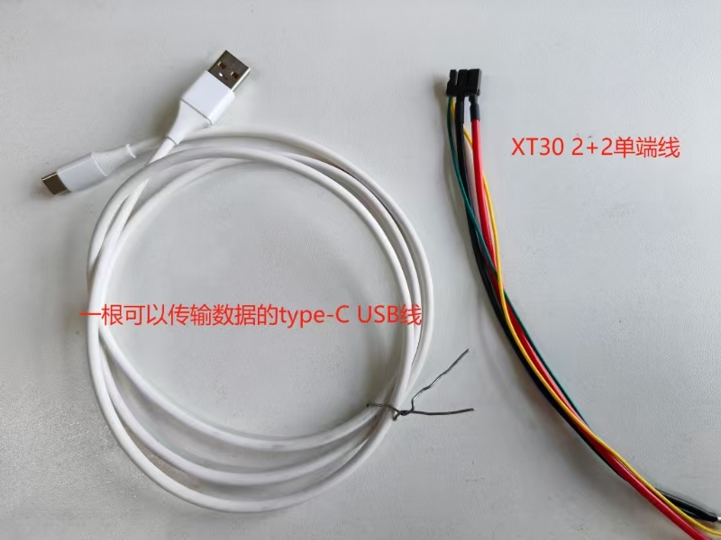

- type-C USB 线：**USB 线并不能给电机驱动板供电**，仅用作传输数据。请注意，有些型号并不支持 type-C，而是定制的 3PIN 数据线，请与售后人员联系如何连接。
- XT30 2+2 电源线：推荐用稳压电源或电池给电机供电。供电电源电流**至少要大于 5A**，电压**不低于 15V，最高 60V**，注意用 24V 及以下电源记得在电机精灵或者 odrivetool 更改电压下限为 10V 或 8V。

```python
odrv0.config.dc_bus_undervoltage_trip_level = 10
```

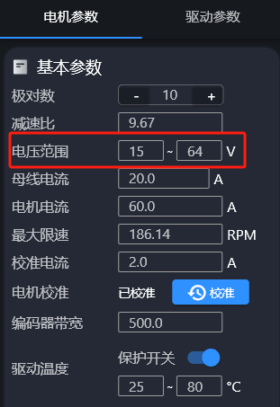

### 1.2 USB 驱动安装

📎 **Attachment (not downloaded, see original doc):** zadig-2.9.exe (5.1 MB)

进入网站[ https://zadig.akeo.ie ](https://zadig.akeo.ie)并下载 USB 驱动工具 Zadig，用 Type-C 数据线将驱动器接入电脑，**请事先给驱动器接入电源，USB 并不能给驱动器供电。**打开 Zadig，点击"Options"，再点击""电机通过下拉框选择“CyberBeast Motor Driver Device（Interface 2）”：

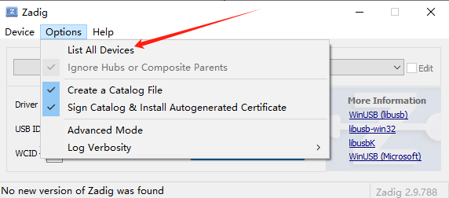

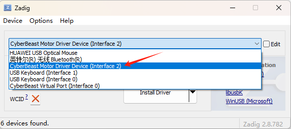

通过点击上下键选择不同的 USB 驱动，请为此接口选择“libusb”驱动版本，并点击“Install Driver”或“Replace Driver”为这个接口安装驱动：

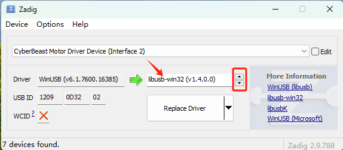

### 1.3 软件安装

#### 1.3.1 电机精灵

1. 安装电机精灵
点击下载最新版本：[电机精灵安装包](https://bl.cyberbeast.cn/actuator/motorwizard.exe)

请下载电机精灵安装包，按照如下顺序安装

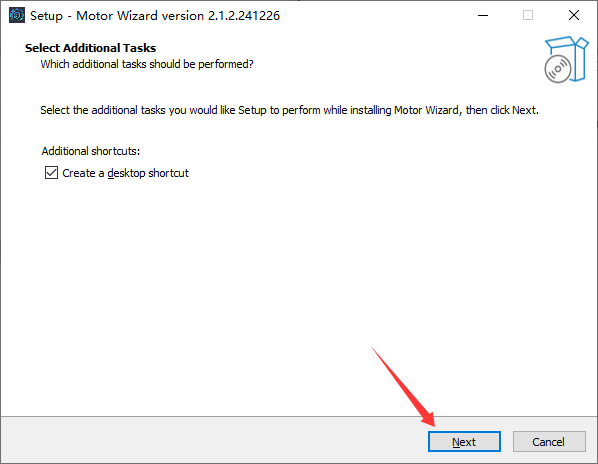

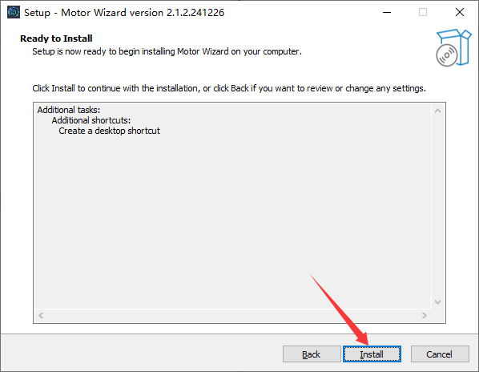

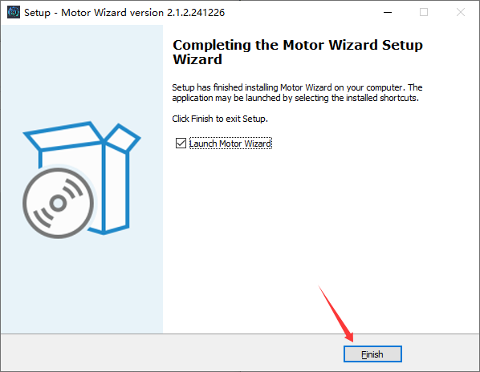

#### 1.3.2 odrivetool

##### **Windows**

1. 安装 python3
📎 **Attachment (not downloaded, see original doc):** 安装python正式.mp4 (16.5 MB)

进入 python 官方网站[ https://www.python.org ](https://www.python.org)下载最新 python 安装程序并按提示安装。请不要下载第三方网站或微软 Microsoft Store 商店中的 python 版本。**请用管理员权限安装 python**。

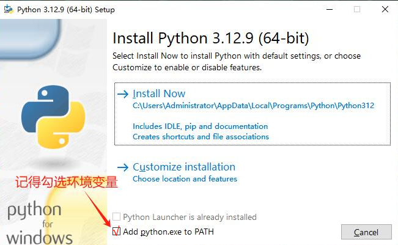

在此附一个版本不太新的 python 文件，供下载网速慢客户下载：

📎 **Attachment (not downloaded, see original doc):** python-3.12.9-amd64.exe (25.7 MB)

2. 安装 odrivetool 及其相关库
打开终端，类似如下图的页面，然后执行之后的指令

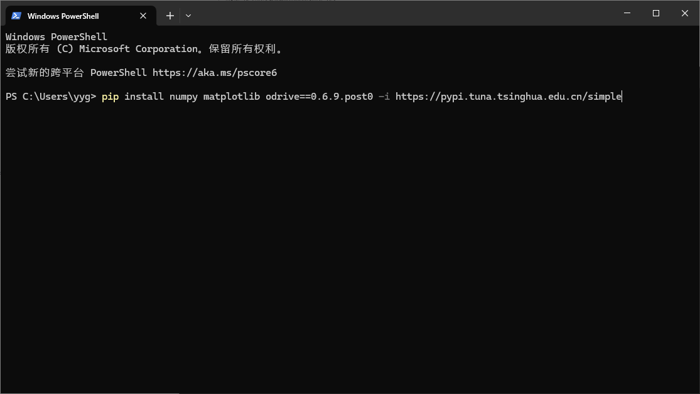

```python
pip install numpy matplotlib odrive==0.6.9.post0 -i https://pypi.tuna.tsinghua.edu.cn/simple
若使用驱动板版本是V8.xx，执行下列指令，并使用mtool连接
pip install matplotlib mwdrive numpy -i https://mirrors.aliyun.com/pypi/simple/
```

这条指令已经替换成清华镜像源安装，基本不用担心网速导致安装失败的问题。其中 numpy 和 matplotlib 为可选项，可以不安装。如果中途出错请重试。如果再三出错，请重启电脑再重试。

如果你完成了 windows 上安装的操作，请[点击](https://bcnyljrhe70u.feishu.cn/docx/N3SMd4QyRobzHkx3wP3cT1qXnpf#I8K4drWFyooajvxidkycF71TnVd)跳转至下一个步骤。

> 💡 如果你看到： “‘python3’ 不是内部或外部命令，也不是可运行的程序”，可能是因为 Python 没有添加到你的 PATH 环境变量中。Python 自带了一个小脚本可以修复这个问题。请导航到 Python 安装文件夹（通常是`C:\Program Files\Python<版本号>\` 或`C:\Users<你的用户名>\AppData\Local\Programs\Python\Python<版本号>\`），然后双击运行 “win_add2path.py” 脚本。
>

##### Linux

3. 安装 python3
如果 `python3 --version` 已经返回类似 `Python 3.8.0` 或更新版本的结果，你可以跳过这一步。安装命令取决于你使用的 Linux 发行版。例如，在 Ubuntu 上：

```python
sudo apt install python3 python3-pip
```

如果这个命令不起作用，请查看[ python 官方下载网站](https://www.python.org/downloads/)。

4. 安装 odrivetool 及其相关库
其中 numpy 和 matplotlib 为可选项，可以不安装

```python
pip3 install numpy matplotlib odrive==0.6.9.post0 -i https://pypi.tuna.tsinghua.edu.cn/simple
```

5. 安装 USB 驱动

```python
sudo apt install libusb-1.0-0
```

如果你完成了 linux 上安装的操作，请[点击](https://bcnyljrhe70u.feishu.cn/docx/N3SMd4QyRobzHkx3wP3cT1qXnpf#I8K4drWFyooajvxidkycF71TnVd)跳转至下一个步骤。

##### **WSL( Windows Subsystem for Linux)**

前三个步骤和 Linux 相似，请参见上一小节。

- 连接驱动器到 WSL
用 type-C 数据线插入 Windows，默认情况下 Windows 会加载此 USB 端口的驱动，而 WSL 并不会加载。需要将此 USB 端口加载到 WSL 中，请参照微软文档（[https://learn.microsoft.com/zh-cn/windows/wsl/connect-usb](https://learn.microsoft.com/zh-cn/windows/wsl/connect-usb)）操作。

如果你完成了 WSL 上安装的操作，请跳转至下一个步骤：启动 odrivetool。

##### 启动 odrivetool

以上，根据自己的系统安装完成后，打开终端命令行 shell（Windows PowerShell 或 Linux Terminal），执行`odrivetool`（键入 odrivetool 并回车），下图显示 windows 下连接成功：

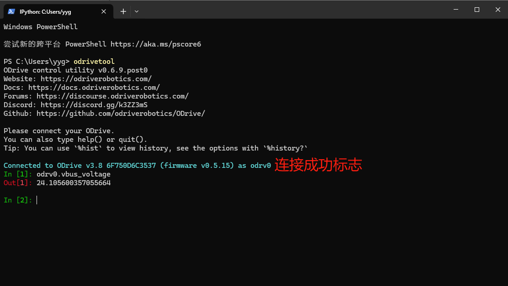

上图显示的指令是用来显示主板的主电源电压。

您正在查看的工具是一个功能齐全的 Python 命令提示符，因此您可以输入任何有效的 Python 代码。

### 1.4 常见问题(更新中)

Q：电机精灵无法连接到驱动板

    A：按照用户手册1.2安装usb驱动

    Q：校准时出现电机类异常

    A：检查三相线是否虚焊，连线过细；电源是否限制电流输出

    Q：校准时出现编码器类异常

    A：外力推动电机，在电机精灵中添加转子轴编码器曲线，观察曲线是否和曲线转动趋势一致。若编码器曲线有跟随转动趋势，则编码器工作环境差，调整安装位置；若曲线完全不动，检查编码器是否损坏

    Q：全部参数写入后无法保存

    A：参数写入后按ENTER键，屏幕中出现写入成功即可

    Q：升级后电机不正常

    A：擦除全部参数，重新校准电机

    Q：电机带负载运动时出现报欠压、驱动板重启

    A：检查电源是否限制电流输出，一般给到10A限制可以。具体根据电机参数判断

    Q：电机带负载运动出现过压

    A：检查母线电压波动情况。在器件容许范围内，提高母线电压上限；尝试更平缓的运动方式，例如力矩斜坡、速度斜坡、位置-梯形曲线。

## 2 电机精灵使用

请先按照[ 1.2 ](https://bcnyljrhe70u.feishu.cn/docx/N3SMd4QyRobzHkx3wP3cT1qXnpf#LVn3dl3tEoqyVdxLUxRchQm8nid)和[ 1.3.1 ](https://bcnyljrhe70u.feishu.cn/docx/N3SMd4QyRobzHkx3wP3cT1qXnpf#YsUydUkFpoMOwOx7uinc6txYnKf)完成 USB 驱动和电机精灵的安装，再进行本节的阅读。

### 2.1 界面介绍

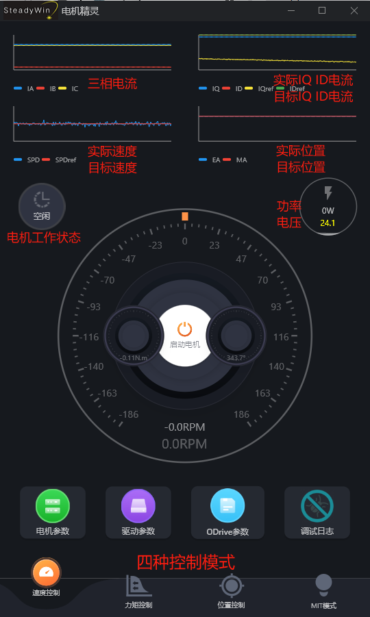

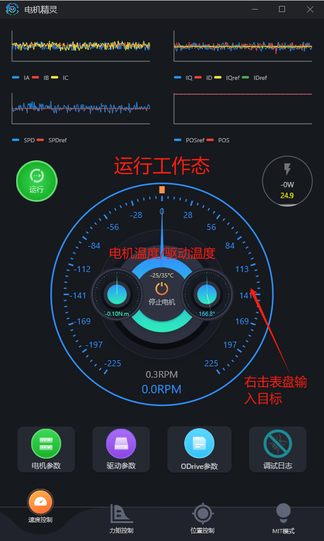

1. 实时波形监控
界面上方展示了多个实时数据波形图，包括：

- **三相电流波形**（IA、IB、IC）：反映电机三相绕组的实际电流。
- **DQ 轴电流**（IQ、ID 以及其参考值 IqRef、IdRef）：展示电机在电流环控制下的实际电流与目标电流对比。
- **速度曲线**（SPD、SPDref）：实时速度与目标速度对比，有助于观察速度环性能。
- **位置曲线**（EA、MA）：反映实际位置与目标位置，便于位置环调试。
2. 中央仪表盘
- **电机转速和转矩显示**：中心仪表盘显示当前转速（RPM）和电机输出转矩（Nm）。
- **角度指示**：显示电机当前位置的角度信息。
- **一键启动按钮**：点击中央“启动电机”按钮可快速开始或停止电机运行。
- **电机运行状态**：左侧显示电机当前的运行模式（如“空闲”状态）。
- **电源监测**：右侧显示当前电机功率和母线电压。
3. 参数配置区
界面底部提供多个按钮，分别进入不同的参数配置页面：

- **电机参数**：设置和查看电机相关的基本参数。
- **驱动参数**：配置电机驱动器的控制参数，如电流环/速度环 PI 参数等。
- **ODrive 参数**：针对 ODrive 架构的内部参数管理与调试。
- **调试日志**：用于调试过程中查看详细日志输出，便于问题定位。
下面我会详细介绍中间四个图标点开后分别是什么

#### 2.1.1 分享、同步和升级

    

    点开电机参数和我们可以看到三个按钮

    - 分享

    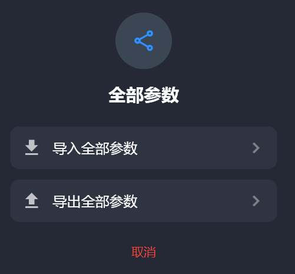

    点开分享后我们可以导入当前电机或导入其他电机参数的 json文件

    - 升级
    升级前确保下载安装芯片对应的DFU驱动

        国民DFU驱动：[CyberBeast Driver User Manual](CyberBeast_Driver_User_Manual_EN.md)

    

    点击升级后电机会进入升级模式（相当于在 odrivetool 进行 odrv0.enter_dfu_mode（）），电机精灵会与电机断联，可进行电机固件的烧录（详见[固件升级](https://bcnyljrhe70u.feishu.cn/docx/N3SMd4QyRobzHkx3wP3cT1qXnpf#GNdcdWiIsozXIbxLsPWcH0annyb)）。

    升级模式有三种：云端升级，本地升级，MCU厂家软件升级。在跨越版本较多时建议勾选擦除所有配置

    

    - 同步
    每次进行参数更改后，都需要在空闲状态下点击同步才可保存所写入的参数，断电不丢失。同步后，电机会重启，然后需要等待几秒钟进行电机的重连（`odrv0.save_configuration()`）。

    

    长按同步按键，会擦除所有配置的参数，恢复默认参数（`odrv0.erase_configuration()`）。

    

#### 2.1.2 电机参数

    点开上图的电机参数图标我们可以看到如下参数

> 💡 - 在此页面下的所有参数更改完配置后，需要在电机处于空闲状态下点击同步保存参数
> - 参数配置下面那一行字是硬件版本/固件版本号，硬件版本是指自己驱动板的版本号，固件版本是指当前驱动所使用的驱动固件版本号（固件升级可能会使固件版本号不同），如图的硬件版本是 3.8.3，固件版本是 0.5.15

    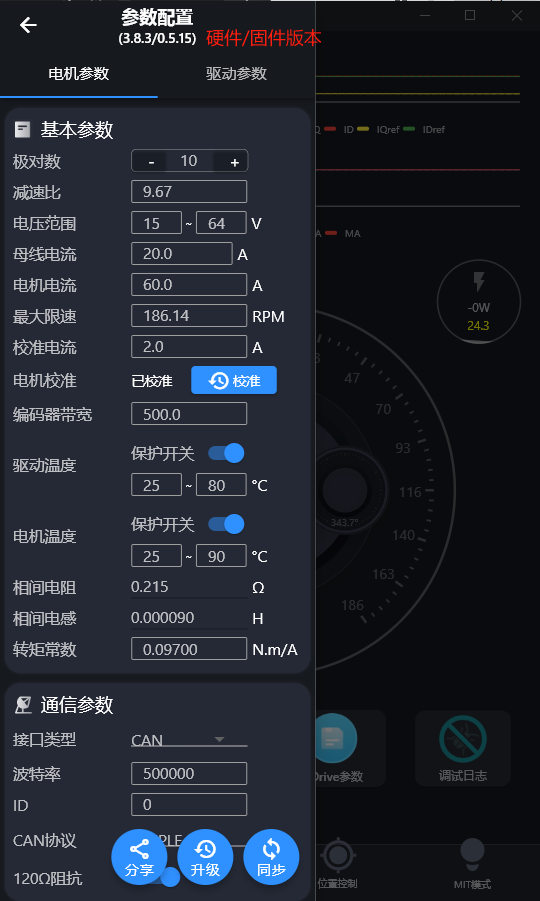

    对应每个参数的介绍，odrivetool 指令如下：

    ***基本参数***

    | **参数名称** | **说明** | **示例值** | `odrivetool` **对应字段** |
    |---|---|---|---|
    | 极对数 | 电机的磁极对数（poles / 2） | 10 | `odrv0.axis0.motor.config.pole_pairs` |
    | 减速比 | 电机输出轴与编码器之间的减速比 | 9.67 | `odrv0.axis0.motor.config.gear_ratio` |
    | 母线电压范围 | 可接受的母线输入电压范围 | 15 V ~ 64 V | `odrv0.config.dc_bus_undervoltage_trip_level`<br>`odrv0.config.dc_bus_overvoltage_trip_level` |
    | 母线电流 | 电源允许的最大供电电流 | 20.0 A | `odrv0.config.dc_max_positive_current` |
    | 反向母线电流 | 电源允许的最大反充电流（负数） | -50.0 A | `odrv0.config.dc_max_negative_current` |
    | 电机电流 | 电机允许的最大电流 | 60.0 A | `odrv0.axis0.motor.config.current_lim` |
    | 电机速度 | 最大电机速度（RPM） | 186.14 RPM（输出轴） | `odrv0.axis0.controller.config.vel_limit`（odrivetool 里的单位是转子侧 转/s） |
    | 校准电流 | 电机校准时注入的电流 | 2.0 A | `odrv0.axis0.motor.config.calibration_current` |
    | 电机校准 | 一键电机校准操作按钮 | - | `odrv0.axis0.requested_state = AXIS_STATE_FULL_CALIBRATION_SEQUENCE` |
    | 编码器带宽 | 编码器滤波带宽设置 | 500 | `odrv0.axis0.encoder.config.bandwidth` |
    | 驱动温度保护 | 驱动器温度保护阈值 | 25 ~ 80°C | `odrv0.axis0.motor.fet_thermistor.config.enabled = True`<br>`odrv0.axis0.motor.fet_thermistor.config.temp_limit_lower`<br>`odrv0.axis0.motor.fet_thermistor.config.temp_limit_upper` |
    | 电机温度保护 | 电机温度保护阈值 | 25 ~ 90°C | `odrv0.axis0.motor.motor_thermistor.config.enabled = True`<br>`odrv0.axis0.motor.motor_thermistor.config.temp_limit_lower`<br>`odrv0.axis0.motor.motor_thermistor.config.temp_limit_upper` |
    | 相间电阻 | 电机相电阻 | 0.215 Ω | `odrv0.axis0.motor.config.phase_resistance` |
    | 相间电感 | 电机相电感 | 0.000090 H | `odrv0.axis0.motor.config.phase_inductance` |
    | 转矩常数 | 电流转矩转换系数（转子侧） | 0.09700 Nm/A | `odrv0.axis0.motor.config.torque_constant` |

    通信参数会在每个协议的使用部分（5.1 5.2）说明这部分如何配置

#### 2.1.3 驱动参数

    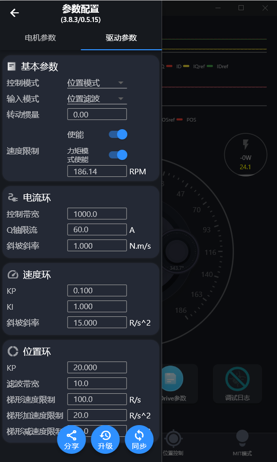

    参数介绍及对应 odrivetool 的指令如下：

    ***基本参数（控制模式配置）***

    | 参数名称 | 说明 | 示例值 | `odrivetool` 对应字段 |
    |---|---|---|---|
    | 控制模式 | 电机控制类型：位置/速度/电流等 | 位置模式 | `odrv0.axis0.controller.config.control_mode`   |
    | 输入模式 | 输入指令类型：位置滤波、步进/方向、模拟等 | 位置滤波 | `odrv0.axis0.controller.config.input_mode` |
    | 转动惯量 | 电机转动部分的惯量（扭矩模式需要） | 0.00 | `odrv0.axis0.controller.config.inertia` |
    | 速度限制 | 限速是否启用 | 启用 | `odrv0.axis0.controller.config.enable_vel_limit` |
    | 力矩链式锁定 | 开启扭矩控制时是否限速 | 启用 | `odrv0.axis0.controller.config.enable_torque_mode_vel_limit` |
    | 最大速度 | 最大运行速度 | 186.14 RPM<br>（输出轴） | `odrv0.axis0.controller.config.vel_limit`（odrivetool 里的单位是转子侧 转/s） |

    ***电流环***

    | 参数名称 | 说明 | 示例值 | `odrivetool` 对应字段 |
    |---|---|---|---|
    | 控制带宽 | 电流环的带宽，越高越快但可能震荡 | 1000.0 | `odrv0.axis0.motor.config.current_control_bandwidth` |
    | Q 轴限流 | 电机最大 Q 轴电流 | 60.0 A | `odrv0.axis0.motor.config.current_lim` |
    | 斜坡斜率 | 电流变化速率限制 | 1.000 N·m/s | `odrv0.axis0.controller.config.torque_ramp_rate` |

    ***速度环***

    | 参数名称 | 说明 | 示例值 | `odrivetool` 对应字段 |
    |---|---|---|---|
    | KP | 比例系数 | `0.100` | `odrv0.axis0.controller.config.vel_gain` |
    | KI | 积分系数 | `1.000` | `odrv0.axis0.controller.config.vel_integrator_gain` |
    | 斜坡斜率 | **在速度斜坡模式下**，速度变化限制，加速度 | `15.000 R/s²` | `odrv0.axis0.controller.config.vel_ramp_rate` |

    ***位置环***

    | 参数名称 | 说明 | 示例值 | `odrivetool` 对应字段 |
    |---|---|---|---|
    | KP | 比例增益（用于位置误差） | `20.000` | `odrv0.axis0.controller.config.pos_gain` |
    | 滤波带宽 | 滤除位置信号抖动的带宽 | `10.0` | `odrv0.axis0.controller.config.input_filter_bandwidth` |
    | 梯形速度限制 | **在位置梯形曲线模式下**，目标速度最大值（位置输入） | `100.0 R/s` | `odrv0.axis0.trap_traj.config.vel_limit` |
    | 梯形加速度限制 | **在位置梯形曲线模式下**，目标加速度最大值 | `20.0 R/s²` | `odrv0.axis0.trap_traj.config.accel_limit` |
    | 梯形减速度限制 | **在位置梯形曲线模式下**，目标减速度最大值 | `20.0 R/s²` | `odrv0.axis0.trap_traj.config.decel_limit` |

#### 2.1.4 ODrive 参数

    电机精灵展示了电机一些最基本可配置的参数，odrivetool 还有很多参数在电机精灵中并没有展示。我们可以通过在 ODrive 参数这个功能项中，找到 odrivetool 的指令并输入，在 odrivetool 中可以输入的指令这里都可以找到。

    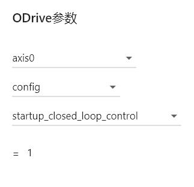

    例如，我们可以在这里将电机配置成开机进入闭环工作模式（如上图）。

> 💡 注意，在这个页面配置完参数后，若需要断电记忆参数，需要在电机处于**空闲状态**下，点击电机参数—>同步进行参数保存。简单来说，**输入后回车点击同步**。
>

### 2.2 四种模式控制

    文字叙述待更新，关于不同模式叙述详见[ ](https://bcnyljrhe70u.feishu.cn/docx/N3SMd4QyRobzHkx3wP3cT1qXnpf#H1aodvyGAokuGWxQeK9cnBOAndg)[3](https://bcnyljrhe70u.feishu.cn/docx/N3SMd4QyRobzHkx3wP3cT1qXnpf#H1aodvyGAokuGWxQeK9cnBOAndg)[.3](https://bcnyljrhe70u.feishu.cn/docx/N3SMd4QyRobzHkx3wP3cT1qXnpf#H1aodvyGAokuGWxQeK9cnBOAndg)，模式调参详见[ 4.2](https://bcnyljrhe70u.feishu.cn/docx/N3SMd4QyRobzHkx3wP3cT1qXnpf#QZYwd8VetoxIeyxvGZ4ce08Cn2c)

#### 2.2.1 MIT 模式

> 💡 使用前请保证电机的扭矩常数（`odrv0.axis0.motor.config.torque_constant`）设置正确，再使用本模式，否则可能输出力矩无法达到预期。可以咨询厂家询问正确的扭矩常数。
>

        在电机已校准的状态下，切换表盘到 MIT 模式，点击启动电机，之后在表盘处右击，可以看到能够输入的参数（如下图，从左往右），接下来我们介绍一下不同使用模式下如何给参数。

        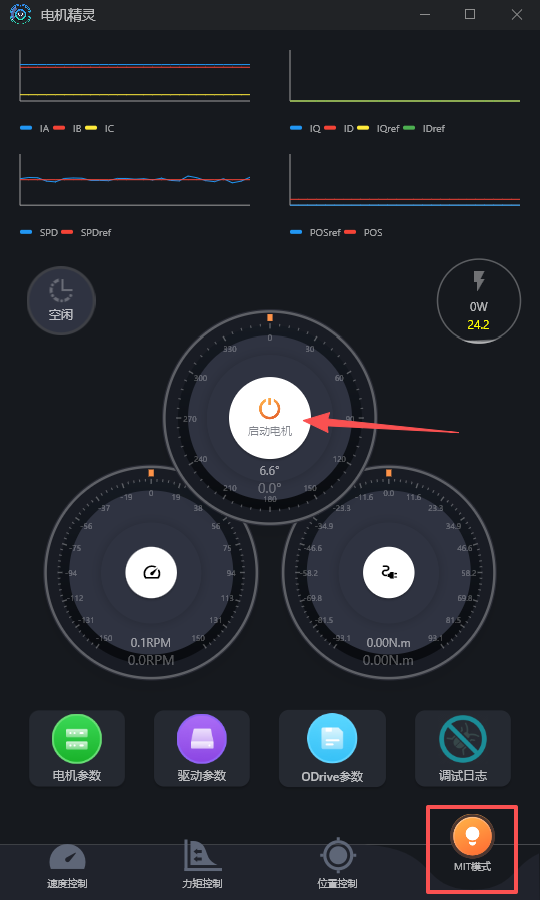

        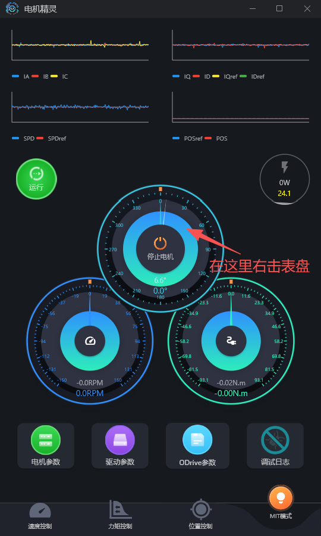

        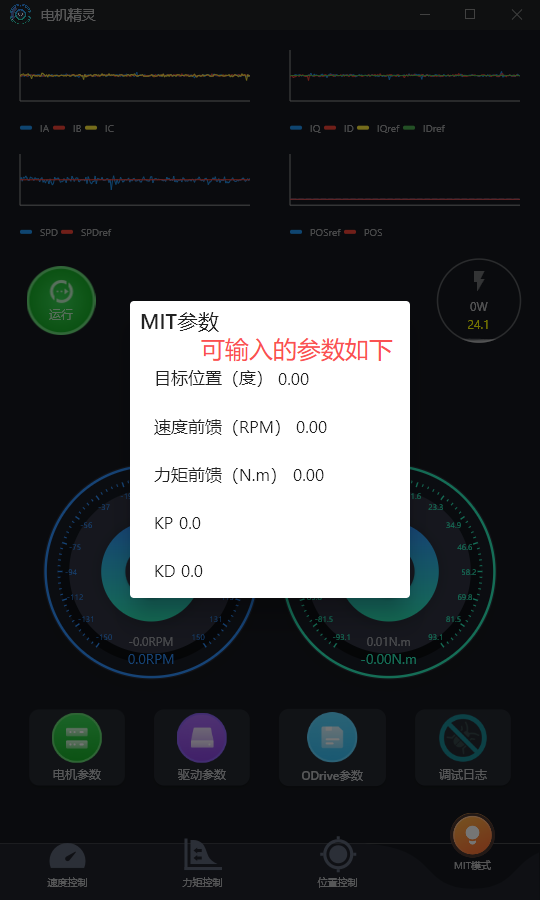

        - 位置控制模式
        在位置控制模式下，电机输出轴将定位并保持在设定的目标角度。例如，若需将电机输出轴稳定在 60° 的位置，可设置如下运动参数：目标位置 60°，KP 50，KD 1，其余参数（速度前馈和力矩前馈）设置为 0：

        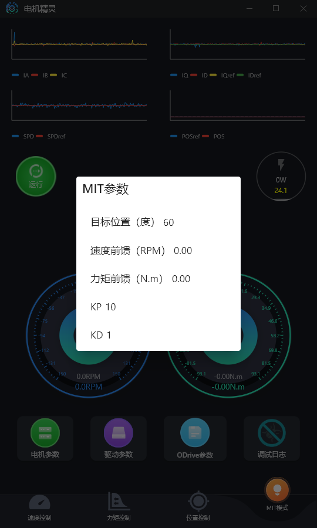

        - 速度控制模式
        在速度控制模式下，目标是电机输出轴给定的期望速度运行。例如，若需电机输出轴转速在 100RPM，可设置如下运动参数：速度前馈 100RPM，KD 1.5，其余参数（目标位置、速度前馈、力矩前馈和 KP）设置为 0：

        

        - 扭矩控制模式
        在扭矩控制模式下，目标是电机输出轴给定的期望力矩运行。例如，期望电机输出 1Nm 力矩，可设置如下运动参数：力矩前馈设置为 1Nm，其余参数（目标位置、速度前馈、力矩前馈、KP 和 KD）设置为 0：

        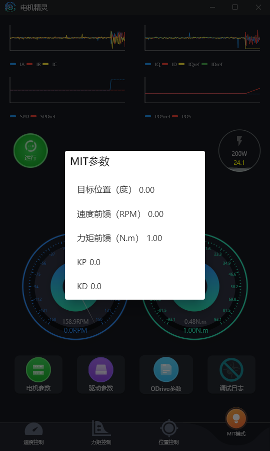

        - 阻尼模式
        阻尼模式常用于实现电机的减速、制动或阻力控制。在该模式下，电机通过输出适当的扭矩，对外部运动施加阻力或制动力，从而达到减速或抑制运动的效果。用户可通过调节输出参数，灵活控制阻尼力或制动力的大小，以适应不同的减速或制动需求。例如，设置参数时令阻尼系数 KD 不为零（如 KD=2），其余参数均设为 0。

        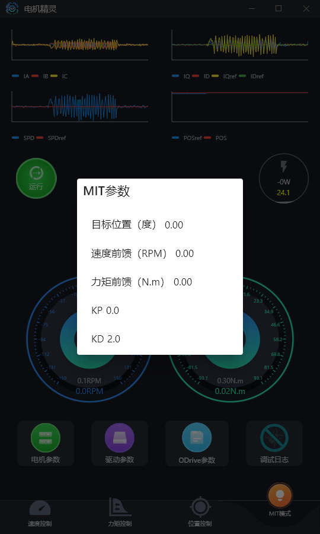

        发送参数后，电机不会主动转动，但当外部力量带动电机旋转时，电机将产生与转动方向相反的阻抗扭矩。该扭矩大小与转速成正比：转速越高，阻抗扭矩越大。

        - 零扭矩模式
        零扭矩模式旨在使电机的输出扭矩保持为零或接近零状态。在该模式下，电机并非完全停止运转，而是主动输出扭矩以抵消自身的摩擦扭矩，从而实现近似“零阻力”的效果。设置时，将所有运动参数均设为 0。发送参数后，电机不会主动转动，但若尝试手动旋转输出轴，可感受到其转动阻力显著低于电机未通电时的机械阻力。

        

        - 力位混合控制模式
        当我们应用在一些机器人上时，上层控制器会给关节电机同时发送期望角度、期望速度和力矩前馈。这时就是力位混合控制。例如，目标位置给 180°，速度给 0，前馈力矩给 0.5Nm，KP 给 15，KD 给 2。这时就是力位混合控制。

        

### 2.3 查看错误码

    当我们的电机触发报警时，电机会立刻停止运行并且进入空闲状态，如下图所示，我们需要右击红色的异常获取异常码

    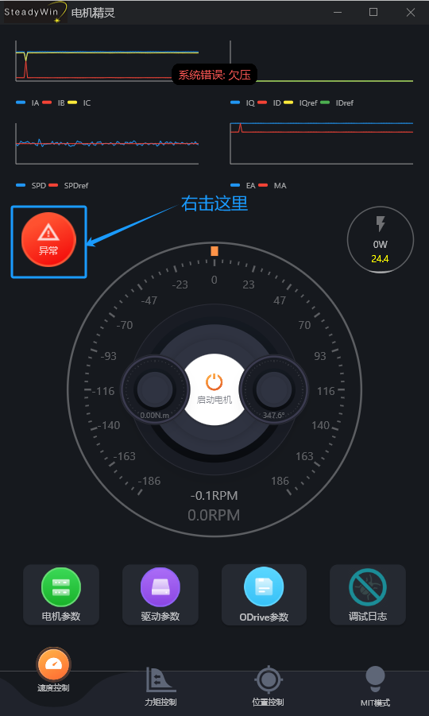

    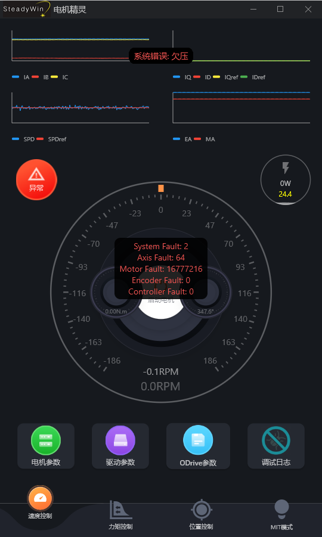

    System Fault 系统异常，Axis Fault 驱动异常，Motor Fault 电机异常，Encoder Fault 编码器异常，Controller Fault 控制异常

    可以对应[协议手册异常码](https://cyberbeast.feishu.cn/docx/BPnQd8reEotLWVxqHFNc9qYZnKh#KKr4dVPH3oQ9r5x5KxocJLmQn4b)去看每个异常码对应的具体异常，可能会有多个异常同时产生，其中会有最根本的异常。

    以上图为例，转换成 16 进制

    System Fault: 0x00000002

    Axis Fault: 0x00000040

    Motor Fault: 0x01000000

    Encoder Fault: 0

    Controller Fault: 0

    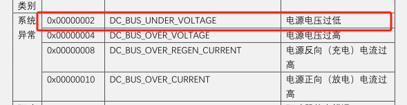

    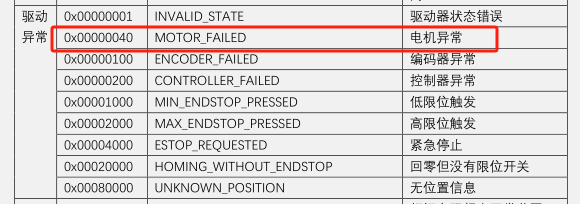

    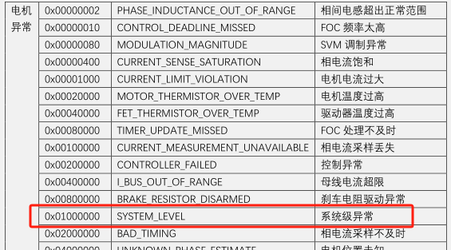

## 3 Odrivetool 使用

> 💡 操作提示
>
> - 经常使用 `TAB` 键，会有指令提示，类似于 linux 下的指令提示，可用`↑` `↓` `←` `→`键选择指令；
> - `↑` `↓`键会显示历史指令；
> - 在指令输入时，会提示历史类似指令，使用`ctrl + →`会直接补全

### 3.1 odrivetool 基本指令

这部分会讲述 odrivetool 的一些经常会用到的指令，如果您已经对 odrivetool 已经有所了解，可以直接跳过这部分，[点击跳到下一节](https://bcnyljrhe70u.feishu.cn/docx/N3SMd4QyRobzHkx3wP3cT1qXnpf#KySSdxV26oqhyfx5wbWcjGMjnfh)。

我们将使用 `<odrv>` 作为任何 ODrive 对象的占位符。每个 ODrive 控制器都是一个 ODrive 对象。在 `odrivetool`中， 可以通过 `odrv0`、`odrv1` 等访问。这些 ODrive 对象的属性由 ODrive API 定义，并且可能在更新 ODrive 固件时发生变化。此外，我们将使用 `<axis>` 作为任何轴的占位符，这是 ODrive 对象的一个属性（例如 `odrv0.axis0`）。一个轴表示电机连接的位置，我们的电机目前只有一个轴，`axis0`。

本手册默认当前电机为`odrv0.axis0`，如果连接了两个电机及以上请根据情况自行变更。

#### 3.1.1 电机状态机

    一个轴的当前状态由`axis0.current_state` 表示。用户可以通过为 `axis0.requested_state` 分配一个新值来请求一个新的状态。启动后的默认状态是 `AxisState.IDLE`。所有状态的描述可以在[这里](https://docs.odriverobotics.com/v/latest/fibre_types/com_odriverobotics_ODrive.html#ODrive.Axis.AxisState)找到。

#### 3.1.2 启动程序

    默认情况下，ODrive 启动时不会执行任何操作，立即进入空闲状态（IDLE）。为了更改启动程序的操作，可以将所需的启动程序设置为 `True`（配置后记得保存配置）。ODrive 将按照下面显示的顺序依次执行所有启用的启动操作。

        - `odrv0.axis0.config.startup_motor_calibration = 1`开机进行三相识别
        - `odrv0.axis0.config.startup_encoder_offset_calibration = 1`开机进行编码器校准
        - `odrv0.axis0.config.startup_closed_loop_control = 1`开机进入闭环

#### 3.1.3 保存和擦除配置

    所有属于 `[...].config` 对象的变量都可以保存到 ODrive 的非易失性内存中，这样它们**在断电后仍然会保留**。相关命令如下：

        - `odrv0.save_configuration()`：将配置保存到 ODrive 的持久内存中，需要在空闲状态下执行。
        - `odrv0.erase_configuration()`：将配置变量重置为出厂默认设置。此操作还会重启设备。

#### 3.1.4 **查看设备错误信息**

    当电机触发报警时，电机会立刻停止运行并且反馈错误，可以通过以下指令查询错误信息

    ```python
    dump_errors(odrv0)
    ```

    执行后会看到如下信息，这里的根源错误是欠压导致电机异常。

    

    如果`dump_errors(odrv0)`无法查到具体错误，我们也可以通过查看错误码知道具体报错（注意反馈的都是十进制数），根据反馈的错误码查询[CyberBeast Driver Protocol Manual](CyberBeast_Driver_Protocol_Manual_EN.md)异常码部分

    ```python
    odrv0.axis0.motor.error        #电机异常错误码
    odrv0.axis0.encoder.error      #编码器异常错误码
    odrv0.axis0.controller.error   #控制异常错误码
    odrv0.error                    #系统异常错误码
    ```

#### 3.1.5 实时绘图工具

    `start_liveplotter(properties[, layout, ...])`

    启动实时绘图工具（请先确认您已经安装 matplotlib 库）。例如打印目标位置和当前位置：

    ```python
    start_liveplotter(lambda:[odrv0.axis0.encoder.pos_estimate,odrv0.axis0.controller.input_pos],["pos","pos_target"])
    ```

    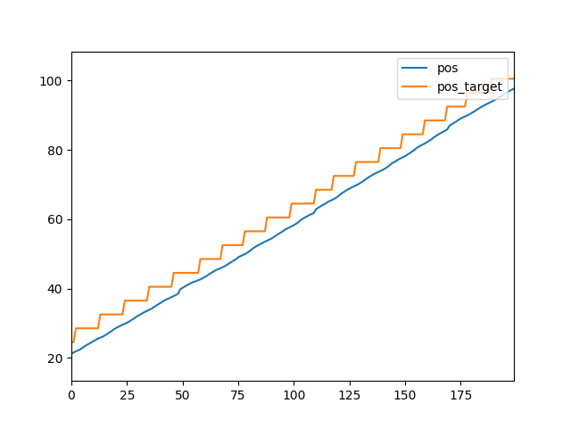

    停止当前运行的实时绘图工具。

    ```python
    stop_liveplotter()
    ```

#### 3.1.6 备份和恢复参数

    打开终端，**不要进入 odrivetool**，在终端窗口进行如下命令的操作

    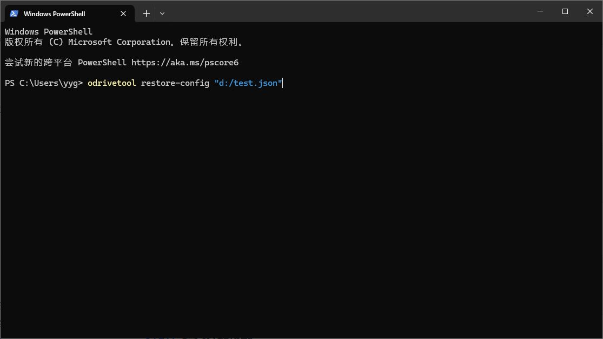

    参数备份：

    ```text
    odrivetool backup-config "d:/test.json"
    ```

    其中`d:/test.json`是用户可自由修改的保存路径和文件名。

    恢复参数时，**请保证电机的硬件版本相同**

    参数恢复的指令为：

    ```text
    odrivetool restore-config "d:/test.json"
    ```

#### 3.1.7 进入升级模式

    进行固件的下载，需要执行以下指令，关于固件的下载，详见[固件升级](https://bcnyljrhe70u.feishu.cn/docx/N3SMd4QyRobzHkx3wP3cT1qXnpf#GNdcdWiIsozXIbxLsPWcH0annyb)

    ```text
    odrv0.enter_dfu_mode()
    ```

### 3.2 电机校准

通常电机在出厂前已经校准，如果进行过固件升级、驱动板拆装、配置擦除，需要重新进行电机校准。

[点击跳到下一节。](https://bcnyljrhe70u.feishu.cn/docx/N3SMd4QyRobzHkx3wP3cT1qXnpf#H1aodvyGAokuGWxQeK9cnBOAndg)

用户第一次使用电机时，需要对电机以及编码器进行校准（通常出厂前已经经过校准）。在校准之前，请固定好电机，或用手握紧，输出轴空载，校准过程如下：

> ⚠️ **警告！**
>
> 校准前，请将电机空载，并固定好电机！
>

    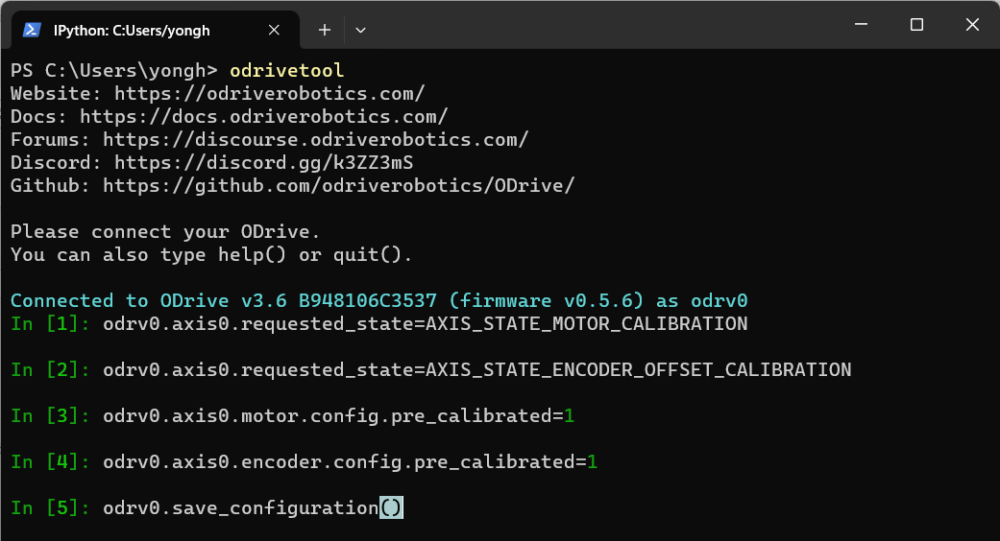

    ```text
    odrv0.axis0.requested_state = AXIS_STATE_MOTOR_CALIBRATION
    dump_errors(odrv0)
    odrv0.axis0.requested_state = AXIS_STATE_ENCODER_OFFSET_CALIBRATION
    dump_errors(odrv0)
    odrv0.axis0.motor.config.pre_calibrated = 1
    odrv0.axis0.encoder.config.pre_calibrated = 1
    odrv0.save_configuration()
    ```

    分步解释如下：

    - 第一步：电机参数自识别

    ```text
    odrv0.axis0.motor.config.phase_resistance
    odrv0.axis0.motor.config.phase_inductance
    ```

    测量电机的相电阻和相电感，会听到尖利的“嘀”一声。相电阻和相电感的测量结果可通过下述指令查看：

    - 第二步：查看错误码

    ```python
    dump_errors(odrv0)
    ```

    查看第一步过后的系统错误码，如果出现任何的红色错误码，则需要重启电机，然后重试，或者报告售后。

    - 第三步：编码器校准
    对编码器进行校准，包括编码器的安装角度与电机机械角度的校准，以及编码器自身的校准。在这个校准过程中，电机会缓慢正转一个角度，再反转一个角度。如果只正转后就停止，则说明有错误，请通过第四步查看错误码。

    - 第四步：查看错误码
    在第三步编码器校准后，查看系统的错误码。通常出现的错误是 ERROR_CPR_POLEPAIRS_MISMATCH，表示编码器的 CPR 设置错误，或者电机的极对数设置错误，请通过下述指令查看/设置：

    ```text
    odrv0.axis0.encoder.config.cpr
    odrv0.axis0.motor.config.pole_pairs
    ```

    - 第五步：写入电机校准成功标志
    - 第六步：写入编码器校准成功标志
    - 第七步：存储校准结果并重启

    ```text
    odrv0.axis0.encoder.config.pre_calibrated = 1
    odrv0.axis0.motor.config.pre_calibrated = 1
    odrv0.save_configuration()
    ```

### 3.3 四种控制模式

在完成电机校准之后，就可以对电机进行控制了。

#### 3.3.1 位置控制

首先需要将控制模式更改为位置模式

```python
odrv0.axis0.controller.config.control_mode = 3
```

设置完控制模式后，我们需要设置输入模式（input_mode），才能决定我们控制位置的算法。下面会说明三种电机自带的位置控制算法。

##### 直接位置控制**（Position Control）**

这是很暴力的控制模式，电机会以全力到达目标位置，电机可能会很容易触发报警，所以我们并不推荐使用，使用此模式需要设置输入模式（input_mode）为：

```python
odrv0.axis0.controller.config.input_mode = 1
```

##### 滤波位置控制**（Filtered Position Control）**

直接要求 ODrive 控制器以最快的速度达到原始设定点可能会导致运动抖动。这是因为 ODrive 使用零阶保持（Zero Order Hold， ZOH）来保持每次发送命令数据之间的值。即使你正在使用外部源生成的连续轨迹，如果该轨迹以适中的频率发送，ODrive 可能会以一种抖动的方式追逐每个阶梯。你可以使用二阶位置滤波器来平滑轨迹。使用此模式需要设置输入模式（input_mode）为：

```python
odrv0.axis0.controller.config.input_mode = 3
```

调节滤波带宽的一个良好起点是将其设置为与命令发送频率相同的值。例如，如果你以 5Hz 发送位置命令，将滤波带宽设置为 5。

```text
odrv0.axis0.controller.config.input_filter_bandwidth = 5
```

> ⚠️ **警告！**
>
> 位置滤波模式是使用的是二阶位置滤波器，这是一个“积分型滤波器”，如果电机朝着单方向长时间运行累计误差会越来越大，会导致电机无法跟上目标位置，所以**这个模式并不适合长时间单方向运转**。
>

##### **梯形曲线位置控制（Trajectory Control）**

这个模式可以让用户设置加速度，滑行速度和减速度，来控制电机从一个位置平滑移动到另一个位置。所谓“梯形”是指其速度曲线看起来是梯形，如下图所示，橙色是速度，蓝色是位置：

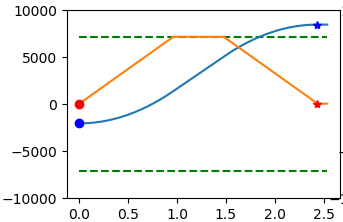

使用此模式需要设置输入模式（input_mode）为：

```python
odrv0.axis0.controller.config.input_mode = 5
```

可调节的控制参数（这部分电机初始有默认值，可以根据需求配置）：

```python
odrv0.axis0.trap_traj.config.vel_limit     #滑行速度最大值，单位turn/s
odrv0.axis0.trap_traj.config.accel_limit   #加速度最大值，单位turn/s^2
odrv0.axis0.trap_traj.config.decel_limit   #减速度最大值，单位turn/s^2
odrv0.axis0.controller.config.inertia      #惯量，单位Nm/(turn/s^2)
```

`vel_limit`是最大规划轨迹速度。这将设置你的滑行速度。

`accel_limit`是最大加速度，单位为转/秒^2

`decel_limit`是最大减速度，单位为转/秒^2

`controller.config.inertia`是与加速度（单位为转/秒^2）和电机扭矩相关的值。默认值为 0。它是可选的，但如果正确调整，可以改善系统的响应。请记住，该值需要根据系统的负载/质量进行调整。

> 💡 所有值都应严格为正数 （>= 0）。
>

同时需要注意的是，电流门限和速度门限仍然会在全局起作用，比如，上述滑行速度最大值如果设置为高于系统级别的 vel_limit，则起作用的是全局 vel_limit。

##### 运行电机

在所有后续的控制操作中，要让电机转动，都需要让电机进入闭环控制状态。在 odrivetool 中指令如下：

```python
odrv0.axis0.requested_state = 8
```

此时电机已经进入工作状态，需要输入目标，**请注意输入单位为转子侧的转**

```python
odrv0.axis0.controller.input_pos = 10 #单位turns
```

#### 3.3.2 速度控制

首先需要将控制模式更改为速度模式

```python
odrv0.axis0.controller.config.control_mode = 2
```

设置完控制模式后，我们需要设置输入模式（input_mode），才能决定我们控制速度的算法。下面会说明两种电机自带的速度控制算法。

##### **直接速度控制（Velocity Control）**

这种模式是最简单的速度控制，电机会以全力到达目标速度，电机可能会很容易触发报警，所以我们并不推荐使用，使能如下：

```text
odrv0.axis0.controller.config.input_mode = 1
```

##### **斜坡速度控制（Ramped Velocity Control）**

斜坡速度控制模式是指按照一定斜率来逐步将速度提升到目标值，会比上述直接速度控制更加缓和，使能如下：

```text
odrv0.axis0.controller.config.input_mode = 2
```

通过调整斜率来控制加速度，加速度单位为转子侧的转/秒^2：

```text
odrv0.axis0.controller.config.vel_ramp_rate = 0.5 #斜率单位是turn/s^2
```

##### 运行电机

在所有后续的控制操作中，要让电机转动，都需要让电机进入闭环控制状态。在 odrivetool 中指令如下：

```python
odrv0.axis0.requested_state = 8
```

此时电机已经进入工作状态，需要输入目标，**请注意输入单位为转子侧的转/秒**

```python
odrv0.axis0.controller.input_vel = 10 #单位turns/s
```

#### 3.3.3 力矩控制

首先需要将控制模式更改为力矩模式

```python
odrv0.axis0.controller.config.control_mode = 1
```

设置完控制模式后，我们需要设置输入模式（input_mode），才能决定我们控制力矩的算法。下面会说明两种电机自带的力矩控制算法。

力矩控制的单位是 Nm（转子侧），而驱动器固件中电流单位是 A，所以还需要设置力矩常数，以让驱动器能够将 Nm 转换为电流，从而按需求驱动电机输出力矩。

```text
# 力矩常数大约等于
odrv0.axis0.motor.config.torque_constant = 8.23/12.3
```

##### **直接力矩控制（Toruqe Control）**

这是最简单的力矩（电流）控制模式，电机会以全力到达目标力矩，电机可能会很容易触发报警，所以我们并不推荐使用，使能如下：

```text
odrv0.axis0.controller.config.input_mode = 1
```

##### **斜坡力矩控制（Ramped Torque Control）**

斜坡力矩控制非常类似于斜坡速度控制，使能如下：

```text
odrv0.axis0.controller.config.input_mode = 6
```

调整斜率如下，斜率的单位是斜率单位转子侧是 Nm/s：

```text
odrv0.axis0.controller.config.torque_ramp_rate = 0.1 #斜率单位是Nm/s
```

##### 运行电机

在所有后续的控制操作中，要让电机转动，都需要让电机进入闭环控制状态。在 odrivetool 中指令如下：

```python
odrv0.axis0.requested_state = 8
```

此时电机已经进入工作状态，需要输入目标，**请注意输入单位为转子侧的牛米**

```python
odrv0.axis0.controller.input_torque = 1.2 #单位Nm
```

#### 3.3.4 MIT 控制

运动控制模式通过综合控制位置，速度和力矩来控制电机运动到目标位置，可以下述公式来表示：

$\begin{array}{c}T_{\text {target }}=K_{p} \times P_{\text {diff }}+K_{d} \times V_{\text {diff }}+T_{f f} \\P_{\text {diff }}=P_{\text {target }}-P_{\text {current }} \\V_{\text {diff }}=V_{\text {target }}-V_{\text {current }}\end{array}$

    其中是$T_{\text {target }}$目标力矩，$P_{\text {diff }}$是位置误差，$V_{\text {diff }}$是速度误差，$K_{p}$是位置控制增益，$K_{d}$是速度控制增益（或叫阻尼系数），$T_{f f}$是前馈力矩。

    运动控制模式使能如下：

    ```python
    odrv0.axis0.controller.config.control_mode = 3
    odrv0.axis0.controller.config.input_mode = 9
    ```

    调整增益：

    ```python
    odrv0.axis0.controller.input_mit_kp = <float> #位置增益，单位Nm/rad
    odrv0.axis0.controller.input_mit_kd = <float> #阻尼系数，单位Nm/rad/s
    ```

    调整增益最大值（会影响参数精度），**注意这里的单位和 CAN MIT 对齐。**

    ```python
    odrv0.axis0.controller.config.mit_max_kp      #默认500，单位Nm/rad
    odrv0.axis0.controller.config.mit_max_kd      #默认5，单位Nm/rad/s
    odrv0.axis0.controller.config.mit_max_pos     #默认12.5，单位rad
    odrv0.axis0.controller.config.mit_max_vel     #默认65，单位rad/s
    odrv0.axis0.controller.config.mit_max_torque  #默认50，单位Nm
    ```

    在所有后续的控制操作中，要让电机转动，都需要让电机进入闭环控制状态。在 odrivetool 中指令如下：

    ```python
    odrv0.axis0.requested_state = 8
    ```

    然后通过输入 input_pos，input_vel，input_torque 来进行运动控制，请注意单位：

    ```python
    odrv0.axis0.controller.input_pos = 5     #单位turns
    odrv0.axis0.controller.input_vel = 30    #单位turn/s
    odrv0.axis0.controller.input_torque = 2  #单位Nm
    ```

> 💡 请注意，在 **USB 控制**时所输入的位置、速度和扭矩，均是指**转子侧**，而用 **CAN** 进行 MIT 控制时，协议中的位置、速度和扭矩均是指**输出轴侧**，这是为了与 MIT 开源协议保持一致！
>

### 3.4 拓展功能

#### 3.4.1 刹车（泄放）电阻


用户可在上图所述的刹车电阻接口（EMG 和 GND）之间接入刹车电阻（也叫泄放电阻），在母线电流倒灌进电源时，分流消耗瞬时的电流。

用户可通过如下配置使能：

```text
odrv0.config.enable_brake_resistor = True
odrv0.config.brake_resistance = xxx #设置外接的刹车电阻阻值
odrv0.save_configuration()
```

如何让驱动器自动泄放呢？可以组合下述两种方式来让控制器自动调整泄放电流：

- 通过调整最大反向电流

```text
odrv0.config.max_regen_current = xxx #反向电流最大值，正数
```

当反向电流大于上述设置值时，驱动器会将多余的电流分流到泄放电阻上。

- 通过调整反电动势电压范围

```text
odrv0.config.enable_dc_bus_overvoltage_ramp= True
odrv0.config.dc_bus_overvoltage_ramp_start= xxx #分流的电压下限
odrv0.config.dc_bus_overvoltage_ramp_end = xxx #分流的电压上限
```

当由于反电动势而产生的电压高于上述下限时，驱动器开始分流到泄放电阻，当电压大于等于上述电压上限时，驱动器将所有电压加于泄放电阻，尝试分流。而电压处于上述下限和上限之间时，驱动器将按比例将电源电压（反电动势电压）加于泄放电阻之上。

请注意，上述两种模式可以同时使能，驱动器会尝试综合两种方式进行泄放。

#### 3.4.2 限位开关

驱动器支持两个限位开关（LW1 和 LW2），其中 LW1 是最小位置，也是归零位置，LW2 是最大位置。可外接两线式开关或三线式 NPN 开关，对于两线式开关，开关一头接地，另一头接 LW1 或 LW2。

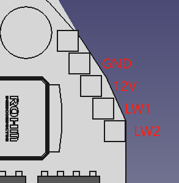

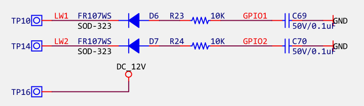

如要使用两个限位开关，请用下述配置：

```text
odrv0.axis0.min_endstop.config.enabled = True
odrv0.axis0.min_endstop.config.gpio_num = 1
odrv0.axis0.max_endstop.config.enabled = True
odrv0.axis0.max_endstop.config.gpio_num = 2
```

在触发限位开关时，系统将会上报`MIN_ENDSTOP_PRESSED`或`MAX_ENDSTOP_PRESSED`错误，上位机可在此时执行相关的操作。

> ⚠️ **警告！**
>
> 硬件版本 3.7 不支持限位开关功能。限位开关功能与脉冲输出功能冲突。
>

#### 3.4.3 用户自设零点

默认情况下，用户从电机读取到的位置，以及做位置控制时的输入值，均是基于驱动器上的绝对值编码器的零点为基准。但是，在用户场景下，编码器的零点在大多数时候并不是用户零点，所以用户需要手动设置这个零点偏移。

一般来说，用户可以通过两种手段来定位这个零点，一种手段是通过限位开关，一种手段是手动设置零点偏移，即用户零点相对于编码器零点的偏移值：

```python
#用户先手动或者通过位置控制转动到期望的用户零点位置后,设置当前位置为零点
odrv0.axis0.encoder.config.index_offset = odrv0.axis0.encoder.pos_estimate + odrv0.axis0.encoder.config.index_offset
```

**对于单编的电机来说，这个值上电会被清零，双编的电机这个值会被保留，且双编记忆范围会随着这个值而变动。**

#### 3.4.4 断电记忆功能

只有双编码器电机有这个功能，请确认自己购买的电机是什么型号的。

    - 可以记忆单圈位置，记忆范围是-（减速比/2）～（减速比/2），对于 6010-8 来说记忆范围是 -4～4（单位：转子侧 转）
    - 如果设置了上述零点，例如设置 index_offset 为 2，则双编的记忆范围变为 -6～2
    - 假设记忆范围为 -4～4，当电机位置为 5 时断电，由于只能记忆单圈位置范围，则电机在当前位置上电后反馈位置为 -3，电机内部会自行进行过圈处理。

## 4 参数调整

### 4.1 固件升级

#### 4.1.1 使用电机精灵进行固件升级

请先下载安装最新的电机精灵：[电机精灵下载](https://bl.cyberbeast.cn/actuator/motorwizard.exe)

下载安装国民DFU驱动：[CyberBeast Driver User Manual](CyberBeast_Driver_User_Manual_EN.md)

双击“升级”按钮，选择固件即可升级。

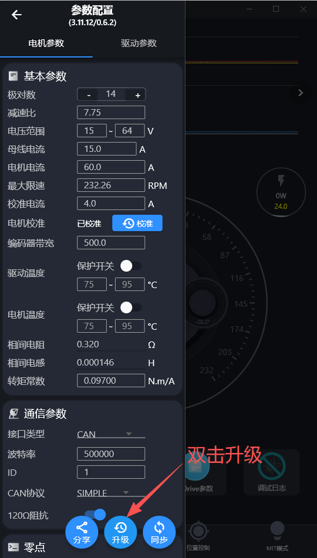

选择需要升级的固件。

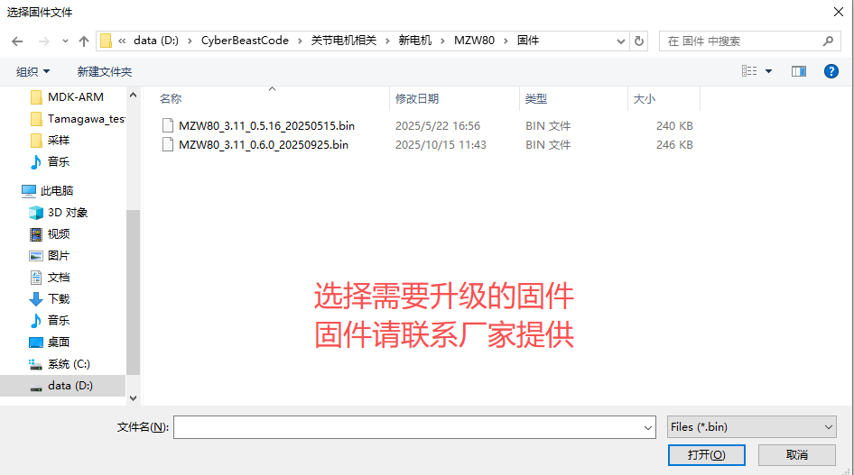

等待进度条走完即完成升级。

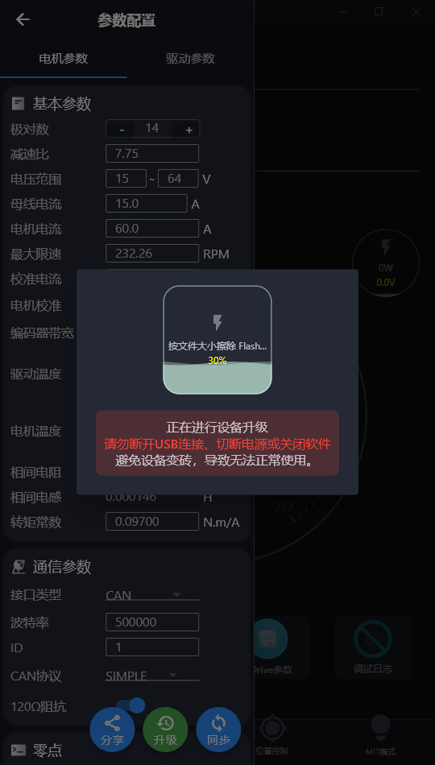

> 💡 如果升级过后，电机一连接 odrivetool 或电机精灵就报错，请执行擦除配置的过程。执行擦除过后，电机需要**空载**重新校准（[电机校准章节](https://cyberbeast.feishu.cn/docx/N3SMd4QyRobzHkx3wP3cT1qXnpf#KySSdxV26oqhyfx5wbWcjGMjnfh)）
>
> - 电机精灵擦除配置：长按同步
> - odrivetool：执行 odrv0.erase_configuration（）

#### 4.1.2 使用 odrivetool 进行固件升级

1. USB（DFU）烧写
📎 **Attachment (not downloaded, see original doc):** odrivetool固件升级.mp4 (28.6 MB)

请注意，国民下载软件是通过 **Type-C 接口**进行烧录，**Type-C 接口并不能供电，请使用电源接口进行供电再进行升级。**

需要下载国民烧录软件的 USB 驱动和相应的烧录软件，解压到任意目录，并且运行，驱动安装时，win11 选择 win10 的文件即可。

📎 **Attachment (not downloaded, see original doc):** 国民DFU驱动.zip (14.0 MB)

📎 **Attachment (not downloaded, see original doc):** Nations_MCU_Download_Tool_V1.3.4.zip (19.7 MB)

然后，连接 Type-C 接口，进入 odrivetool，并执行下述指令将驱动器置于 DFU 模式：

```text
odrv0.enter_dfu_mode()
```

最后，点击国民烧录软件进行烧写，如下图所示。请注意，在烧写完成过后，请点击“常用操作”，然后点击“复位”，可重启驱动器，并可正常通过 odrivetool 连接调测。

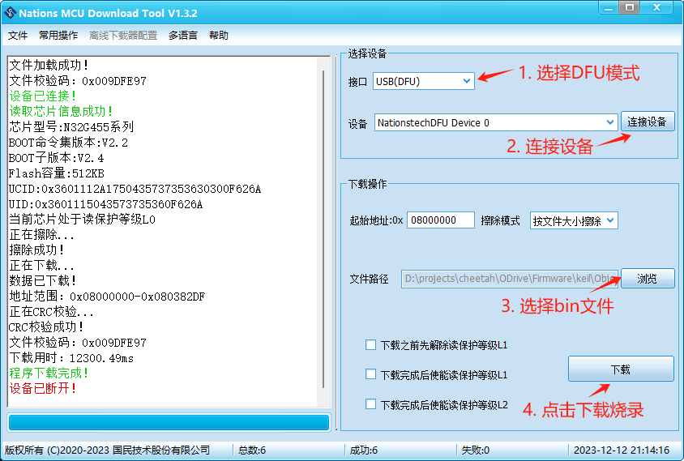

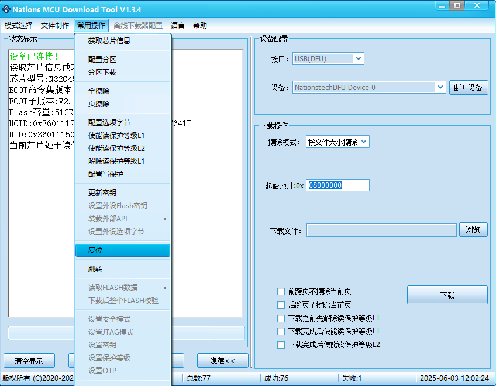

> 💡 如果升级过后，电机一连接 odrivetool 或电机精灵就报错，请执行擦除配置的过程。执行擦除过后，电机需要**空载**重新校准（[电机校准章节](https://cyberbeast.feishu.cn/docx/N3SMd4QyRobzHkx3wP3cT1qXnpf#KySSdxV26oqhyfx5wbWcjGMjnfh)）
>
> - 电机精灵擦除配置：长按同步
> - odrivetool：执行 odrv0.erase_configuration（）

2. SWD（JLink 或 DAP）烧写
使用 SWD 方式下载跟 DFU 模式相似，但需要通过 SWD 调试接口（接口顺序如下）进行连接，并使用 Jflash 进行下载。

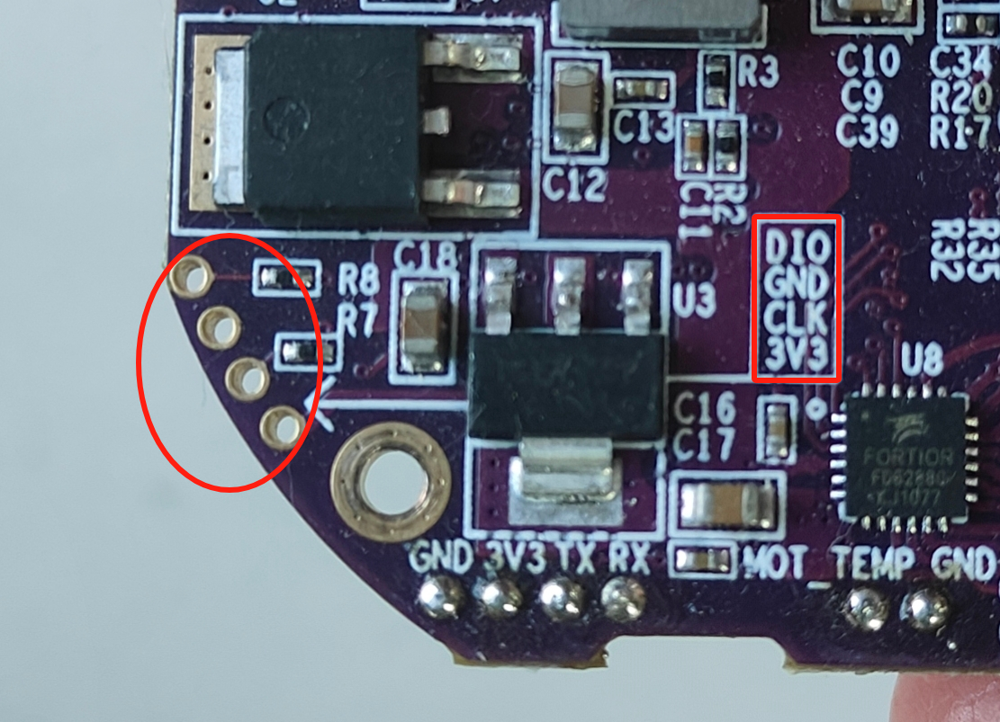

#### 4.1.3 pyocd

pyocd 是 openOCD 的 python 版本，可支持 STLink，JLink，DAP 等通用调试工具进行擦除、烧写、重置等操作。**请注意，必须用 SWD 接口连接驱动器。**关于 SWD 的线序，如上图。**SWD 接口中有 3.3V 电源，请不要接错线序，以免损毁驱动器！**

3. `pip install pyocd`安装
4. 烧写
首先，列出连接的调试工具：

```text
pyocd list
```

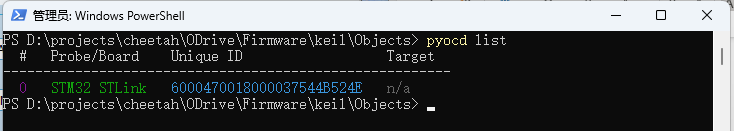

然后，执行下述指令烧写 bin 文件：

```text
pyocd load .\ODrive_N32G455.bin -a 0x8000000
```

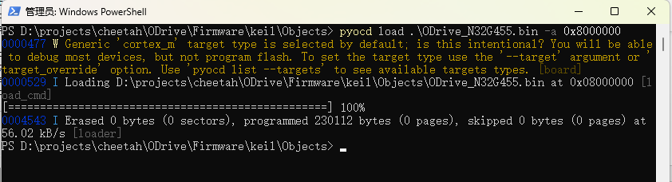

### 4.2 PID 及不同控制模式调参

视频封面即索引，可根据自身需求进行时间轴跳转

📎 **Attachment (not downloaded, see original doc):** 202506061025.mp4 (2.4 GB)

```text
odrv0.axis0.controller.config.pos_gain=20.0
odrv0.axis0.controller.config.vel_gain=0.16
odrv0.axis0.controller.config.vel_integrator_gain=0.32
```

下述过程可以为用户调节 PID 参数提供一个参考：

5. 设置 PID 初始值
6. 将 vel_integrator_gain 调为 0
7. odrv0.axis0.controller.config.vel_integrator_gain=0
    调节 vel_gain 方法：

8. 用速度控制模式转动电机，如果转动不平稳，有抖动或震动，减小 vel_gain，直到转动平稳
9. 接着，每次把 vel_gain 增大 30%左右，直到出现明显的抖动
10. 此时，将 vel_gain 减小 50%左右，即可稳定
11. 调节 pos_gain 方法：
12. 用位置模式尝试转动电机，如果转动不平稳，有拉动或震动，减小 pos_gain，直到转动平稳
13. 接着，每次把 pos_gain 增大 30%左右，直到位置控制出现明显的过调（即每次位置控制电机会超出目标位置，然后振荡回到目标位置）
14. 然后，逐渐减小 pos_gain，直到过调现象消失
15. 在上述 4 步调整过后，可将 vel_integrator_gain 设置为 0.5*bandwidth*vel_gain，其中 bandwidth 是系统控制带宽。何为控制带宽？比如，从用户设置目标位置，到电机真正到达目标位置的时间为 10ms，则控制带宽就是 100Hz，那么 vel_integrator_gain=0.5*100*vel_gain。
在上述调参过程中，建议使用 [3](https://bcnyljrhe70u.feishu.cn/docx/N3SMd4QyRobzHkx3wP3cT1qXnpf#KUN8do5syo24zPxNQ41ctwJfnOe)[.1 实时绘图工具](https://bcnyljrhe70u.feishu.cn/docx/N3SMd4QyRobzHkx3wP3cT1qXnpf#KUN8do5syo24zPxNQ41ctwJfnOe) 中的图形化手段实时查看调参效果，避免肉眼感知的误差。如果使用电机精灵，PID 调整效果“所见即所得”，下图是 PID 参数示意：

    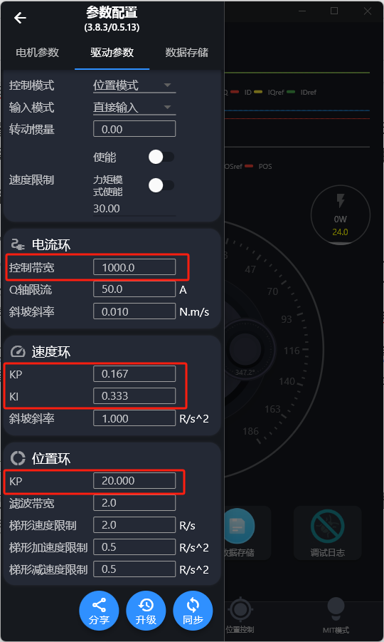

### 4.3 关键门限（limits）

#### 4.3.1 电压门限

    如果电机报欠压或者过压的报警，通常都与此门限有关。

    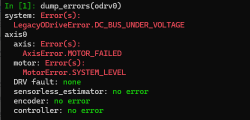

    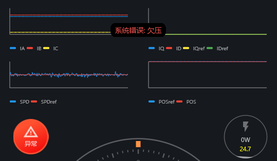

    - **odrivetool**
    低电压告警门限（V），默认值为 15V；超电压告警门限（V），默认值 64V。

    ```python
    odrv0.config.dc_bus_undervoltage_trip_level    #低电压告警门限（V）
    odrv0.config.dc_bus_overvoltage_trip_level     #超电压告警门限（V）
    ```

    - **电机精灵**

    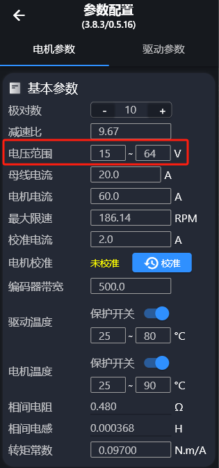

    在电机精灵更改参数后记得在电机处于空闲状态下，点击同步保存参数。

> 💡 注意用 24V 及以下电源记得在上位机更改电压下限为 10V 或 8V。否则可能会在使用过程中频繁报欠压错误。
>

#### 4.3.2 电流门限

    如果电机报过流的报警，通常都与此门限有关。

    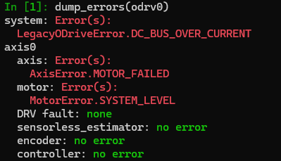

    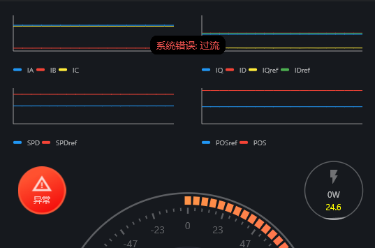

    未完成，待更新，请将母线电流（`odrv0.config.dc_max_positive_current`）的参数调整至 200A 来防止电机不必要的过流报警，电机电流（`odrv0.axis0.motor.config.current_lim`）最大 80A，默认 60A。

    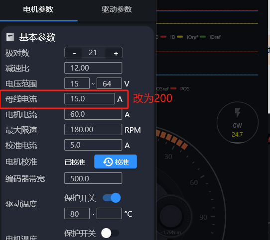

#### 4.3.3 温度保护

    驱动上的温度保护是默认开启的，默认值是 25℃～80℃。当温度达到设定范围的下限时，电机开始进行温度保护，电机力矩开始变小；电机温度爬升，越接近温度保护上限时，电机力越小，直至电机停止运行（这个过程并不产生报错）。

    如果不想室温就开始保护，可以尝试把范围更改的 70℃～90℃（驱动温度范围和电机温度范围同时设置）。

    只有电机温度急剧上升时，电机会因温度产生报错。

    - **odrivetool**
    使能电机驱动板温度保护和使能电机温度保护开关，1 开启，0 关闭。

    ```python
    odrv0.axis0.motor.motor_thermistor.config.enabled = 1  #电机温度保护使能
    odrv0.axis0.motor.fet_thermistor.config.enabled = 1    #驱动板温度保护使能
    ```

    电机温度保护门限

    ```python
    odrv0.axis0.motor.motor_thermistor.config.temp_limit_lower    #下限
    odrv0.axis0.motor.motor_thermistor.config.temp_limit_upper    #上限
    ```

    驱动板温度保护门限

    ```python
    odrv0.axis0.motor.fet_thermistor.config.temp_limit_lower    #下限
    odrv0.axis0.motor.fet_thermistor.config.temp_limit_upper    #上限
    ```

    获取温度

    ```python
    # 获取温度
    odrv0.axis0.motor.motor_thermistor.temperature #电机温度
    odrv0.axis0.motor.fet_thermistor.temperature #驱动板温度
    ```

    - **电机精灵**

    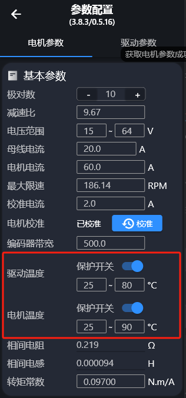

#### 4.3.4 速度门限

    速度门限是设置电机能达到的最高速度

    - **odrivetool**
    全局速度门限使能，1 开启，0 关闭

    ```python
    odrv0.axis0.controller.config.enable_vel_limit = 1
    ```

    全局速度限制

    ```python
    odrv0.axis0.controller.config.vel_limit = 30
    ```

    上述指令将其限制为 30turn/s（转/秒）。请注意，默认情况下纯力矩模式下此速度限制不起作用，但可以打开下述开关来使能：

    ```text
    odrv0.axis0.controller.config.enable_torque_mode_vel_limit = 1
    ```

    - **电机精灵**
    下面输入的数值都是全局速度限制，右图上面的开关是是否使能全局速度限制，下面的开关是纯力矩模式下此速度限制是否使能。

    

    

## 5 通信协议使用

通信协议手册：[CyberBeast Driver Protocol Manual](CyberBeast_Driver_Protocol_Manual_EN.md)

### 5.1 CANSimple

#### 5.1.1 接线说明

硬件版本为 v3.7 3.9 3.10 3.11 按如第一张图所示的线序进行接线，硬件版本为 v3.8 4.1 按如第二张图所示的线序进行接线，正常 CANH 的显性电压应为 3.5V 左右，CANL 的显性电压应为 1.5V 左右。用万用表测量 CANH 和 CANL 的对地电压应为 2.5V。


> ⚠️ **警告！**
>
> 所有 CAN 设备需要共地，否则 CAN 可能无法正常工作。
>

#### 5.1.2 120 Ω阻抗匹配

请保证总线上总阻抗约为 60Ω。标准 CAN 网络需要**两端各 120Ω（控制端和最远电机端），总共为 60Ω**。在板子的内部集成了软件控制 120Ω电阻开关，按以下指令开启：

- odrivetool

```python
odrv0.can.config.enable_r120 = True
```

- 电机精灵


#### 5.1.3 切换通信协议

- odrivetool
驱动器默认的协议即为 CAN Simple，如果用户切换到 CANOpen 协议，则需要通过下述指令切回 CAN Simple：

```text
odrv0.can.config.protocol = 1
```

请注意，通信接口同时支持 RS485，脉冲方向和 PWM。通过下述指令确保通信接口是 CAN：

```text
odrv0.config.comm_intf_mux = 0
```

- 电机精灵
在电机精灵中，也可在电机参数->通信参数中，切换物理接口以及 CAN 协议版本。


#### 5.1.4 波特率变更

出厂默认速率 500Kbps，仅支持CAN的驱动器最大通信速率 1Mbps，支持CANFD的驱动器最大通信速率 5Mbps。可以通过 odrivetool 和电机精灵更改波特率。

- odrivetool

```python
 odrv0.can.config.baud_rate = 500000
```

- 电机精灵


#### 5.1.5 周期消息

用户可配置电机向上位机周期性发送消息，而不用上位机向电机发送请求消息。可通过 `odrv0.axis0.config.can` 下的一系列配置来打开/关闭周期消息（值为 0 表示关闭，为其他值表示周期时间，单位为 ms），如下表所示：

| 消息 | cmd_id | 内容 | odrivetool 配置 | 默认值 |
|---|---|---|---|---|
| Heartbeat | 0x01 | 心跳反馈 | `odrv0.axis0.config.can.heartbeat_rate_ms` | 100 |
| Get_Encoder_Estimates | 0x09 | 编码器位置速度反馈 | `odrv0.axis0.config.can.encoder_rate_ms` | 10 |
| Get_Motor_Error | 0x03 | 电机错误反馈 | `odrv0.axis0.config.can.motor_error_rate_ms` | 0 |
| Get_Encoder_Error | 0x03 | 编码器错误反馈 | `odrv0.axis0.config.can.encoder_error_rate_ms` | 0 |
| Get_Controller_Error | 0x03 | 控制错误反馈 | `odrv0.axis0.config.can.controller_error_rate_ms` | 0 |
| Get_Iq | 0x14 | Q 轴电流反馈 | `odrv0.axis0.config.can.iq_rate_ms` | 0 |
| Get_Thermistor_Temperature | 0x15 | 温度反馈 | `odrv0.axis0.motor.motor_thermistor.temperature`<br>`odrv0.axis0.motor.fet_thermistor.temperature` | 0 |
| Get_Bus_Voltage_Current | 0x17 | 母线电压电流反馈 | `odrv0.axis0.config.can.bus_vi_rate_ms` | 0 |

**出厂时，前两种周期消息默认打开**，所以当用户监控 CAN 总线时，会看到两种消息以设定周期进行广播。用户可通过下述指令关闭它们：

```text
odrv0.axis0.config.can.heartbeat_rate_ms = 0
odrv0.axis0.config.can.encoder_rate_ms= 0
```

用电机精灵关闭，打开电机精灵 -> ODrive 参数找到如上指令，键入 0，回车，点击同步保存。


Get_Encoder_Estimates（0x09）上的反馈内容只有在电机**进入闭环后**才会反馈当前的位置和速度信息，空闲状态下只会反馈上次进入闭环时的位置和速度信息（没有进入过闭环就反馈 0）。

#### 5.1.6 更改电机 ID

驱动器 ID 是总线唯一的，范围是 0～63。如果用户有多台电机串联在总线上，则需要给每台电机设置不同的 ID。用户可以通过 USB 或总线方式修改 ID：

- odrivetool

```text
odrv0.axis0.config.can.node_id = xxx
```

- 电机精灵
打开电机精灵，连接上电机后，点击“电机参数”，在“通信参数”一栏中，修改 ID，点击“同步”存储到驱动器中。


#### 5.1.7 获取详细错误信息

在协议手册中搜索“heartbeat”可以查看 CAN 心跳帧的详细说明。心跳帧中包含了设备当前的状态信息（如下图），用于快速判断是否存在异常。

其中，byte5（`Flags`）用于标识当前设备的状态或故障类型，可作为初步判断依据；byte0（`Axis_Error`）记录了轴级别的错误码，对排查问题也有帮助。需要注意的是，**这些错误信息通常只能指出问题的表象，真正的故障原因还需结合 Flags 中的提示**，进一步查看对应的详细错误（Get_Error，如下图）说明进行分析。


例如，Flags 为 0x82，转换为二进制是 1000 0010，说明出现编码器异常（bit7 是位置梯形曲线是否执行完成的标志位，并不参与异常），这个时候需要根据功能码为 0x03 Get_Error 获取详细的编码器异常，如上图说明书截图。

向功能码为 0x03 发送 01 后，获得详细的编码器异常如下图。


0x00000002，我们找到[协议手册的异常码](https://cyberbeast.feishu.cn/docx/BPnQd8reEotLWVxqHFNc9qYZnKh#KKr4dVPH3oQ9r5x5KxocJLmQn4b)，对应编码器异常


这个异常通常是电机驱动配置的极对数和电机实际的极对数不匹配，往往发生在电机校准过程中发生。

每次发生异常可能有多个异常发生，需要对应全所有异常码，才可判断出电机异常的根本原因。至此，CAN 获取电机异常码的过程结束。

#### 5.1.8 RxSdo 使用


CAN RxSdo 和 TxSdo 发送数据是小端的，首先要根据自己的固件版本（固件版本详见[ ](https://bcnyljrhe70u.feishu.cn/docx/N3SMd4QyRobzHkx3wP3cT1qXnpf#XbxRdrkQMo0Pqux5meqcbF1Jnmb)[2](https://bcnyljrhe70u.feishu.cn/docx/N3SMd4QyRobzHkx3wP3cT1qXnpf#XbxRdrkQMo0Pqux5meqcbF1Jnmb)[.1 电机参数](https://bcnyljrhe70u.feishu.cn/docx/N3SMd4QyRobzHkx3wP3cT1qXnpf#XbxRdrkQMo0Pqux5meqcbF1Jnmb)）确认对应的 json 文件（说明书内下载）

举个例子，我要更改 。dc_max_positive_current 为 40（本数据是 float 类型），写数据第一位为 01，查到 id 是 98（STW 0.5.14 json ），对应的十六进制码是 0x0062，40 对应的 IEEE 如图：42 20 00 00。于是，需要发送：can_id 为 0x005，发送内容为：01 62 00 00 00 00 20 42。


对于 uint8 变量/bool 变量，例如我要更改电机的工作状态，写数据第一位为 01，查到 request_state 的 id 是 137（0.5.11），对应十六进制是 0x0089，写入状态为 08，发送内容为 01 89 00 00 08 00 00 00 


#### 5.1.9 通信超时停止

CAN 上目前有通信超时停止功能，可以实现的效果：从第一次发送 CAN 指令开始，CAN 通信间断超过设定时间会报电机异常，**需要恢复通信且清除这个报错**，电机才可正常运行。例如，假设设定为 2000（单位 ms），从电机第一次接收到 can 通信指令到第二次电机接收到指令间隔超过 2000ms，电机产生报错。

    参数默认为 0 关闭，设置值单位为 ms，设置后指令即生效，指令如下：

    - odrivetool
    设置后需在空闲状态下保存。

    ```python
    odrv0.can.config.break_timeout = 2000    #设定超时时间为2000ms
    ```

    超时后电机会报错：

    

    - 电机精灵
    ODrive 参数 -> 如下指令 -> 键入回车，在空闲状态下点击同步。

    

超时后电机报错码：


### 5.2 CANOpen

关于[接线说明](https://bcnyljrhe70u.feishu.cn/docx/N3SMd4QyRobzHkx3wP3cT1qXnpf#EZFEd6iuSoP56wx1J8EcbntvnGg)，[阻抗匹配](https://bcnyljrhe70u.feishu.cn/docx/N3SMd4QyRobzHkx3wP3cT1qXnpf#EV9jdu00boMITLxNMt2cqSSvnHd)，[波特率变更](https://bcnyljrhe70u.feishu.cn/docx/N3SMd4QyRobzHkx3wP3cT1qXnpf#TgX5dl5H0o25JOxBQvZcJPlBnyb)同步 CANSimple 部分，请自行查阅。

#### 5.2.1 切换通信协议

    - odrivetool
    驱动器默认的协议即为 CAN Simple，如果用户需要使用 CANOpen，请通过下面两种方式任选其一进行通信方式选择：

    ```text
    odrv0.can.config.protocol = 2
    ```

    请注意，通信接口同时支持 RS485，脉冲方向和 PWM。通过下述指令确保通信接口是 CAN：

    ```text
    odrv0.config.comm_intf_mux = 0
    ```

    - 电机精灵
    在电机精灵中，也可在电机参数->通信参数中，切换物理接口以及 CAN 协议版本。

    

### 5.3 RS485(Modbus RTU)

485接口在部分板卡上面为选配接口，如需要此接口，请与销售确认。

#### 5.3.1 接线说明


#### 5.3.2 切换通信协议

- odrivetool
请注意，在版本大于等于 3.10 的硬件版本上，通信接口同时支持 RS485，脉冲方向和 PWM。通过下述指令确保通信接口是 CAN：

```python
odrv0.config.comm_intf_mux = 1
```

- 电机精灵
在电机精灵中，也可在通信参数中，切换物理接口。


#### 5.3.3 波特率变更

基于 RS485 的 Modbus RTU，最大通信速率 115200bps，出厂默认速率 115200bps。可以通过 odrivetool 和电机精灵更改波特率。

- odrivetool

```python
odrv0.config.uart_c_baudrate = 115200
```

- 电机精灵
点开 ODrive 参数后输入如图


#### 5.3.4 随机端点访问使用

待更新。

#### 5.3.5 Modbus站号修改

- odrivetool

```python
odrv0.axis0.config.can.node_id = xx
```

### 5.4 PWM 输入控制

请确认硬件版本是 v3.10 3.11 4.1 及以上版本再使用本功能。

此功能支持通过标准 RC PWM 信号（1ms–2ms 脉宽，50Hz）控制各类可写参数，如位置、速度或力矩等。通过配置 GPIO 引脚为 PWM 模式，并设置映射关系，可实现从 RC 接收机或其他 PWM 控制器对电机的直接控制。

#### 5.4.1 接线说明

    PWM 信号线连接如图所示位置，硬件版本为 3.10 3.11 按第一张图接线，硬件版本为 4.1 按第一张图接线，本接口支持 5V 及以下的 PWM 信号，需要使 PWM 信号与电机驱动共地。

    

    

#### 5.4.2 软件配置

    - 切换通信接口为 PWM：

    ```python
    odrv0.config.comm_intf_mux = 3
    ```

    在电机精灵中，也可在通信参数中，切换物理接口，请点开电机参数中查找此项。

    

    后续配置并不支持电机精灵配置，请先行根据[ 1.3.2 ](https://bcnyljrhe70u.feishu.cn/docx/N3SMd4QyRobzHkx3wP3cT1qXnpf#Xrj1d6UwKokjcax0RFvcVJphnZb)安装好 odrivetool 再进行后续配置。

    - 设置 PWM 映射控制模式
    可以映射为速度/位置/力矩模式，以下模式三者按需配置其一即可。

    速度模式

    请将电机控制模式设置为[斜坡速度模式](https://bcnyljrhe70u.feishu.cn/docx/N3SMd4QyRobzHkx3wP3cT1qXnpf#Mrc6dx39Zo1s4PxXAOgc99Fgnbe)（control_mode = 2， input_mode = 2）

    ```python
    # 设置模式为速度模式
    odrv0.axis0.controller.config.control_mode = 2
    # 速度模式的斜坡速度模式
    odrv0.axis0.controller.config.input_mode = 2
    # 设置PWM输入为速度输入
    odrv0.config.gpio1_pwm_mapping.endpoint = odrv0.axis0.controller._input_vel_property
    ```

    位置模式

    请将电机控制模式设置为[梯形曲线位置模式](https://bcnyljrhe70u.feishu.cn/docx/N3SMd4QyRobzHkx3wP3cT1qXnpf#I21YddeF1ojr7Nx0JdSc5JCznrh)（control_mode = 3， input_mode = 5）

    ```python
    # 设置模式为位置模式
    odrv0.axis0.controller.config.control_mode = 3
    # 位置模式的梯形曲线模式
    odrv0.axis0.controller.config.input_mode = 5
    # 设置PWM输入为位置输入
    odrv0.config.gpio1_pwm_mapping.endpoint = odrv0.axis0.controller._input_pos_property
    ```

    力矩模式

    请将电机控制模式设置为[斜坡力矩模式](https://bcnyljrhe70u.feishu.cn/docx/N3SMd4QyRobzHkx3wP3cT1qXnpf#W0JZdpkhxopGx8xA8rIcZVWqnff)（control_mode = 1， input_mode = 6）

    ```python
    # 设置模式为力矩模式
    odrv0.axis0.controller.config.control_mode = 1
    # 速度模式的斜坡力矩模式
    odrv0.axis0.controller.config.input_mode = 6
    # 设置PWM输入为力矩输入
    odrv0.config.gpio1_pwm_mapping.endpoint = odrv0.axis0.controller._input_torque_property
    ```

    -  设置 PWM 映射参数

    ```python
    odrv0.config.gpio1_pwm_mapping.min = -8.0
    odrv0.config.gpio1_pwm_mapping.max = 8.0
    ```

    min 和 max 定义了 PWM 脉宽（1ms～2ms）映射到的控制量范围，驱动内部会将脉宽值线性映射为 [min， max] 范围之间的实数值。min 和 max 可根据需求设置为任意值。

    -  保存配置（可选）

    ```python
    odrv0.save_configuration()
    ```

    - 完成以上配置后，请使电机进入闭环即可进行 PWM 控制。

    ```python
    odrv0.axis0.requested_state = 8
    ```

### 5.5 脉冲/方向控制

请确认硬件版本是 v3.10 3.11 4.1 及以上版本再使用本功能。

此功能与限位开关功能冲突。本功能是控制驱动最简单的方法，但也是最原始、最脆弱的方法。因此，除非情况特殊，否则请勿使用此控制方式。

本功能支持通过传统的 Step/Dir（脉冲/方向）接口来控制无刷电机，实现与普通步进电机驱动器兼容的控制方式，此模式下：

- Step（脉冲）信号：每一个上升沿对应电机移动一个预设的步距（由 steps_per_circular_range 决定），最大推荐 Step 频率：50kHz
- Dir（方向）信号：电平决定运动方向（高电平顺时针 / 低电平逆时针）

#### 5.5.1 接线说明

    Step（脉冲信号）和 Dir（方向信号）信号线连接至如图位置，本接口支持 5V 及以下的脉冲信号，请确保 Step 和 Dir 信号与电机驱动**共地（共阴极）**，否则信号可能识别失败。

    

    

#### 5.5.2 软件配置

    - 切换通信接口为 Step/Dir：

    ```python
    odrv0.config.comm_intf_mux = 2
    ```

    在电机精灵中，也可在通信参数中，切换物理接口，请点开电机参数中查找此项。

    

    后续配置并不支持电机精灵配置，请先行根据[ 1.3.2 ](https://bcnyljrhe70u.feishu.cn/docx/N3SMd4QyRobzHkx3wP3cT1qXnpf#Xrj1d6UwKokjcax0RFvcVJphnZb)安装好 odrivetool 再进行后续配置。

    - 启用 Step/Dir

    ```python
    odrv0.axis0.config.enable_step_dir = True
    ```

    请注意，要退出脉冲/方向控制，您需要将其设置 enable_step_dir 为 False，然后进入空闲状态，再返回闭环控制。

    - 设置脉冲步长
    对应圆形位置范围内需要多少个 STEP 脉冲，决定 1 step 是多大位移量，步长是一个整数。为了获得最佳效果，请将这个参数设置为 2 的幂。

    ```python
     # 转子侧每圈 1024 个 step
    odrv0.axis0.controller.config.steps_per_circular_range = 1024
    ```

    - 完成以上配置后，请设置电机为**位置模式**。

    ```python
    # 设置模式为位置模式
    odrv0.axis0.controller.config.control_mode = 3
    # 位置模式的梯形曲线模式
    odrv0.axis0.controller.config.input_mode = 5
    ```

    - 在空闲状态保存配置（可选）

    ```python
    odrv0.save_configuration()
    ```

    - 进入闭环后，发送脉冲即可进行控制

    ```python
    odrv0.axis0.requested_state = 8
    ```

## 6 SDK 及例程

### 6.1 C/C++ SDK

基于 CAN Simple 协议，可下载下述 C/C++ SDK 进行集成：[北京守护兽科技有限公司/MWMotorSDK](https://gitee.com/cyberbeast/mwmotorsdk)

基于 SDK 快速上手：[MWMotor SDK快速上手](https://cyberbeast.feishu.cn/docx/KRJcdmc3yovKxsxNnXOcNmppnwf)

请参照上述开源网站的详细测试实例进行集成测试。

### 6.2 Python SDK

请首先参照 1.3.2 节步骤安装 odrivetool（`pip install ––upgrade odrive`）。

下面是三个示例：

1. **实战：上电校准**

```python
import odrive
import time

odrv0 = odrive.find_any()
odrive.utils.dump_errors(odrv0)
odrv0.clear_errors()
odrv0.axis0.requested_state=odrive.utils.AxisState.MOTOR_CALIBRATION
time.sleep(5)
while (odrv0.axis0.current_state!=1):
time.sleep(0.5)
odrive.utils.dump_errors(odrv0)
odrv0.axis0.requested_state=odrive.utils.AxisState.ENCODER_OFFSET_CALIBRATION
time.sleep(6)
while (odrv0.axis0.current_state!=1):
time.sleep(0.5)
odrive.utils.dump_errors(odrv0)
odrv0.axis0.motor.config.pre_calibrated=1
odrv0.axis0.encoder.config.pre_calibrated=1
odrv0.save_configuration() 
```

2. **实战：速度控制**

```python
import odrive
import time

odrv0 = odrive.find_any()
odrv0.axis0.controller.config.control_mode=odrive.utils.ControlMode.VELOCITY_CONTROL
odrv0.axis0.controller.config.input_mode=odrive.utils.InputMode.VEL_RAMP
odrv0.axis0.controller.config.vel_ramp_rate=50
odrv0.axis0.requested_state=odrive.utils.AxisState.CLOSED_LOOP_CONTROL
odrv0.axis0.controller.input_vel=15
odrive.utils.dump_errors(odrv0)
time.sleep(5)
odrv0.axis0.controller.input_vel=0
```

3. **实战：位置控制**

```python
import odrive

odrv0 = odrive.find_any()
odrv0.axis0.controller.config.control_mode=odrive.utils.ControlMode.POSITION_CONTROL
odrv0.axis0.controller.config.input_mode=odrive.utils.InputMode.POS_FILTER
odrv0.axis0.requested_state=odrive.utils.AxisState.CLOSED_LOOP_CONTROL
odrv0.axis0.controller.input_pos=10
```

4. **实战：数据采集**
用户在研发集成过程中，经常需要采集电机运行的数据，比如采集电压电流变化，位置速度变化等等，Python SDK 集成了强大的数据抓取能力，可以用简单的脚本实现海量运行数据抓取，让研发和集成变得更加简单。

```python
import odrive
import numpy as np
import time
import math
from odrive.utils import BulkCapture

# 查找并连接到 ODrive 设备
odrv0 = odrive.find_any()
print("连接成功")

# 设置控制模式和输入模式
odrv0.axis0.controller.config.control_mode = odrive.utils.ControlMode.POSITION_CONTROL
odrv0.axis0.controller.config.input_mode = odrive.utils.InputMode.POS_FILTER
print("进入位置环，位置滤波模式")

# 启动电机
odrv0.axis0.requested_state = odrive.utils.AxisState.CLOSED_LOOP_CONTROL
print("启动电机")

# 使用 BulkCapture 来捕获数据（捕获iq电流和位置信息）
cap = BulkCapture(
    lambda :[odrv0.axis0.motor.current_control.Iq_measured, odrv0.axis0.encoder.pos_estimate],  # 传递数据捕获的函数
    data_rate=200,    # 200Hz 采样频率
    duration=15       # 总共15秒的采样时间
)
print("抓取实时位置和电流信息")

# 旋转电机到位置0，并停留3秒
odrv0.axis0.controller.input_pos = 0
print("尝试位置环，旋转电机到位置0")
while not math.isclose(odrv0.axis0.encoder.pos_estimate, odrv0.axis0.controller.input_pos, rel_tol=0.08, abs_tol=0.08):
    time.sleep(0.01)
time.sleep(3)

# 旋转电机到位置10，并停留3秒
odrv0.axis0.controller.input_pos = 10
print("尝试位置环，旋转电机到位置10")
while not math.isclose(odrv0.axis0.encoder.pos_estimate, odrv0.axis0.controller.input_pos, rel_tol=0.08, abs_tol=0.08):
    time.sleep(0.01)
time.sleep(3)

# 旋转电机到位置-10，并停留3秒
odrv0.axis0.controller.input_pos = -10
print("尝试位置环，旋转电机到位置-10")
while not math.isclose(odrv0.axis0.encoder.pos_estimate, odrv0.axis0.controller.input_pos, rel_tol=0.08, abs_tol=0.08):
    time.sleep(0.01)
time.sleep(3)

# 停止电机
odrv0.axis0.requested_state = odrive.utils.AxisState.IDLE
print("旋转结束")

# 获取捕获的数据
cap.event.wait()
print(cap.data)
data = cap.data  # 获取捕获到的数据
np.savetxt("D:/test.csv", data, delimiter=',')
print("数据已保存到 test.csv")

```

下面的代码是在上一个位置控制实例的基础上，增加了实时位置和电流数据抓取的功能，并将数据保存成一个 csv 文件。

其中进行 BulkCapture 的语句中，data_rate 代表采样频率，单位是 hz，duration 代表采样时间，单位是秒，其中的 lambda 表达式可以插入任何的数学运算，以方便数据分析。

### 6.3 Arduino SDK

    用户使用 Arduino 可通过 CAN 总线来控制电机，底层协议如 4.1 中描述。可兼容硬件/库：

    - 内置有 CAN 接口的 Arduino，如 Arduino UNO R4 Minima，Arduino UNO R4 WIFI 等
    - 内置 CAN 接口的 Teensy 开发板可使用适配的 FlexCAN_T4 库（Teensy 4.0 和 Teensy 4.1）进行访问
    - 其他 Arduino 兼容的板可使用基于 MCP2515 的 CAN 扩展板进行访问
    下面是一个示例，展示如何配置电机响应 Arduino 的位置控制指令：

    - 配置电机
    除了 3.1.3 的基础配置外，将控制配置成控制带宽为 20rad/s（Arduino Uno 的发送速度受限，所以控制带宽不用太高，如果用更快的 Arduino，可提高此带宽值）：

    - 配置 CAN
    按照下述方法配置 CAN：

    - 安装 ODriveArduino 库
    按照下述步骤安装 OdriveArduino 库（假设用户已经安装 Arduino IDE）：

    1. 打开 Arduino IDE
    2. Sketch -> Include Library -> Manage Libraries
    3. 输入”ODriveArduino”进行搜索
    4. 点击搜索到的 ODriveArduino 库进行安装
    - Arduino 源码

    ```cpp
     #include <Arduino.h>
    #include "ODriveCAN.h"
    
    // Documentation for this example can be found here:
    // https://docs.odriverobotics.com/v/latest/guides/arduino-can-guide.html
    
    /* Configuration of example sketch -------------------------------------------*/
    
    // CAN bus baudrate. Make sure this matches for every device on the bus
    #define CAN_BAUDRATE 500000
    
    // ODrive node_id for odrv0
    #define ODRV0_NODE_ID 0
    
    // Uncomment below the line that corresponds to your hardware.
    // See also "Board-specific settings" to adapt the details for your hardware setup.
    
    // #define IS_TEENSY_BUILTIN // Teensy boards with built-in CAN interface (e.g. Teensy 4.1). See below to select which interface to use.
    // #define IS_ARDUINO_BUILTIN // Arduino boards with built-in CAN interface (e.g. Arduino Uno R4 Minima)
    // #define IS_MCP2515 // Any board with external MCP2515 based extension module. See below to configure the module.
    
    /* Board-specific includes ---------------------------------------------------*/
    
    #if defined(IS_TEENSY_BUILTIN) + defined(IS_ARDUINO_BUILTIN) + defined(IS_MCP2515) != 1
    #warning "Select exactly one hardware option at the top of this file."
    
    #if CAN_HOWMANY > 0 || CANFD_HOWMANY > 0
    #define IS_ARDUINO_BUILTIN
    #warning "guessing that this uses HardwareCAN"
    #else
    #error "cannot guess hardware version"
    #endif
    
    #endif
    
    #ifdef IS_ARDUINO_BUILTIN
    // See https://github.com/arduino/ArduinoCore-API/blob/master/api/HardwareCAN.h
    // and https://github.com/arduino/ArduinoCore-renesas/tree/main/libraries/Arduino_CAN
    
    #include <Arduino_CAN.h>
    #include <ODriveHardwareCAN.hpp>
    #endif // IS_ARDUINO_BUILTIN
    
    #ifdef IS_MCP2515
    // See https://github.com/sandeepmistry/arduino-CAN/
    #include "MCP2515.h"
    #include "ODriveMCPCAN.hpp"
    #endif // IS_MCP2515
    
    #ifdef IS_TEENSY_BUILTIN
    // See https://github.com/tonton81/FlexCAN_T4
    // clone https://github.com/tonton81/FlexCAN_T4.git into /src
    #include <FlexCAN_T4.h>
    #include "ODriveFlexCAN.hpp"
    struct ODriveStatus; // hack to prevent teensy compile error
    #endif // IS_TEENSY_BUILTIN
    
    /* Board-specific settings ---------------------------------------------------*/
    
    /* Teensy */
    
    #ifdef IS_TEENSY_BUILTIN
    
    FlexCAN_T4<CAN1, RX_SIZE_256, TX_SIZE_16> can_intf;
    
    bool setupCan() {
      can_intf.begin();
      can_intf.setBaudRate(CAN_BAUDRATE);
      can_intf.setMaxMB(16);
      can_intf.enableFIFO();
      can_intf.enableFIFOInterrupt();
      can_intf.onReceive(onCanMessage);
      return true;
    }
    
    #endif // IS_TEENSY_BUILTIN
    
    /* MCP2515-based extension modules -*/
    
    #ifdef IS_MCP2515
    
    MCP2515Class& can_intf = CAN;
    
    // chip select pin used for the MCP2515
    #define MCP2515_CS 10
    
    // interrupt pin used for the MCP2515
    // NOTE: not all Arduino pins are interruptable, check the documentation for your board!
    #define MCP2515_INT 2
    
    // freqeuncy of the crystal oscillator on the MCP2515 breakout board. 
    // common values are: 16 MHz, 12 MHz, 8 MHz
    #define MCP2515_CLK_HZ 8000000
    
    static inline void receiveCallback(int packet_size) {
      if (packet_size > 8) {
        return; // not supported
      }
      CanMsg msg = {.id = (unsigned int)CAN.packetId(), .len = (uint8_t)packet_size};
      CAN.readBytes(msg.buffer, packet_size);
      onCanMessage(msg);
    }
    
    bool setupCan() {
      // configure and initialize the CAN bus interface
      CAN.setPins(MCP2515_CS, MCP2515_INT);
      CAN.setClockFrequency(MCP2515_CLK_HZ);
      if (!CAN.begin(CAN_BAUDRATE)) {
        return false;
      }
    
      CAN.onReceive(receiveCallback);
      return true;
    }
    
    #endif // IS_MCP2515
    
    /* Arduinos with built-in CAN */
    
    #ifdef IS_ARDUINO_BUILTIN
    
    HardwareCAN& can_intf = CAN;
    
    bool setupCan() {
      return can_intf.begin((CanBitRate)CAN_BAUDRATE);
    }
    
    #endif
    
    /* Example sketch ------------------------------------------------------------*/
    
    // Instantiate ODrive objects
    ODriveCAN odrv0(wrap_can_intf(can_intf), ODRV0_NODE_ID); // Standard CAN message ID
    ODriveCAN* odrives[] = {&odrv0}; // Make sure all ODriveCAN instances are accounted for here
    
    struct ODriveUserData {
      Heartbeat_msg_t last_heartbeat;
      bool received_heartbeat = false;
      Get_Encoder_Estimates_msg_t last_feedback;
      bool received_feedback = false;
    };
    
    // Keep some application-specific user data for every ODrive.
    ODriveUserData odrv0_user_data;
    
    // Called every time a Heartbeat message arrives from the ODrive
    void onHeartbeat(Heartbeat_msg_t& msg, void* user_data) {
      ODriveUserData* odrv_user_data = static_cast<ODriveUserData*>(user_data);
      odrv_user_data->last_heartbeat = msg;
      odrv_user_data->received_heartbeat = true;
    }
    
    // Called every time a feedback message arrives from the ODrive
    void onFeedback(Get_Encoder_Estimates_msg_t& msg, void* user_data) {
      ODriveUserData* odrv_user_data = static_cast<ODriveUserData*>(user_data);
      odrv_user_data->last_feedback = msg;
      odrv_user_data->received_feedback = true;
    }
    
    // Called for every message that arrives on the CAN bus
    void onCanMessage(const CanMsg& msg) {
      for (auto odrive: odrives) {
        onReceive(msg, *odrive);
      }
    }
    
    void setup() {
      Serial.begin(115200);
    
      // Wait for up to 3 seconds for the serial port to be opened on the PC side.
      // If no PC connects, continue anyway.
      for (int i = 0; i < 30 && !Serial; ++i) {
        delay(100);
      }
      delay(200);
    
      Serial.println("Starting ODriveCAN demo");
    
      // Register callbacks for the heartbeat and encoder feedback messages
      odrv0.onFeedback(onFeedback, &odrv0_user_data);
      odrv0.onStatus(onHeartbeat, &odrv0_user_data);
    
      // Configure and initialize the CAN bus interface. This function depends on
      // your hardware and the CAN stack that you're using.
      if (!setupCan()) {
        Serial.println("CAN failed to initialize: reset required");
        while (true); // spin indefinitely
      }
    
      Serial.println("Waiting for ODrive...");
      while (!odrv0_user_data.received_heartbeat) {
        pumpEvents(can_intf);
        delay(100);
      }
    
      Serial.println("found ODrive");
    
      // request bus voltage and current (1sec timeout)
      Serial.println("attempting to read bus voltage and current");
      Get_Bus_Voltage_Current_msg_t vbus;
      if (!odrv0.request(vbus, 1)) {
        Serial.println("vbus request failed!");
        while (true); // spin indefinitely
      }
    
      Serial.print("DC voltage [V]: ");
      Serial.println(vbus.Bus_Voltage);
      Serial.print("DC current [A]: ");
      Serial.println(vbus.Bus_Current);
    
      Serial.println("Enabling closed loop control...");
      while (odrv0_user_data.last_heartbeat.Axis_State != ODriveAxisState::AXIS_STATE_CLOSED_LOOP_CONTROL) {
        odrv0.clearErrors();
        delay(1);
        odrv0.setState(ODriveAxisState::AXIS_STATE_CLOSED_LOOP_CONTROL);
    
        // Pump events for 150ms. This delay is needed for two reasons;
        // 1. If there is an error condition, such as missing DC power, the ODrive might
        //    briefly attempt to enter CLOSED_LOOP_CONTROL state, so we can't rely
        //    on the first heartbeat response, so we want to receive at least two
        //    heartbeats (100ms default interval).
        // 2. If the bus is congested, the setState command won't get through
        //    immediately but can be delayed.
        for (int i = 0; i < 15; ++i) {
          delay(10);
          pumpEvents(can_intf);
        }
      }
    
      Serial.println("ODrive running!");
    }
    
    void loop() {
      pumpEvents(can_intf); // This is required on some platforms to handle incoming feedback CAN messages
    
      float SINE_PERIOD = 2.0f; // Period of the position command sine wave in seconds
    
      float t = 0.001 * millis();
      
      float phase = t * (TWO_PI / SINE_PERIOD);
    
      odrv0.setPosition(
        sin(phase), // position
        cos(phase) * (TWO_PI / SINE_PERIOD) // velocity feedforward (optional)
      );
    
      // print position and velocity for Serial Plotter
      if (odrv0_user_data.received_feedback) {
        Get_Encoder_Estimates_msg_t feedback = odrv0_user_data.last_feedback;
        odrv0_user_data.received_feedback = false;
        Serial.print("odrv0-pos:");
        Serial.print(feedback.Pos_Estimate);
        Serial.print(",");
        Serial.print("odrv0-vel:");
        Serial.println(feedback.Vel_Estimate);
      }
    }
    ```

### 6.4 ROS SDK

    以下步骤在 Ubuntu 23.04 和 ROS2 Iron 上经过测试验证，但不支持 MAC 和 Windows 平台，且在其他 ROS2 版本上未验证，需要经过修正后才可使用。

#### 6.4.1 安装 odrive_can 包

        1. 新建一个 ROS2 workspace（请参见[ https://docs.ros.org/en/iron/index.html](https://docs.ros.org/en/iron/index.html)）
        2. 用 git clone [https://github.com/odriverobotics/odrive_can ](https://github.com/odriverobotics/odrive_can)将代码下载到上述 workspace 目录中的 src 目录
        3. 在 terminal 中转到 workspace 的根目录，并运行：

        ```text
        colcon build --packages-select odrive_can
        ```

        4. 运行之前的环境准备：

        ```text
        source ./install/setup.bash
        ```

        5. 运行例程节点：

        ```text
        ros2 launch odrive_can example_launch.yaml
        ```

#### 6.4.2 调用服务和查看消息

        假设上述 odrive_can_node 节点运行于命名空间 odrive_axis0（可在。/launch/example_launch.yaml 中设置）。一旦节点运行起来过后，就可以查看所公布的话题消息，如：

        ```text
        ros2 topic echo /odrive_axis0/controller_status
        ros2 topic echo /odrive_axis0/odrive_status
        ```

        并调用开放的服务接口，如下述调用可开始进行电机校准：

        ```text
        ros2 service call /odrive_axis0/request_axis_state/odrive_can/srv/AxisState "{axis_requested_state:4}"
        ```

## 7 电机驱动附件下载

📎 **Attachment (not downloaded, see original doc):** 电机驱动附件.zip (84.9 MB)

